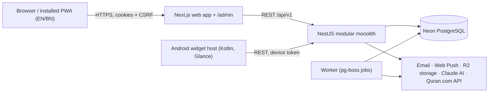

# Executive Summary: Daily Good Deeds Planning Package

**Date:** 2026-10-30 · **Stage:** Planning complete, **awaiting approval** · **Code written:** none

## 1. Repository condition
- `D:\Daily Good Deeds` was **empty** and not under version control. It is now a git repository with remote `origin` set to `github.com/RuhulAminDSi/daily-good-deeds`. Nothing has been pushed yet.
- Installed: Node 24.21, npm 12.2, git 2.45, JDK 21, and an Android SDK folder. Missing: pnpm (enable with Corepack), Docker (not needed), `psql` (optional), and `ANDROID_HOME`.
- Nothing existing has to be preserved. The full findings are in [PROJECT_DISCOVERY.md](PROJECT_DISCOVERY.md).

## 2. Recommended architecture

- **Modular monolith.** A single NestJS API with explicit module boundaries, plus a worker process that runs from the same codebase. No microservices.
- **Shared TypeScript packages.** `domain` (recurrence, streaks, local-date logic, Hijri dates, zakat), `contracts` (Zod schemas and the OpenAPI client), `i18n`, `ui`, and `tokens`. Web and API run the same streak and date logic.
- **Data model.** 85 tables ([README §6](README.md) holds the inventory and phases), with a `local_date` and timezone stored on every dated record. Journals are encrypted with one versioned app key. Calendar and streak reads use a derived `daily_summaries` table. Each table's owning module is defined.
- **Offline.** The client queues writes in an IndexedDB outbox, and `/sync` applies each queued operation idempotently, using row-level last-writer-wins and a `change_seq` pull cursor. The Android widget reuses the same protocol.

## 3. Major technical decisions
23 ADRs are in [architecture/ARCHITECTURE_DECISIONS.md](architecture/ARCHITECTURE_DECISIONS.md) and the log is in [implementation/DECISION_LOG.md](implementation/DECISION_LOG.md). You confirmed the first four.

| # | Decision |
|---|---|
| 1 | **Managed Postgres (Neon)** for every environment. Neon branches are used for PR previews. |
| 2 | **Monorepo:** pnpm + Turborepo, with a Next.js PWA and a NestJS API |
| 3 | **Anthropic Claude** by default, behind an `AiProvider` abstraction. AI is optional, quota-limited, consent-gated, and can be switched off globally or per user. |
| 4 | **Islamic content:** Quran.com API (cached) plus a curated seed for Duas and Hadith, every item with a source reference. Prayer times are computed on the device with `adhan`. |
| 5 | **In-house auth, deliberately simple:** Argon2id passwords; an opaque, DB-backed session cookie for the web (revocation is immediate; SameSite=Lax + Origin check); revocable opaque device tokens for the widget; TOTP + 10-min step-up for admins. No JWTs or refresh-token rotation (DL-012). |
| 6 | **pg-boss** instead of Redis for background jobs. Redis is deferred until it is needed. |
| 7 | **Streak rules are normative** (SRS §7.5.1). Rest and skip days are neutral, capped at 4 per 30 days. Days inside the 7-day edit window never break a streak. Copy never shames the user. |
| 8 | **Journals stay online-only in v1** and are never cached on the device, for privacy. Admins have no access to journal content. |
| 9 | **Android widget:** a minimal Kotlin host app (Glance + WorkManager) linked to an account with a short code or QR. The main product stays web-only. |
| 10 | **Hosting proposal:** Vercel (web), Render or Fly.io (API and worker), Neon, and R2, all in the Singapore region (closest to Bangladesh). Still open. |

## 4. Planned modules
**198 features in 19 modules:** 81 Must, 83 Should, 32 Could, 2 Won't (wearables and subscriptions). The canonical list is [product/FEATURE_ID_REGISTRY.md](product/FEATURE_ID_REGISTRY.md).

| Module | Features | Module | Features |
|---|---|---|---|
| Authentication & identity | 11 | Islamic lifestyle | 18 |
| Roles & permissions | 7 | Notifications | 10 |
| EN/BN localization | 9 | Family & community | 14 |
| Good deeds | 14 | Digital wellbeing | 7 |
| Calendar & habits | 11 | Gamification | 8 |
| Personal growth | 9 | AI | 13 |
| Journal | 10 | PWA & mobile web | 9 |
| Daily planning | 8 | Android widget | 9 |
| Reporting | 8 | Integrations | 6 |
| Admin & platform | 17 | | |

## 5. Implementation phases
Full details are in [implementation/IMPLEMENTATION_MASTER_PLAN.md](implementation/IMPLEMENTATION_MASTER_PLAN.md): 200 tasks and 528 subtasks.

| Phase | Scope | Relative size |
|---|---|---|
| P0 | Discovery & planning | S (done) |
| P1 | Specifications (this package) | L (in review) |
| **P2** | **Foundation:** monorepo, CI, design tokens and UI kit, EN/BN infrastructure, PWA shell and in-app-browser fallback, auth, RBAC, admin shell, audit log, feature flags, email adapter, staging deploy | **XL** |
| P3 | Good-deeds core: library, custom deeds, recurrence, checklist, calendar, heatmap, streaks, content admin with translations and versioning | XL |
| P4 | Goals, journal (encrypted), planner, life balance, achievements and Good Deeds Tree, basic reports | L |
| P5 | Islamic: salah, prayer times, Quran, dhikr and tasbih, duas, fasting and Ramadan, Hijri calendar, zakat, hadith | L |
| P6 | Notifications: in-app, email, Web Push, reminders, quiet hours, broadcasts, job monitoring | M |
| P7 | Family and community groups, challenges, campaigns, posts, moderation, QR participation | XL |
| P8 | AI gateway and AI features | L |
| P9 | Full offline sync and the Android widget | XL |
| P10 | Integrations, advanced reports and exports, admin intelligence, then hardening and production release | XL |

**Reordering:** Notifications moved ahead of Community because reminders support the core habit loops. The PWA shell and the in-app-browser fallback moved into P2 because every page depends on them (DL-007).

## 6. Specification coverage (checked by script, not estimated)
| Item | Count |
|---|---|
| Functional / non-functional requirements (SRS) | 314 / 118 |
| User stories / acceptance criteria | 206 / 147 (all 81 Must features covered) |
| Test cases (TEST_PLAN, matching the tracker IDs exactly) | 254 |
| Page specifications | 66 (11 public, 41 user, 14 admin) |
| In-scope features traced through FR → story → task → test | **196 / 196, no gaps** ([qa/TRACEABILITY_MATRIX.md](qa/TRACEABILITY_MATRIX.md)) |
| Unknown or duplicate IDs across all docs | 0 |
| Mermaid diagrams that parse with Mermaid 11.4.1 | 39 / 39 |
| `openapi.yaml` (Redocly lint) | Valid, 4 deliberate warnings |
| Colour-contrast pairs | Computed by script. Text pairs are ≥ 4.63:1. One amber colour was darkened to pass. |

## 6a. Self-review (simplification pass)
Four independent reviews (reuse, simplification, efficiency, altitude) checked the whole package. They found about 50 issues. The fixes are recorded as DL-012…DL-034 in the [decision log](implementation/DECISION_LOG.md).

**Simplified**
- **Auth:** opaque DB-backed sessions replace JWTs and refresh-token rotation, so revocation is immediate.
- **Sync:** conflicts resolve by row-level last-writer-wins, with no review UI.
- **Data model and infra:**
  - Single journal encryption key.
  - Boolean feature flags; A/B testing is a separate later feature.
  - One rate-limit table with 3 tiers.
  - No partitioning yet.
  - One PWA manifest.
  - One widget-linking flow with no in-app scanner.
- **Phase 2 trimmed:** the role editor, admin invites, audit CSV export and OpenTelemetry move to P10; email change and XLIFF export move to P4.

**Made cheaper**
- Calendar and heatmap read a derived `daily_summaries` table.
- Streaks update incrementally, with a debounced rebuild.
- Reminders use an indexed `next_fire_at` scan.
- Future letters are delayed jobs.
- A `GET /today` composite shares its builder with the widget snapshot.
- Neon pooling and region pinning are specified.

**Made consistent:** each fact now has one owning doc and the others link to it:

| Fact | Owner |
|---|---|
| Numbers | SRS |
| Tables, counts and phases | README §6 |
| Module ownership | COMPONENT_ARCHITECTURE |
| Settings keys | DATA_DICTIONARY Settings registry |
| Rate limits | API_CONVENTIONS |
| Permissions | API_SPECIFICATION §0 |
| Error codes | ERROR_HANDLING |

This fixed about a dozen conflicting values, including token lifetimes, lockout, rate limits, retention, step-up window, widget refresh, offline window and edit-window keys.

## 7. Major risks (top 8 of 24; see the master plan §5)
| Risk | Mitigation |
|---|---|
| RISK-001: Very large scope (198 features) | MoSCoW priorities and phase gates. Could items can be deferred without breaking dependencies. |
| RISK-003: Credentials arrive late | Every adapter has an explicit "unconfigured" state. No mock data in production. |
| RISK-004: Defects in the custom auth | Proven libraries, an authorization-matrix test for every endpoint, and the security test plan |
| RISK-005: Bengali quality | Key-parity checks in CI and native-reviewer sign-off for each phase |
| RISK-007: Timezone and streak bugs | Pure domain engines with property tests, a DST test matrix, and rebuildable caches |
| RISK-012 / RISK-020: Religious content accuracy and AI output | Two-person verification and license checks for content. AI never issues fatwas and has an evaluation suite. |
| RISK-018: Privacy leaks through family or community features | Data is private by default, sharing is per item, and every read path has visibility tests |
| RISK-022 / RISK-023: Offline sync conflicts and Android battery limits | Idempotency keys, a conflict log, a stale-data indicator, and refresh on tap |

## 8. Unresolved questions (none block approval; the first three block the start of P2)
1. **Neon project:** please create one and share `DATABASE_URL` and `DIRECT_URL` securely, as a local `.env`, never committed.
2. **Domain name** for the app, email sending, and Android App Links.
3. **CI and hosting:** confirm GitHub Actions + Vercel + Render/Fly.io, or name alternatives.
4. Email provider (Resend recommended) and the Google OAuth client. Both are needed by the end of P2.
5. A native Bengali reviewer and an Islamic content reviewer. Who are they?
6. Licensing of Quran translations (EN/BN) and Hadith collections. Must be confirmed before P5.
7. The AI monthly budget cap and per-user daily quota defaults (proposed: 30 requests per user per day).
8. Android: minSdk 26 and distribution through Google Play (developer account needed by P9).
9. Default week start: the docs assume **Saturday** for BN users and Monday for EN. Please confirm.

## 9. Recommended first implementation phase
**Phase 2, Foundation**, beginning with these tasks:
- `T-P2-PLAT-001`: monorepo scaffold
- the CI pipeline
- design tokens and the UI kit
- i18n infrastructure
- auth and RBAC

This phase makes the project buildable and deployable to staging with real authentication before any domain features are added. It needs the Neon connection string (question 1) to start the database tasks. Tooling, UI-kit, and i18n work can start without it.

**Approval is requested.** Implementation will not begin until you approve this plan. Change requests on any document are welcome.
