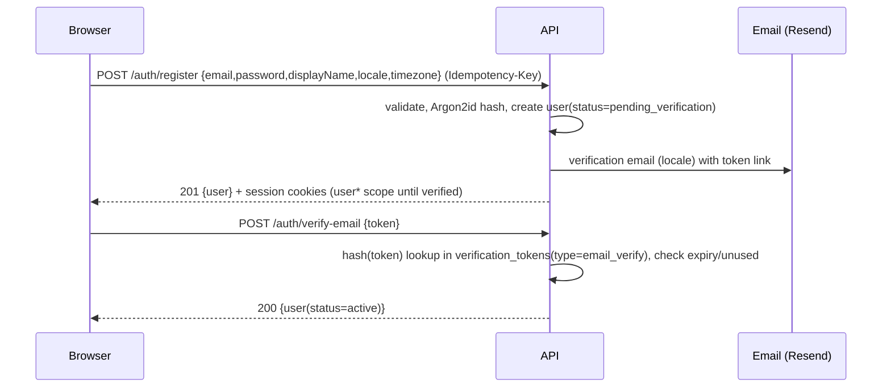
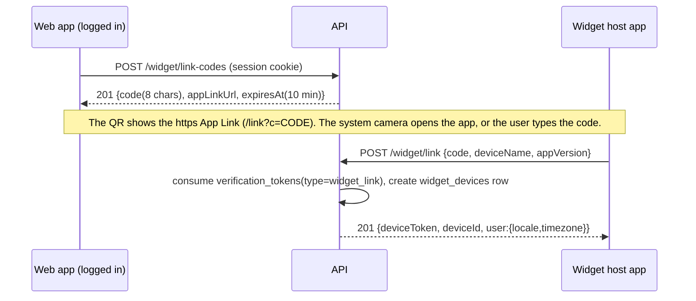

# API Authentication & Session Design

Implements F-AUTH-001…011 and F-RBAC-001…007. Endpoints are listed in [API_SPECIFICATION.md §1–2](API_SPECIFICATION.md). The tables used here are `users`, `auth_identities`, `user_sessions`, `verification_tokens`, `mfa_factors`, `recovery_codes`, and `widget_devices` (see [../README.md §6](../README.md)).

## 1. Credential types

All credentials are **opaque random tokens stored only as SHA-256 hashes** and looked up on each request. There are no JWTs, refresh tokens or signing keys (DL-012).

| Client | Credential | Transport | Lifetime |
|---|---|---|---|
| Web app (browser) | Session ID | `__Host-dgd_session` httpOnly cookie | User: per [SRS FR-AUTH-002-03](../specifications/SRS.md) (30 d absolute, 7 d idle). Admin: 12 h absolute, 30 min idle |
| Android widget | Device token | `Authorization: Bearer` | Expires after 180 days of inactivity ([SRS FR-WIDGET-001-03](../specifications/SRS.md)) |
| Public API client (P10) | Scoped API key (`dgd_live_…`) | `Authorization: Bearer` | Until revoked |

### 1.1 Session lookup
- Session IDs and device tokens are 256-bit random values (base64url). `user_sessions.token_hash` and `widget_devices.token_hash` store only the SHA-256 hash.
- Every request resolves the credential to `(userId, sessionId, roles, permissions, stepup_at)` with one indexed query. The session result is cached in-process for at most 5 s, and permissions for at most 60 s.
- **Revocation is immediate.** Logout, "log out everywhere", password change, role change and admin actions set `revoked_at` on the affected rows. The next request after the cache window fails with `401 AUTH_SESSION_REVOKED`.
- Idle and absolute expiry are enforced on lookup. `last_seen_at` is updated at most once per minute per session.

## 2. Web cookie flow

| Cookie | Attributes | Content |
|---|---|---|
| `__Host-dgd_session` | `HttpOnly; Secure; SameSite=Lax; Path=/` | Session ID ([SRS FR-AUTH-002-04](../specifications/SRS.md)) |

- **Topology.** The API is proxied under `app.<domain>/api` through a Next.js rewrite, so the cookie is first-party. This matters in in-app browsers and Safari ITP.
- **CSRF.** `SameSite=Lax`, plus a mandatory check on every state-changing request (POST/PUT/PATCH/DELETE) that uses cookie auth: `Origin` (or, if it is absent, `Sec-Fetch-Site`) must be the app origin, otherwise `403 CSRF_ORIGIN_MISMATCH`. Bearer-auth requests are exempt. There is no CSRF token cookie.
- **Expiry.** On `401 AUTH_SESSION_EXPIRED` or `AUTH_SESSION_REVOKED`, the client redirects to `/login?next=`. There is no refresh call.
- **SSR.** Next.js server components forward the cookie to the API through the same-origin rewrite.

## 3. Registration, login, verification

- **Password policy.** 10–128 characters. Checked against the k-anonymity Pwned Passwords range API (if that is unreachable, the server falls back to a local top-100k list). No composition rules (NIST 800-63B). Hashing parameters are defined in [SRS FR-AUTH-002-01](../specifications/SRS.md) (Argon2id), plus a server-side pepper from env/KMS. Hashes are rehashed on login when the parameters are upgraded.
- **Enumeration resistance.** `register` with an existing email returns the same `201`-shaped response *only if* the client cannot tell it apart. Practically: it returns `202 {status:"check_email"}` for both new and existing emails, and the existing owner receives a "someone tried to register" email. `login` failures always return `401 AUTH_INVALID_CREDENTIALS`, with timing equalized by running a dummy hash.
- **Unverified users** (`user*`) can use the app for 7 days. Community, AI, invitations, and exports require a verified email (`403 AUTH_EMAIL_NOT_VERIFIED`).
- **Lockout and throttling** follow [SRS FR-AUTH-002-02](../specifications/SRS.md): progressive back-off per account and a throttle per IP. They return `429 AUTH_ACCOUNT_LOCKED` or `429 RATE_LIMITED`. These counters are the only Postgres-backed rate limits ([API_CONVENTIONS.md §10](API_CONVENTIONS.md)).

## 4. Verification and reset tokens (`verification_tokens`)

| Field | Rule |
|---|---|
| `type` | `email_verify` \| `password_reset` \| `email_change` \| `account_deletion_confirm` \| `widget_link` |
| token | 32 random bytes, base64url, sent only in the email or QR. **Only the SHA-256 hash is stored.** |
| expiry | email_verify 48 h; password_reset 30 min; email_change 24 h; deletion confirm 24 h; widget_link 10 min |
| single use | `consumed_at` set atomically (`UPDATE … WHERE consumed_at IS NULL RETURNING`) |
| supersede | Issuing a new token of the same type invalidates older unconsumed ones |
| resend | at most 1 per 60 s and 5 per day per type |

- **Password reset** (`POST /auth/password/forgot`) always returns `202`. A successful `POST /auth/password/reset` revokes **all** sessions and device tokens and sends a confirmation email.
- Email links point to the **web app** (`/verify-email?token=`, `/reset-password?token=`). The page posts the token to the API, so it never appears in API logs. The token is also stripped from the URL with `history.replaceState`.

## 5. Android widget device tokens

- The code is a `verification_tokens` row of type `widget_link` (§4): hashed, single use, with a 10-minute expiry ([SRS FR-WIDGET-001-02](../specifications/SRS.md)). The widget never sees the user's password, so Google-only accounts work too.
- The device token has scope `widget` ([SRS FR-WIDGET-001-03](../specifications/SRS.md)). It allows only `GET /widget/snapshot`, `GET /checklist/{localDate}`, and `POST /sync` for the entity types `completion`, `salah_record`, `dhikr_log` and `practice_log`. Any other endpoint returns `403 TOKEN_SCOPE_INSUFFICIENT`.
- The token is stored with Android Keystore-backed encryption. There is no refresh. A revoked or expired token returns `401`, and the widget shows "Re-link device".
- Users see linked devices in `GET /me/sessions` (`kind: "widget"`) and can revoke them there.

## 6. Google OAuth (Authorization Code + PKCE, redirect)

1. `GET /auth/oauth/google/start?next=/today` → the server generates `state` (signed, includes `next` and a nonce) and a `code_verifier`, stores both in a 10-minute httpOnly cookie, and returns `302` to Google with `code_challenge` (S256), `scope=openid email profile`, and a `nonce`.
2. Google → `GET /auth/oauth/google/callback?code&state` → the server validates `state`, exchanges the code with the verifier, and verifies the ID token (`iss`, `aud`, `exp`, `nonce`, `email_verified=true`).
3. Account resolution:
   - An existing `auth_identities(provider='google', subject=sub)` → log in.
   - Otherwise, if a verified `users.email` matches, **link only if** the existing account's email is verified. A pending-verification account with that email is not auto-linked; the user must log in with their password and link from settings.
   - Otherwise → create the user (`status=active`, email verified).
4. Set the session cookie and `302` to `next`. `next` must be a same-origin relative path.
- **In-app browsers.** Google blocks OAuth in embedded webviews (`disallowed_useragent`). The web client detects in-app browsers (F-PWA-007) and hides the Google button there, offering "Open in browser" plus email login instead.
- A user can unlink Google only if a password is set (`DELETE /me/identities/google` → `409 AUTH_LAST_LOGIN_METHOD` otherwise).

## 7. Sessions and multi-device

- `user_sessions` holds one row per web login: `id, user_id, token_hash, is_admin, device_label, ip_hash, approx_location (country), created_at, last_seen_at, expires_at, stepup_at, revoked_at, revoke_reason`. Widget devices live in `widget_devices`. `GET /me/sessions` merges both.
- `GET /me/sessions` lists active sessions, with `current: true` on the caller's.
- `DELETE /me/sessions/{id}` revokes one session. `POST /auth/logout` revokes the current session and clears cookies. `POST /auth/logout-all` revokes everything except the current session (or including it, with `?includeCurrent=true`).
- Limits: web sessions per [SRS FR-AUTH-007-03](../specifications/SRS.md) (the least recently used is evicted). At most 5 widget devices.

## 8. RBAC and admin access

- **Roles:** `guest` (unauthenticated, implicit), `user`, `admin`, `super_admin`. Roles map to permissions through `role_permissions`. The permission catalog is in [API_SPECIFICATION.md §0](API_SPECIFICATION.md).
- The NestJS `@RequirePermissions('users.manage')` guard runs after authentication. Denial returns `403 PERMISSION_DENIED`. Admin route denial for a non-admin user returns **404**, which hides the admin surface.
- **Super Admin invariants:**
  - At least one active `super_admin` must always exist. Demoting or deleting the last one returns `409 LAST_SUPER_ADMIN`.
  - Only a super admin can grant `admin`/`super_admin`. In P2 the four roles and their permissions are **seeded from code**, and only role *assignment* can be edited. The role/permission editor comes in P10 (DL-032). The first super admin is created by a seed/CLI command.
  - An admin cannot change their own roles.
- **Admin MFA (F-RBAC-007).** TOTP (RFC 6238, SHA-1, 6 digits, 30 s, ±1 step) is **required** for `admin`/`super_admin`. If an admin has no TOTP enrolled, admin endpoints return `403 MFA_ENROLLMENT_REQUIRED`. The TOTP secret is AES-256-GCM encrypted using an envelope key. Ten single-use recovery codes are issued at enrollment and stored hashed.
- **Step-up re-authentication (F-RBAC-006).** Endpoints marked ⚑ need `user_sessions.stepup_at` within the last **10 minutes** ([SRS FR-RBAC-006-01](../specifications/SRS.md)). Otherwise they return `401 STEP_UP_REQUIRED`, and the client calls `POST /auth/step-up {password? | totpCode}` to refresh `stepup_at` on the session.
  - ⚑ applies to: role changes, user suspension/deletion, permission edits (P10), feature-flag changes in prod, broadcast notifications, export of user data by admins, and system settings.
- Every admin mutation writes `audit_logs` (actor, action, target, before/after diff with secrets redacted, ip_hash, request_id).

## 9. Account deletion (F-AUTH-009)

1. `POST /me/deletion` with `{password | totpCode | recentOAuth}` creates a deletion request and sends a confirmation email.
2. Confirming via the token sets `users.status = pending_deletion` and `deletion_scheduled_at` to the end of the grace period in [SRS FR-AUTH-009-01](../specifications/SRS.md) (30 days). All sessions are revoked, and the user is offered a data export (`POST /exports`).
3. Logging in during the grace period shows a "Cancel deletion" option (`DELETE /me/deletion`).
4. After the grace period, a worker job hard-deletes or anonymizes the data:
   - Personal data and journals are hard-deleted.
   - Community posts become `[deleted user]`, or are removed if the user chose so.
   - Audit logs keep `actor_id` as a tombstone hash.

## 10. Security checklist (mapped in qa/SECURITY_TEST_PLAN)

- All auth endpoints are HTTPS-only. HSTS uses `preload`.
- No tokens in URLs except one-time email and link tokens, which are consumed immediately.
- Secrets (password pepper, TOTP encryption key, journal key, OAuth secret) come from environment or KMS. They are never committed and are rotated per runbook.
- Log redaction: `password`, `token`, `deviceToken`, `code`, `totpCode`, and `Authorization`/`Cookie` headers.
