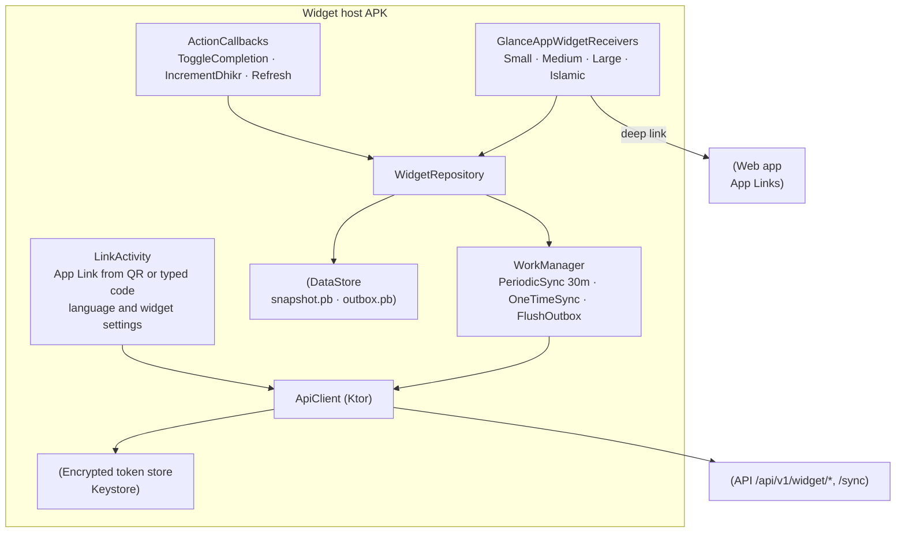
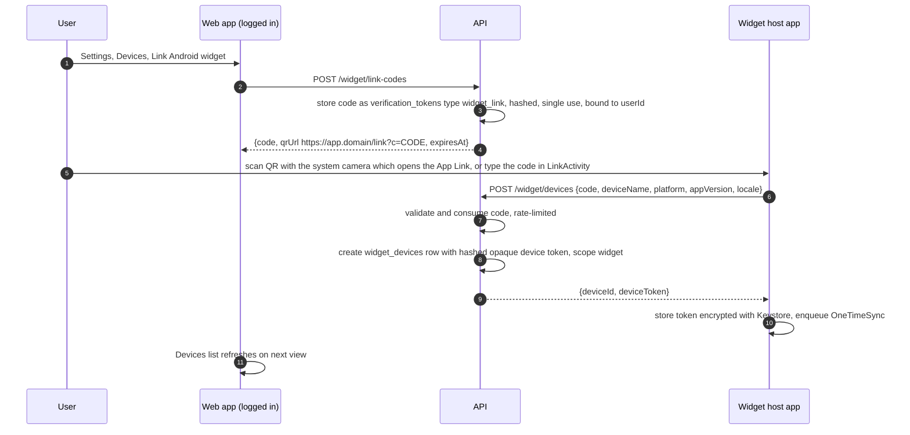
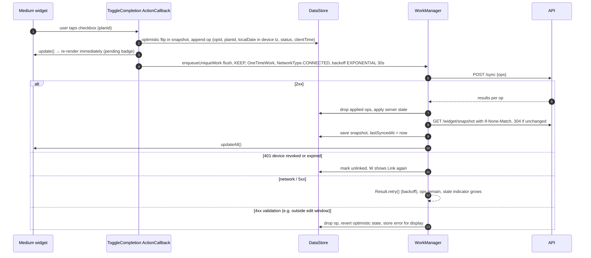

# Android Widget Architecture

> Status: Proposed. Features: F-WIDGET-001…009. Phase **P9**. Decision: ADR-012. **This is not a native version of the product.** It is a widget host with a single linking/settings screen. Every feature screen opens the web app.

## 1. Project

| Item | Choice |
|---|---|
| Location | `apps/android-widget/` (Gradle, Kotlin DSL; outside the pnpm workspace; own CI job) |
| Package | `org.<domain>.dailygooddeeds.widget` (final ID depends on the domain) |
| minSdk / target | 26 / latest stable (35+) |
| UI | Jetpack Glance (`glance-appwidget`), Material 3 Glance theme generated from `packages/tokens` |
| Background | WorkManager |
| Storage | Jetpack DataStore (Proto) for snapshot + outbox; tokens in **EncryptedSharedPreferences/Tink with an Android Keystore master key** |
| Networking | Ktor client (OkHttp engine) + kotlinx.serialization; certificate transparency enforced by the platform; no cleartext (`networkSecurityConfig`) |
| DI | Manual / Hilt-lite (small app) |
| Errors | Sentry Android (no PII) |

## 2. Components

## 3. Widgets (F-WIDGET-002…005)

| Widget | Default size (cells) | Responsive sizes (`SizeMode.Responsive`) | Content | Interactions |
|---|---|---|---|---|
| Small progress | 2×1 / 2×2 | 110×40dp, 110×110dp | Today's completion ring (x/y), current streak | Tap → `/today` |
| Medium checklist | 4×2 | 250×110dp, 250×180dp | Up to 4–6 next deeds with checkboxes, progress bar | Tap checkbox → toggle (offline-capable); tap title → `/deeds/{id}`; refresh button |
| Large detailed | 4×4 | 250×250dp, 320×320dp | Checklist (scrollable `LazyColumn`), streak, next reminder, affirmation | Same as medium + "Open journal" |
| Islamic tracker | 4×2 / 4×3 | 250×110dp, 250×180dp | 5 prayers with status chips, next prayer + time, Hijri date, dhikr counter | Tap prayer chip → cycle (not prayed → prayed → prayed in jamaah); tap +1 on dhikr; tap header → `/islamic/salah` |

Shown only when the corresponding module is enabled in the user's server preferences. The Islamic widget shows "Enable in settings" if the module is opted out.

**Stale-data indicator (F-WIDGET-007):** every widget renders `lastSyncedAt`. If it is older than 2 h, a muted "Updated 3 h ago" line plus a sync icon appears. If older than 24 h or the day has rolled over locally, the list is greyed with "Tap to refresh". Pending local ops show a small "⟳ 2 pending" badge.

## 4. Device linking (F-WIDGET-001)

Users log in on the **web**. There are no passwords in the widget app, and Google OAuth in a widget would be blocked anyway.

Code lifetime, attempt limits, and the device-token idle expiry are defined in SRS FR-WIDGET-001. The linking flow follows DL-020:
- The web issues the code. There is no app-initiated flow and no poll endpoint.
- The QR code is just an https App Link, so the system camera opens it. The app bundles no scanner (no CameraX or ML Kit).
- The device token is opaque (DL-012). There is no refresh token.

Unlinking: from web Settings → Devices, which revokes the device row. The next widget call gets a 401 and the widget shows "Link again". Or from the app: "Unlink" clears local storage and calls `DELETE /widget/devices/{id}`.

**Token scope:** the `widget:*` permission set in the [permission catalog](../api/API_SPECIFICATION.md) §0. That covers reading the snapshot and writing completions, salah and dhikr, all for the user's own data. A widget token can never read journals or call admin, community, or AI endpoints.

## 5. Sync model (F-WIDGET-006)

- **Snapshot pull:** `GET /widget/snapshot` returns the compact `WidgetSnapshot` payload defined in [../api/API_SPECIFICATION.md](../api/API_SPECIFICATION.md). It uses the same builder as `GET /today` (DL-025).
  - The **ETag** is derived *before* the snapshot is built, from the user's latest `change_seq`, the local date, the current prayer slot and the locale (DL-020).
  - `generatedAt` is excluded from the ETag, so an unchanged snapshot returns 304 without being built.
- **Mutations** use the same `POST /sync` protocol as the PWA (ADR-010), with `opId` (UUIDv7) idempotency.

- **Periodic refresh:** a `PeriodicWorkRequest` at the interval set by SRS FR-WIDGET-006 (30 min, DL-020), with `NetworkType.CONNECTED`. Doze/App Standby may defer it. Retry backoff follows the same FR. `updatePeriodMillis = 0` in the widget info, because WorkManager owns refresh. Event triggers (below) cover freshness between periodic runs.
- **Additional triggers:** widget added/resized, device boot (`RECEIVE_BOOT_COMPLETED`), local midnight rollover (`AlarmManager` inexact alarm at 00:01 local → OneTimeSync so the day boundary is correct even before network), timezone/locale change broadcasts, and a high-priority FCM data message (**optional, P10**) when the web marks something done. The default is the next periodic sync.
- **Battery:** no exact alarms, no foreground service. Payloads are small, with ETag.

## 6. Localization (F-WIDGET-008)
- Resources: `values/strings.xml` (en), `values-bn/strings.xml`, generated from `packages/i18n` (`widget.*` namespace) by a script in CI. Bengali digits follow the user's `numerals` preference by formatting with the `bn-BD` locale where enabled.
- **Locale source:** the server preference (`snapshot.locale`) is authoritative. The app applies it with `AppCompatDelegate.setApplicationLocales()` (per-app language, Android 13+ native; AppCompat backport below), so widget strings rendered by `LocalContext` follow the user's web setting. If no link exists yet, the system locale is used.
- Content strings (deed titles) arrive already localized from the API.

## 7. Deep links (F-WIDGET-009)
- Android App Links to `https://app.<domain>/{locale}/…` with `assetlinks.json` served by the web app at `/.well-known/assetlinks.json` (`delegate_permission/common.handle_all_urls` only for the link-landing path `/link`). All other paths open the **browser / installed PWA** via `Intent.ACTION_VIEW` + `CustomTabsIntent`, so feature UI is always web.
- Targets: `/today`, `/deeds/{id}`, `/islamic/salah`, `/islamic/tasbih`, `/journal/new`, `/settings/devices`.

## 8. Security
- Tokens are encrypted at rest with a Keystore-backed key. They are never logged and excluded from backups (`android:allowBackup="false"`, `dataExtractionRules`).
- Widget content can appear on the lock screen (on some launchers). A "Hide details" setting replaces deed titles and prayer status with counts only.
- Exported components: only the receivers and `LinkActivity` (for the App Link). Callbacks are not exported. Release builds use R8/ProGuard.

## 9. Testing
Unit tests for repository/outbox (JUnit + Turbine), Glance UI tests (`glance-appwidget-testing`), WorkManager tests (`work-testing` with `TestDriver`), an instrumented test on an emulator for linking + toggle + offline replay, and a contract test of the snapshot JSON against `packages/contracts` (exported JSON Schema).
