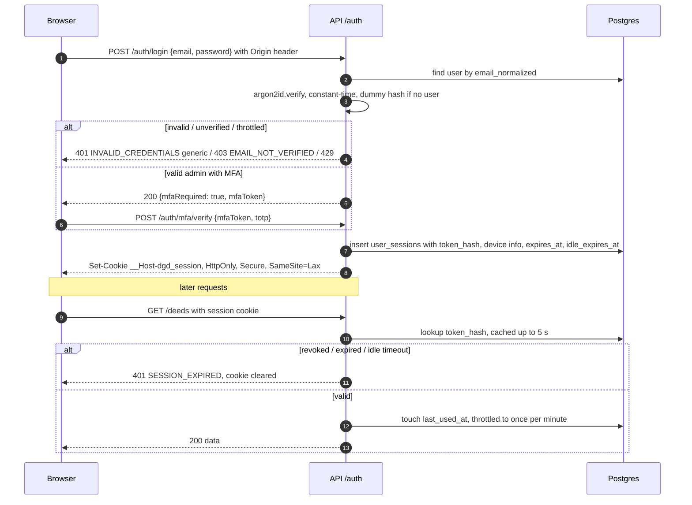
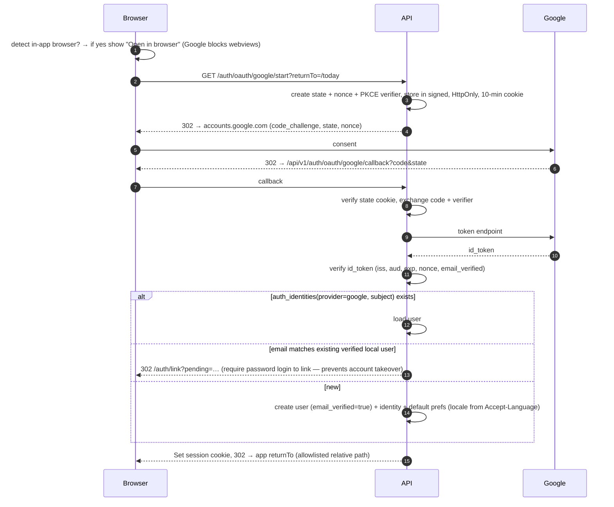

# API Architecture

> Status: Proposed. This doc covers how the API is structured and behaves. Endpoint-level contracts are in [../api/API_SPECIFICATION.md](../api/API_SPECIFICATION.md), and conventions are in [../api/API_CONVENTIONS.md](../api/API_CONVENTIONS.md).

## 1. Style
- **REST over HTTPS, JSON**, base path `/api/v1`. Breaking changes need `/api/v2`; additive changes ship in place (ADR-020).
- **OpenAPI 3.1** is generated from Zod schemas in `packages/contracts` and served at `/api/v1/openapi.json` (non-prod) and in the docs. CI blocks breaking diffs with `oasdiff`.
- Resource map per [../README.md §5](../README.md#5-canonical-api-resource-map-apiv1).

## 2. Pipeline

| Order | Component | Purpose |
|---|---|---|
| 1 | `helmet` | Security headers (API returns JSON only; CSP `default-src 'none'`) |
| 2 | CORS | Allowlist: `https://app.<domain>`, preview origins in non-prod; `credentials: true` |
| 3 | Request ID + Pino (+ Sentry) | `X-Request-Id` (an incoming value is accepted if it is a UUID, otherwise one is generated). OpenTelemetry tracing arrives in P10 (DL-032) |
| 4 | Body limits | Per SRS NFR-SECURITY-019 (JSON body and `POST /sync` limits); files never go through the API (signed URLs) |
| 5 | Throttler | See §5 |
| 6 | `AuthGuard` | Session cookie or bearer device token → SHA-256 → lookup in `user_sessions` / `widget_devices` (≤ 5 s cache) → `req.actor` (`userId`, `permissions`, `sessionId`, `deviceId?`, `stepUpAt`, `locale`). Revoked or expired → 401 (DL-012) |
| 7 | `OriginGuard` | Cookie-authenticated unsafe methods: `Origin` (or `Sec-Fetch-Site: same-site`) must be in the allowlist. Combined with `SameSite=Lax`, this is the CSRF defence (no token) |
| 8 | `PermissionsGuard` | `@RequirePermissions(...)`; `@Public()` opt-out |
| 9 | `StepUpGuard` | `@RequireStepUp()` for destructive admin/account ops |
| 10 | `ZodValidationPipe` | Validates params/query/body; errors → localized `problem+json` |
| 11 | `IdempotencyInterceptor` | `Idempotency-Key` on POSTs flagged `@Idempotent()` (see §6) |
| 12 | Controller → Service | Business logic |
| 13 | `LocaleInterceptor` | Resolves translation fallbacks; adds `Content-Language` |
| 14 | `ProblemFilter` | All exceptions → RFC 9457 `application/problem+json` with `code`, localized `title`/`detail`, `requestId`, field `errors[]` |

## 3. Response shapes (summary)
- Single resource: `{ "data": {...} }`
- Collection: `{ "data": [...], "page": { "nextCursor": "...", "limit": 20 } }`. **Cursor pagination** uses a plain opaque base64 of `(sort_key, id)`. It is not signed, because every query is user-scoped (DL-033). Offset pagination is allowed only on admin tables (`?page=&pageSize=` ≤ 100).
- Errors: problem+json (see [../api/ERROR_HANDLING.md](../api/ERROR_HANDLING.md)).
- Dates: ISO-8601 UTC timestamps (`occurredAt`); `localDate` as `YYYY-MM-DD`. JSON fields are camelCase; DB columns are snake_case.

## 4. Localization in the API
- Locale resolution: `?locale=` (admin preview only) → authenticated user's `user_preferences.language` → `Accept-Language` → `en`.
- Content with translations returns the resolved locale fields plus `meta.locale` and `meta.fallback: true|false`.
- Error messages are localized via `packages/i18n` (`errors.*` namespace); machine-readable `code` stays stable (`DEED_NOT_FOUND`).
- Numbers and dates are **not** pre-formatted by the API (except in emails and push payloads). Clients format them so they can apply the Bengali-digit preference.

## 5. Rate limiting & abuse controls
The limits themselves are defined in **one table**, in [../api/API_CONVENTIONS.md](../api/API_CONVENTIONS.md) (DL-014). Login throttling is defined in SRS FR-AUTH-002-02.

How they are enforced:
- `@nestjs/throttler` with its in-memory store and three tiers: `auth-strict`, `write` and `default`. Exceeding a limit returns `429` with `Retry-After`.
- Only login and password reset also use a Postgres-backed counter, so their limits hold across API instances.
- Product quotas (AI usage, posts per day, exports) are domain rules enforced in services, not by the throttler.

## 6. Idempotency
These rules follow DL-016. The full contract is in [../api/API_CONVENTIONS.md](../api/API_CONVENTIONS.md).

- **`POST /sync`:** each op carries its own `opId`, and deduplication goes through `sync_operations`. No header is needed.
- **Side-effecting POSTs without a natural unique key** (exports, invitations, AI requests, broadcasts) are flagged `@Idempotent()` and **require** an `Idempotency-Key`. The key is stored in `idempotency_keys` for 24 h.
- **Natural-key writes** such as completions, keyed by `(plan, local_date)`, are upserts and need no key.
- **Replays:** the same key with the same request hash returns the stored response. The same key with a different body returns `422 IDEMPOTENCY_KEY_REUSED`.

## 7. Concurrency control
- Mutable resources expose `version` (int) and `ETag: W/"<version>"`. `PATCH`/`PUT` accept `If-Match` and return `412` on mismatch. `If-Match` is **required only on admin content** and is optional elsewhere. The sync protocol uses row-level LWW instead (ADR-010).

## 8. Key flows

### 8.1 Login and session lookup

There are no refresh tokens and no rotation. A session lives until its absolute or idle expiry (SRS FR-AUTH-002-03/04), or until it is revoked. Revocation takes effect on the next request once the 5 s cache expires.

### 8.2 Google OAuth (redirect, server-side code exchange)

### 8.3 Offline sync
See [PWA_ARCHITECTURE.md §5](PWA_ARCHITECTURE.md#5-offline-outbox--synchronization).

## 9. Versioning & deprecation
- `Deprecation` and `Sunset` headers are set on deprecated endpoints at least 90 days before removal. The widget sends `X-Client: android-widget/<version>`, and the API can respond `426 CLIENT_UPGRADE_REQUIRED` with a minimum supported version.

## 10. Health & ops endpoints
`GET /health/live` (process up), `GET /health/ready` (DB reachable + migrations applied + pg-boss started), `GET /admin/system/health` (permissioned, detailed). No secrets or versions are exposed on the public health endpoints.
