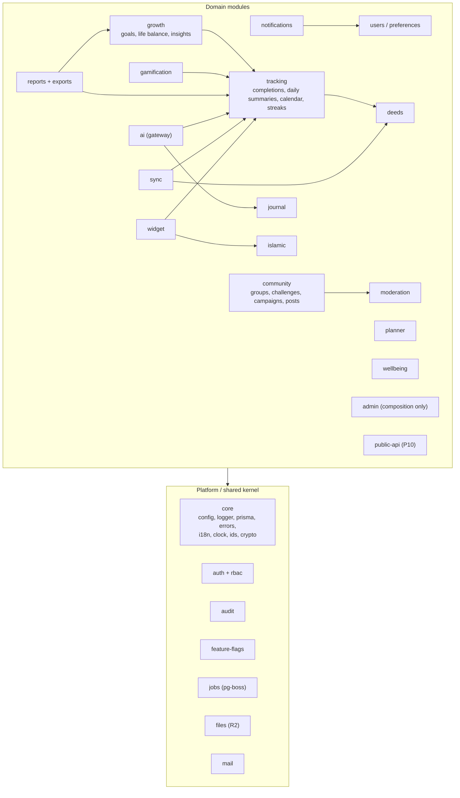

# Component Architecture

> Status: Proposed. This doc defines module boundaries for `apps/api` (HTTP entrypoint `main.ts` and worker entrypoint `worker.ts`, DL-036), route groups for `apps/web`, and the responsibilities of each shared package.

## 1. NestJS modules (apps/api: API + worker entrypoints)

Each module owns its tables, controllers, services, repositories, and event handlers. **The table in §1.1 is the single source of truth for which module owns which table.** `database/DATABASE_DESIGN.md` links here instead of repeating it. The table inventory itself, with counts and phases, is in [../README.md §6](../README.md#6-canonical-table-inventory-validated-from-the-directives-entity-list). **Another module's tables are never queried directly.** Cross-module access goes through an exported service interface or through domain events.



### 1.1 Module responsibility & allowed dependencies

| Module | Owns tables | Features | May depend on (sync calls) | Emits events | Consumes events |
|---|---|---|---|---|---|
| `core` | idempotency_keys | — (cross-cutting `Idempotency-Key` support, DL-016) | — | — | — |
| `auth` | users (credentials part), auth_identities, user_sessions, verification_tokens (incl. `widget_link`), mfa_factors, recovery_codes | F-AUTH-001…007, 011, F-RBAC-006/007 | core, users, mail, audit | `user.registered`, `user.logged_in`, `session.revoked` | `role.assigned` (invalidates the session permission cache) |
| `rbac` | roles, permissions, user_roles, role_permissions | F-RBAC-001…004 | core, audit | `role.assigned` | — |
| `users` | users (profile), user_preferences | F-AUTH-008…010, F-I18N-003 | core | `user.preferences_changed`, `user.deletion_requested`, `user.deleted` | — |
| `audit` | audit_logs | F-RBAC-005, F-ADMIN-016 | core | — | all `*.privileged` events |
| `feature-flags` | feature_flags (booleans), experiments (P10), system_settings | F-ADMIN-009/010 | core | — | — |
| `deeds` | deed_categories(+tr), deeds(+tr), deed_plans, favorite_deeds, content_versions (for deeds) | F-DEED-001…006, 011…014, F-ADMIN-003/004/011 | core, files | `plan.changed` | `user.deleted` |
| `tracking` | deed_completions, completion_attachments, daily_summaries, streaks | F-DEED-004, 007…010, F-CAL-* | core, deeds (read plans), files | `completion.recorded`, `completion.removed`, `streak.milestone` | `plan.changed` (recompute `daily_summaries` from today forward, enqueue the streak rebuild) |
| `growth` | goals, goal_milestones, growth_snapshots, life_balance_* | F-GROW-*, F-RPT-003…005 | core, tracking (read API) | `goal.completed` | `completion.recorded` |
| `journal` | journal_entries | F-JRNL-001…009 | core, crypto (core) | `journal.future_letter_scheduled` | `user.deleted` |
| `planner` | planner_items | F-PLAN-* | core, deeds (recurrence via domain pkg) | — | — |
| `islamic` | islamic_* , salah_records, quran_*, khatam_plans, dhikr_*, duas(+tr), hadith_*(+tr), sunnah_practices, practice_logs, fasting_records, ramadan_plans, zakat_calculations | F-ISL-*, F-ADMIN-005 | core, external Quran client | `salah.recorded` | `user.deleted` |
| `wellbeing` | wellbeing_logs, affirmations | F-WELL-* | core | — | — |
| `gamification` | achievements(+tr), user_achievements | F-GAME-*, F-CAL-009 | core, tracking (read) | `achievement.unlocked` | `completion.recorded`, `goal.completed`, `streak.milestone` |
| `community` | groups, group_members, group_invitations, challenges, challenge_*, campaigns, campaign_participations, volunteer_opportunities, posts, comments, reactions | F-COMM-001…011, 014, F-INTG-006, F-ADMIN-006 | core, moderation, files | `post.created`, `challenge.joined` | `user.deleted`, `moderation.action_taken` |
| `moderation` | content_reports, user_blocks, moderation_actions | F-COMM-012/013, F-ADMIN-008 | core, audit | `moderation.action_taken` | `post.created` (auto-screen) |
| `notifications` | notifications, notification_preferences, reminders, push_subscriptions, broadcasts | F-NOTIF-*, F-INTG-002, F-ADMIN-007 | core, users, mail, jobs | — | `achievement.unlocked`, `challenge.*`, `journal.future_letter_scheduled` |
| `ai` | ai_consents, ai_conversations, ai_messages, ai_usage_logs, ai_insights | F-AI-*, F-JRNL-010 | core, feature-flags, tracking (read summaries), journal (decrypted read with consent) | `ai.insight_created` | `user.deleted` |
| `reports` | export_jobs | F-RPT-001…008 | core, tracking, growth, islamic (read APIs), files, jobs | `export.ready` | — |
| `sync` | sync_operations | F-PWA-005/006, F-WIDGET-006 | core, tracking, deeds, islamic (write APIs) | — | — |
| `widget` | widget_devices | F-WIDGET-001…009 | core, auth, tracking, islamic (shares the snapshot builder with `GET /today`, DL-025) | — | — |
| `admin` | — (composition) | F-ADMIN-001/002/012…015 | any module's *admin service* interface | — | — |
| `public-api` | api_clients | F-INTG-005 | read services | — | — |

**Enforcement.** `eslint-plugin-boundaries` uses an allowlist that mirrors this table. CI fails on any violation. Circular dependencies are banned (`madge --circular`).

### 1.2 Internal module layout

```
src/modules/deeds/
  deeds.module.ts
  http/            controllers (thin), request/response mapping
  application/     services (use cases), permission checks beyond guards
  domain/          entities, policies (pure)
  infra/           repositories (Prisma), external clients
  events/          emitters + handlers
  jobs/            pg-boss handlers (loaded only by worker entrypoint)
  deeds.public.ts  exported interface for other modules
```

### 1.3 Authorization model

- **Permission codes** and their role mapping are defined **only** in the catalog in [../api/API_SPECIFICATION.md](../api/API_SPECIFICATION.md) §0, for example `users.read` and `moderation.act`. The ownership scope (`own`, `group`, `any`) is not part of the code. Repositories enforce it (see below).
- Default role grants:
  - **Guest:** public content read only.
  - **User:** `*:own` on personal resources, plus group-scoped permissions in the groups they belong to.
  - **Admin:** content, moderation, and user management, but not role assignment to Admin/Super Admin, system settings, or key operations.
  - **Super Admin:** everything, including role assignment and system settings.
- The `@RequirePermissions()` decorator and `PermissionsGuard` check the actor's permission set. That set is **loaded together with the session lookup** and cached for at most 60 s. It is never embedded in a token (DL-012).
- Ownership is enforced in repositories. Every query takes `actorId`, and a generic `findById` without an owner is not available to user-facing services.
- Group roles (`owner`, `admin`, `member`) live in `group_members.role` and are evaluated by `community` policies.
- Destructive admin endpoints also require a recent step-up, meaning `user_sessions.stepup_at` falls within the window set by SRS FR-RBAC-006-01 (10 min, DL-022). Admin roles also require TOTP (F-RBAC-007).

## 2. Web app (apps/web)

### 2.1 Route groups (App Router)

```
app/
  [locale]/                      en | bn  (next-intl middleware; default from cookie → Accept-Language → en)
    (public)/                    no auth required; SSR/SSG; indexable
      page.tsx                   landing
      about, privacy, terms, faq
      deeds/explore              public deed library preview (Guest)
      campaigns/[slug]           public campaign page (QR target)
      auth/login, register, verify-email, forgot-password, reset-password, oauth/callback
      open-in-browser            in-app browser guidance
    (app)/                       auth required (middleware redirect → login); app shell with nav
      today                      daily checklist (home)
      calendar/{day,week,month,year}
      deeds, deeds/[id], deeds/new, favorites
      history
      goals, goals/[id], growth, life-balance, reflection/monthly
      journal, journal/[id], journal/new?type=
      planner/{today,week}
      islamic/{salah,prayer-times,quran,memorization,khatam,dhikr,tasbih,duas,sunnah,fasting,ramadan,zakat,learn,hadith}
      wellbeing/*
      achievements, tree
      family, groups/[id], challenges/[id], community, community/posts/[id]
      ai/{coach,insights,weekly}
      reports, exports
      notifications
      settings/{profile,preferences,language,notifications,privacy,ai,islamic,sessions,devices,account}
    admin/                       role ∈ {admin, super_admin}; separate layout; step-up gate
      dashboard, users, users/[id], roles            (P2: view roles and assign them; the permission editor is P10, DL-032)
      content/{deeds,categories,achievements,affirmations}, islamic/{duas,hadith,sources}
      translations, campaigns, notifications, moderation, flags, experiments
      system/{health,jobs,backups,api}, audit
  api/                           (no business APIs) — only: /api/csp-report, /api/revalidate
  manifest.ts, sw.ts (Serwist), robots.ts
```

### 2.2 Rendering & data strategy

| Route type | Rendering | Data fetching | Cache |
|---|---|---|---|
| (public) marketing | SSR per request (nonce CSP, DL-038) | fetch-cached server calls (e.g. API status, 60 s) | no HTML CDN cache; static assets on CDN |
| (public) auth pages | SSR (no cache) | none | no-store |
| (app) pages | RSC shell + client islands | TanStack Query against the API (client). Only the first-paint query is prefetched in RSC, with forwarded cookies: `GET /today` for the Today page (DL-025). Functions are pinned to `sin1` (DL-026). | SW: see PWA doc |
| admin | Client-rendered within an RSC layout | TanStack Query | no SW cache (network-only) |

Conventions (T-P2-PLAT-005):
- `loading.tsx` only in leaf segments that do slow work. A loading boundary streams the response early, so a `notFound()` beneath it returns HTTP 200. Existence checks that may 404 run above any loading boundary.
- Public pages don't call database-backed endpoints at render time.

### 2.3 Client state
- Server state: **TanStack Query**, persisted to IndexedDB for `(app)` reads (offline read, F-PWA-004).
- Offline mutations: **outbox** (`packages/domain/sync` + `apps/web/lib/outbox`), applied optimistically to the query cache.
- UI state: React state/context; no global store library unless needed.
- Forms: React Hook Form + Zod resolver (schemas from `packages/contracts`) with localized messages.

## 3. Shared packages

| Package | Responsibility | Consumers | Rules |
|---|---|---|---|
| `packages/contracts` | Zod request/response schemas, error codes enum, generated OpenAPI doc and TS client | web, api, worker | No runtime deps beyond zod; versioned with the API |
| `packages/domain` | Pure logic: recurrence (RRULE subset), local-date math, streaks, completion rates, Hijri helpers, zakat calculator, prayer-time wrapper, sync merge | web, api, worker | No I/O and no framework imports; 95 % coverage target; property-based tests |
| `packages/i18n` | `en.json`, `bn.json`, typed keys, ICU formatters, Bengali digit conversion, date formatting helpers | web, api, worker; exported to Android `strings.xml` by script | Missing-key check in CI |
| `packages/ui` | Design-system components (Radix + Tailwind), icons, layout primitives | web | Accessible by default; Storybook stories + axe tests |
| `packages/tokens` | Design tokens source (JSON) → CSS variables, Tailwind preset, Android `colors.xml`/Glance theme | ui, web, android | Single source for colours/spacing/radius |
| `packages/config` | ESLint (incl. boundaries), tsconfig bases, Prettier | all | — |

## 4. Worker process

The worker entrypoint `apps/api/src/worker.ts` (`pnpm worker`, DL-036) creates a Nest application context **without HTTP**. Job handlers are providers marked `@Job({ name, schema, ... })` in each module's `jobs/` folder; `JobRunner` discovers them, creates each queue plus `<name>.dlq`, and drains in-flight jobs on SIGTERM.

| Queue | Producer | Schedule | Concurrency | Retry |
|---|---|---|---|---|
| `reminders.tick` | cron | every minute: **one** indexed scan `WHERE enabled AND next_fire_at <= now()` covering all reminder types, including prayer reminders (DL-024) | singleton | n/a |
| `notifications.deliver` | reminders.tick, broadcasts, events | on demand | 20 | 5× exp backoff, DLQ |
| `broadcasts.fanout` | admin broadcast | `startAfter = scheduled_at` | 1 | 3× |
| `email.send` | auth, notifications | on demand | 10 | 5× |
| `streaks.rebuild` | past-day edits, plan-rule changes, sync batches. Today/yesterday completions update `streaks` inline (DL-023) | on demand, debounced via `singletonKey = userId` | 5 | 3× |
| `snapshots.monthly` | cron | 1st of month 02:00 per tz bucket | 2 | 3× |
| `exports.generate` | reports | on demand | 2 | 3× |
| `future-letters.deliver` | journal, when a letter is saved | delayed job, `startAfter = deliver_at`. No polling (DL-024) | 5 | 5× |
| `ai.weekly-report` | cron (per user opt-in) | weekly, per tz | 3 | 3× |
| `quran.cache-refresh` | cron | weekly | 1 | 3× |
| `account.purge` | cron | daily | 1 | 3× (hard delete after 30-day grace) |
| `cleanup.*` | cron | daily | 1 | — (expired sessions and tokens, `idempotency_keys` > 24 h, and `sync_operations`, tombstones, notifications, AI data and audit logs past their retention under SRS NFR-PRIVACY-009) |

The worker connects through Neon's **direct** URL with a small fixed pool and polls pg-boss at about 10 s intervals. Preview branches run no worker (DL-026).
