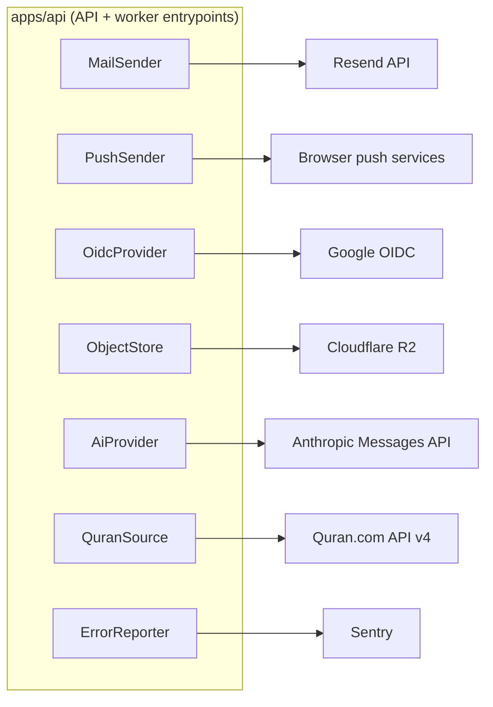
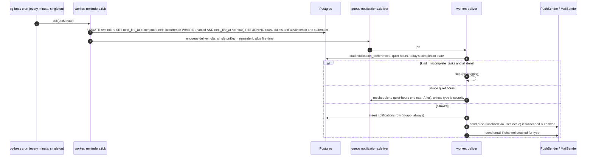

# Integration Architecture

> Status: Proposed. **Pattern:** every external service sits behind a port (TypeScript interface) in `core` or the owning module, with a concrete adapter selected by config. If credentials are missing, the adapter becomes a **`Disabled*` implementation**: it logs a warning at boot, the feature reports `unconfigured` via `/admin/system/health`, and the user-facing feature is hidden or degraded. No mock data is ever served in production.

## 1. Integration inventory

| Integration | Port | Default adapter | Feature IDs | Required config | Failure behaviour |
|---|---|---|---|---|---|
| Email | `MailSender` | `ResendMailSender` (fallback `SmtpMailSender`) | F-INTG-001, F-AUTH-004/005, F-NOTIF-005 | `RESEND_API_KEY`, `MAIL_FROM`, verified domain | Queue retry 5× → DLQ; registration still succeeds and the user can resend verification |
| Web Push | `PushSender` | `VapidPushSender` (`web-push`) | F-INTG-002, F-NOTIF-006 | `VAPID_PUBLIC_KEY`, `VAPID_PRIVATE_KEY`, `VAPID_SUBJECT` | 404/410 from push service → delete subscription; others retry |
| Google OAuth | `OidcProvider` | `GoogleOidc` (`openid-client`) | F-AUTH-003 | `GOOGLE_CLIENT_ID`, `GOOGLE_CLIENT_SECRET`, redirect URI | Button hidden when unconfigured |
| Google Calendar | `CalendarExporter` | ICS feed first (per-user secret URL), Google Calendar API later | F-INTG-003, F-PLAN-008 | OAuth scope `calendar.events` (P10) | Feature-flagged off |
| Object storage | `ObjectStore` | `S3ObjectStore` (R2 endpoint) | F-DEED-010, F-RPT-006/007, F-COMM-009 | `S3_ENDPOINT`, `S3_BUCKET`, keys | Attachments disabled; exports fall back to direct download stream if small |
| AI | `AiProvider` | `AnthropicProvider` | F-AI-* | `ANTHROPIC_API_KEY`, `AI_MODEL_*` | AI features hidden; core app unaffected |
| Speech-to-text | `Transcriber` | Browser Web Speech API (client-side, where supported) → server adapter later | F-AI-011 | — | Voice button hidden if unsupported |
| Quran text | `QuranSource` | `QuranComApiSource` + DB cache | F-ISL-003/004/005 | `QURAN_API_BASE`, (client credentials if required by the API's terms) | Serve cached data; if uncached, show reading tracker without text |
| Prayer times | (library) | `adhan` in `packages/domain` | F-ISL-002 | none | Offline-capable |
| Hijri | (library) | `Intl` islamic-umalqura + offset | F-ISL-013 | none | — |
| Error tracking | `ErrorReporter` | Sentry | NFR-OBSERVABILITY | `SENTRY_DSN` | No-op |
| Product analytics | `AnalyticsSink` | Self-hosted PostHog or Plausible (aggregate, consented) | F-RPT-008 | key | No-op; no third-party trackers without consent |
| QR codes | (library) | `qrcode` generated server-side for campaign URLs | F-INTG-006 | — | — |
| Wearables | — | **Won't Have initial** | F-INTG-004 | — | — |
| Public API | `api_clients` + scoped tokens | in-house | F-INTG-005 | — | — |

## 2. Context diagram

## 3. Reminder & notification pipeline (timezone + quiet hours)

Reminders are stored as `reminders(user_id, kind, local_time TIME, days_of_week, tz, enabled, target_ref, next_fire_at timestamptz)`. The definitive columns are in the data dictionary. **`next_fire_at`** is computed in `packages/domain`: when a reminder is written, after it fires, and when the user changes timezone. It is indexed with a partial index `WHERE enabled`. The worker does **not** create one cron per user, and it does not query per timezone. A per-minute tick runs **one** indexed scan (DL-024).

**Rules**
- DST: `next_fire_at` is computed in the reminder's IANA zone. A local time that doesn't exist (spring forward) maps to the next valid minute. A repeated local time (fall back) maps to its first occurrence, and because the claim advances `next_fire_at`, it fires once.
- Prayer reminders (F-NOTIF-010) are ordinary `reminders` rows of kind `prayer`. Their `next_fire_at` is the next prayer time, computed with `adhan` from the user's location and method, so the **same tick** delivers them. There is no separate tick.
- Future-self letters are not reminders. They are pg-boss jobs created with `startAfter = deliver_at` when the letter is saved (DL-024).
- Copy is always encouraging and non-shaming, uses localized templates (`packages/i18n` `notifications.*`), and contains no worship details in push payloads by default (privacy on lock screens). A setting can opt into detailed text.
- A daily per-user cap applies, excluding security notifications. The value is set by the SRS notification requirements, and it is configurable per user.

## 4. Email
- Templates: React Email components in `apps/api/src/modules/mail/templates`, rendered per locale with Bengali font fallbacks (`Noto Sans Bengali`, system fonts), with a plain-text alternative.
- Transactional: verify email, password reset, new device login, account deletion scheduled/completed, export ready. Digests (P6): weekly summary (opt-in).
- `List-Unsubscribe` headers on all non-transactional mail. SPF/DKIM/DMARC configured on the sending domain.

## 5. External API resilience
- HTTP client with timeouts (connect 3 s, total 10 s; AI streaming 60 s), retries only on idempotent calls and 5xx/429, honouring `Retry-After`, plus a circuit breaker per integration (opens after 5 consecutive failures for 30 s).
- All outbound calls are logged with their request ID, and secrets are redacted from the logs. OpenTelemetry traces arrive in P10 (DL-032).
- Outbound requests go only to a configured host allowlist (SSRF prevention). User-supplied URLs (e.g. volunteer links) are never fetched server-side.

## 6. Public API (P10, F-INTG-005)
- OAuth2 client credentials for organizations, or personal access tokens with scopes (`deeds:read`, `completions:write`). Separate rate limits; `/public/v1` namespace; read-mostly. Journals and worship data are **never** exposed by the public API.
