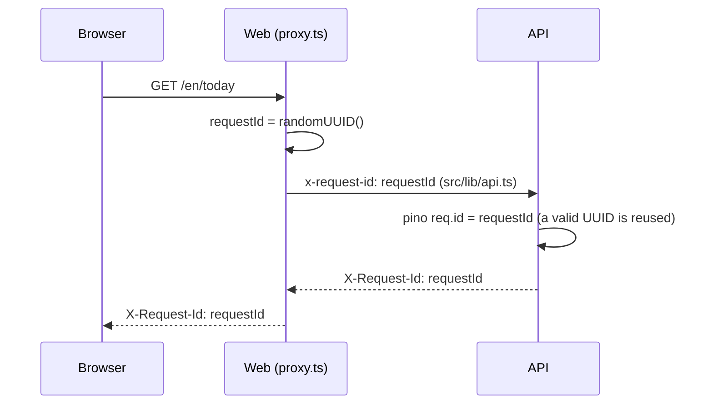

# Observability

How the web app, API and worker report errors and write logs (T-P2-PLAT-009). The normative requirements are SRS NFR-OBSERVABILITY-003/005 and NFR-PRIVACY-010. This document covers how they are implemented and the conventions new code follows. Tracing (OpenTelemetry) comes in P10 (DL-032).

## 1. Error reporting (Sentry)

| Process    | Where                                     | What is reported                                                            | Tags                                                  |
| ---------- | ----------------------------------------- | --------------------------------------------------------------------------- | ----------------------------------------------------- |
| API        | `ProblemDetailsFilter`                    | Every response with status ≥ 500 (the original exception)                   | `requestId`                                           |
| Worker     | `JobRunner`                               | A job's final failed attempt (retries exhausted), plus pg-boss internal errors | `queue`, `jobId`, `retryCount` (or `source: pg-boss`) |
| Web server | `src/instrumentation.ts` `onRequestError` | Server component, route handler and server action errors                    | `requestId`, `routePath`, `routeType`, `digest`       |
| Browser    | `src/lib/error-reporting.ts`              | Uncaught errors and unhandled rejections, plus errors caught by `error.tsx` | `digest` (error boundary)                             |

- **Configuration.** API and worker read `SENTRY_DSN` and `APP_RELEASE`. The web reads `NEXT_PUBLIC_SENTRY_DSN` and `NEXT_PUBLIC_APP_RELEASE`, which are inlined into the browser bundle at build time. Use one Sentry project per app. When no DSN is set, reporting is a no-op, the browser never downloads the Sentry SDK, and the CSP does not allow Sentry.
- **Release.** Set to the git SHA by the deploy pipeline (T-P2-PLAT-010). Uploading source maps privately (NFR-OBSERVABILITY-005) is also part of that task.
- **Errors only.** No tracing and no server-side default integrations. The browser keeps Sentry's default integrations, such as global handlers and breadcrumbs, with `sendDefaultPii` off.
- **Shared code.** `@dgd/observability` provides `scrubEvent` and `scrubString` for every runtime. `@dgd/observability/node` provides `createNodeReporter`, which the API, the worker and the web server share. It uses a Sentry scope per report and no global state.

### Correlation

- **One id end to end.** A page render and every API call it makes share one request id. It shows up in the web's Sentry event, the API's Sentry event, and the API's logs.
- **Server and browser.** A server render error and the browser's error-boundary report share the React `digest`.
- **Support.** A support request can be traced from the `X-Request-Id` response header.

## 2. Privacy (NFR-PRIVACY-010)

Every event passes through `scrubEvent` (`beforeSend`) before it leaves the process. The scrubbing is unit-tested in `packages/observability/src/scrub.spec.ts`, and the API test `test/observability.spec.ts` checks it on the real wire envelope.

| Rule                                                  | Example                                                                                       |
| ----------------------------------------------------- | --------------------------------------------------------------------------------------------- |
| Values under sensitive keys are replaced at any depth | `authorization`, `cookie`, `password`, `token`, `apiKey`, `journal*`, `*body*` → `[REDACTED]` |
| Request bodies and cookies are dropped                | `request.data`, `request.cookies`                                                             |
| Emails keep only the domain                           | `asha@example.com` → `[REDACTED]@example.com`                                                 |
| URL credentials are removed                           | `postgresql://u:pw@host` → `postgresql://[REDACTED]@host`                                     |
| Secret query parameters keep only their name          | `?token=abc`, `?code=…`, `?api_key=…` → `=[REDACTED]`                                         |

New code must not put secrets in URLs. Scrubbing is a safety net, not a licence.

## 3. Structured log conventions

Logs are JSON lines on stdout, one event per line, collected by the host. They are kept for 30 days (NFR-OBSERVABILITY-003). The API and worker use Pino through `nestjs-pino`; development pretty-prints them.

| Field                                                     | Meaning                                                                                                                                                                                                         |
| --------------------------------------------------------- | --------------------------------------------------------------------------------------------------------------------------------------------------------------------------------------------------------------- |
| `level`                                                   | Pino number: 20 debug, 30 info, 40 warn, 50 error                                                                                                                                                               |
| `time`                                                    | Epoch milliseconds                                                                                                                                                                                              |
| `msg`                                                     | Short, constant message. Variable data goes in fields, never inside `msg`. Always pass one with an error (`logger.error({ err }, 'db error')`): without it pino copies the unscrubbed `err.message` into `msg`. |
| `req.id`                                                  | Request id. It is on every line logged during a request.                                                                                                                                                        |
| `req.method`, `req.url`, `res.statusCode`, `responseTime` | On the one completion line per request (4xx at info, 5xx at error)                                                                                                                                              |
| `err`                                                     | `{ type, message, stack }`, only on error lines                                                                                                                                                                 |
| `context`                                                 | Nest logger context (class name)                                                                                                                                                                                |
| `userId`                                                  | **Pseudonymous user id** (UUID). Added by T-P2-AUTH-* once sessions exist. Never log emails or names.                                                                                                           |
| `queue`, `jobId`                                          | Worker job lines                                                                                                                                                                                                |
| `csp`                                                     | Web CSP violation summary: page and blocked origin/path, directive, disposition                                                                                                                                 |

**Rules:**

- Secret and private field names live in one list, `SENSITIVE_FIELDS` in `@dgd/observability`. Log redaction paths and Sentry scrubbing are both derived from it, so add new fields there. Logged errors go through the same `scrubEvent` as Sentry events.
- Health probes are not logged.
- Content the user wrote (deed notes, journal entries, posts) is never logged at any level.

## 4. CSP violation reports

- **How browsers report.** The page CSP (`apps/web/src/proxy.ts`) declares `report-to csp`, with `Reporting-Endpoints: csp="/api/csp-report"` and a `report-uri` fallback.
- **The endpoint.** `app/api/csp-report/route.ts` accepts both the Reporting API format and the legacy format. It caps the body at 16 KB (413) and rejects invalid JSON (400). Each violation becomes one `warn` log line, with URLs reduced to origin and path. Nothing is stored.
- **Alerting** on violation volume is part of the P10 alerting work (NFR-OBSERVABILITY-006).
