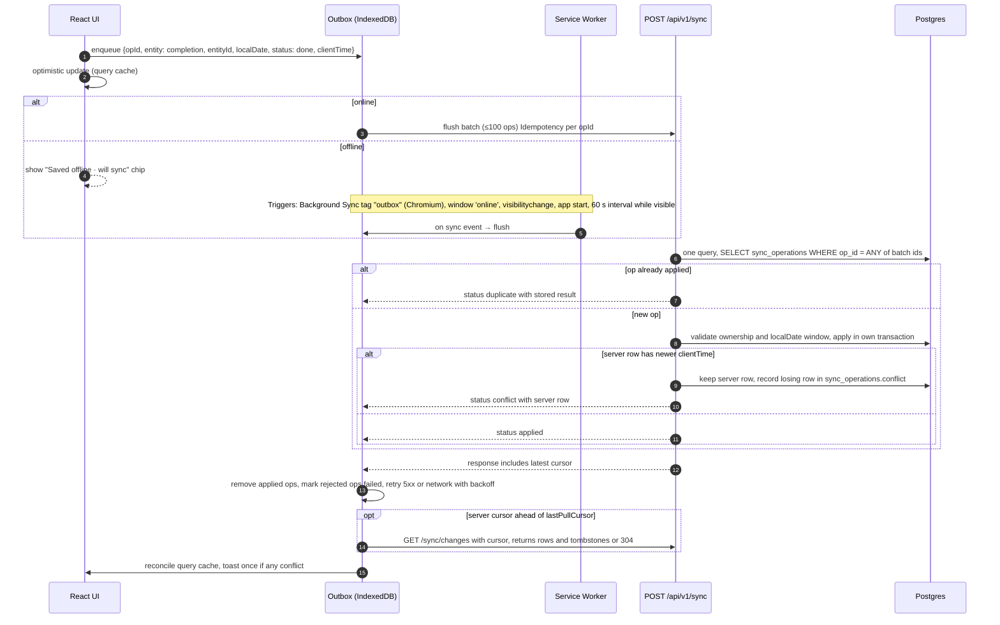

# PWA Architecture

> Status: Proposed. Features: F-PWA-001…009. Phase split: shell, manifest, responsive nav, and in-app-browser handling in **P2**; offline data, outbox, sync, and the update flow in **P9**.

## 1. Goals and non-goals
- **Goals:** installable on Android and desktop Chromium, and on iOS Safari via Add to Home Screen. Fast repeat loads. Offline completions that sync reliably. **What works offline**, and the storage limits, are defined only in the SRS §18 offline matrix and NFR-PRIVACY-004 (DL-021). This doc covers the mechanism.
- **Non-goals:** journals offline in v1, whether reading or editing. Journals are never stored in IndexedDB, for privacy. Offline admin is also a non-goal.

## 2. Manifest (F-PWA-001)
There is **one** manifest, `app/manifest.ts` served as `/manifest.webmanifest` (DL-028). It contains:
- `name: "Daily Good Deeds"` and a `short_name`
- `scope: /` and `start_url: /today?source=pwa`. Middleware redirects to `/{locale}/today` using the locale cookie, so switching language never leaves the installed app's scope.
- `display: standalone`, with theme and background colours taken from the design tokens
- icons at 192 and 512, plus maskable variants
- two `shortcuts`: Today and Tasbih (Tasbih is added with its page in P5; until then only Today)

`name`, `short_name`, `description` and shortcut names are in the visitor's language (locale cookie, then `Accept-Language`), since the manifest is fetched once at install time. Icons are rendered from one SVG mark by `next/og` at build time (`src/lib/brand-icon.tsx`), with no binary assets in the repo.

A single scope is used because per-locale scopes would drop out of standalone mode when the user switches language. An installed app's name is fixed at install time anyway.

## 3. Service worker (Serwist, ADR-011)

### 3.1 Caching strategy per route/request type
Implemented in `apps/web/src/sw.ts`, bundled by `@serwist/turbopack` (Turbopack has no plugin hook, so a static route, `src/app/serwist/[path]/route.ts`, builds it) and served as `/serwist/sw.js` with `Service-Worker-Allowed: /`. The CSP adds `worker-src 'self'`, because `'strict-dynamic'` makes `script-src` ignore `'self'`. Production builds only. The offline pages `/en/offline` and `/bn/offline` are precached, versioned by the commit. When the first install takes control of an already-loaded page, the page asks the worker to save it, so "visited once" holds from the first visit. Page matching covers navigations and the provider's `CACHE_URLS` fetches after client-side navigation, never RSC payloads.

| Request | Strategy | Cache name | Expiry | Notes |
|---|---|---|---|---|
| Build assets (`/_next/static/*`) | Precache (revisioned) | `precache` | per build | Immutable |
| App shell HTML for `(app)` routes | **NetworkFirst**, 3 s timeout → cached shell | `pages` | 50 entries / 7 d | Offline fallback `/{locale}/offline` if never visited. Journal routes are excluded |
| `(public)` marketing pages | StaleWhileRevalidate | `public-pages` | 30 entries / 7 d | |
| Auth pages, `/admin/*` | **NetworkOnly** | — | — | Never cached |
| Fonts (self-hosted woff2) | CacheFirst | `fonts` | 1 y | Bengali font subsets |
| Images/icons | CacheFirst | `images` | Per NFR-PERFORMANCE-002 | |
| API GET reads (`/api/v1/*`) | **Not cached by the SW.** TanStack Query persists selected queries to IndexedDB instead. | — | — | Avoids caching personalized responses in shared Cache Storage and keeps auth/locale variance correct |
| Public content API (`/categories`, `/deeds?system=true`, `/islamic/duas`, `/islamic/hadith/today`) | StaleWhileRevalidate | `content-api` | 1 d | Locale in the URL → cache key safe |
| API mutations | NetworkOnly, with the outbox fallback in app code | — | — | |

On logout: clear the `pages` and `content-api` caches, delete the IndexedDB database, and `postMessage` the SW to drop personalized entries.

### 3.2 IndexedDB schema (`dgd-v1`, via `idb`)

| Store | Key | Indexes | Contents | Max |
|---|---|---|---|---|
| `meta` | key | — | `userId`, `schemaVersion`, `lastPullCursor` (the server's `change_seq`), `lastSyncAt`, `tz` | — |
| `queryCache` | queryHash | `updatedAt` | Persisted TanStack queries on an allowlist: `GET /today`, recent checklist days, plans, categories, streak summary, prayer-time params, dhikr presets and preferences. Never journals | Window per NFR-PRIVACY-004 |
| `outbox` | opId (uuidv7) | `status`, `createdAt`, `entity` | `{opId, entity, entityId, action, payload, clientTime, attempts, lastError, status: pending\|inflight\|failed}` | 1 000 ops. The UI warns at 500 |
| `entities.completions` | id | `[localDate]`, `[planId+localDate]` | Local mirror for optimistic UI | Window per NFR-PRIVACY-004 |
| `entities.tasbih` | presetId+localDate | — | Counter state (works fully offline) | Window per NFR-PRIVACY-004 |

The DB is namespaced per user. When a different user logs in, the old DB is deleted.

## 4. Responsive navigation (F-PWA-002)
Mobile (< 768 px): bottom tab bar (Today, Calendar, Islamic*, Journal, More), where Islamic is replaced by Growth if the module is opted out. Tablet: collapsible rail. Desktop (≥ 1024 px): sidebar. Details are in [../design/NAVIGATION_MAP.md](../design/NAVIGATION_MAP.md).

## 5. Offline outbox & synchronization

**Rules**
- Ops are applied in `createdAt` order per entity. A batch never mixes users. The protocol rules (status values, row-level LWW on `clientTime`, clamping) are in SRS §19, and the wire format is in API_SPECIFICATION §10 (DL-015).
- `rejected` ops (validation, 403, outside the edit window, `LOCAL_DATE_OUT_OF_RANGE`) move to `failed`. The UI explains why in the user's language and offers to discard or edit.
- Conflicts are resolved on the server. The client shows a single localized "updated on another device" toast. There is no conflict store and no review UI.
- Completions are idempotent on `(user_id, deed_plan_id, local_date)`, so a double tap across devices is harmless.
- When the session expires while offline, the outbox is kept. After re-login as the **same** user it flushes; for a different user it is discarded (with a warning before logout if pending ops exist).

## 6. In-app browser compatibility (F-PWA-007, F-PWA-008)

Detection uses UA heuristics (`FBAN|FBAV|FB_IAB` Facebook, `Messenger`, `Instagram`, `Telegram` (Android `TelegramBot`/WebView markers; iOS Telegram uses SFSafariViewController in many versions), `Line/`, `; wv)` generic Android WebView) **combined with capability checks**, never UA alone.

| Environment | Install | Service worker | Web Push | Google OAuth | IndexedDB | Strategy |
|---|---|---|---|---|---|---|
| Chrome Android / Edge / Samsung Internet | ✅ prompt | ✅ | ✅ | ✅ | ✅ | Full |
| Desktop Chrome/Edge | ✅ | ✅ | ✅ | ✅ | ✅ | Full |
| Desktop Firefox | ❌ install | ✅ | ✅ | ✅ | ✅ | No install prompt; everything else works |
| Safari macOS 17+ | ✅ Add to Dock | ✅ | ✅ | ✅ | ✅ | Full |
| Safari iOS 16.4+ (browser tab) | Manual "Add to Home Screen" guidance | ✅ | ❌ (only when installed) | ✅ | ✅ (may be evicted after 7 days of no use) | Show install guide; push after install |
| iOS installed PWA (16.4+) | — | ✅ | ✅ (permission on user gesture) | ✅ | ✅ | Full minus Background Sync |
| Facebook / Messenger / Instagram IAB | ❌ | ⚠ varies | ❌ | ❌ (Google `disallowed_useragent`) | ⚠ ephemeral | Banner "Open in browser" (Android: `intent://` link to Chrome; iOS: instruct "⋯ → Open in Safari"); email login works inside |
| Telegram in-app | ❌ | ⚠ | ❌ | ⚠ | ⚠ | Same as above |
| Generic Android WebView | ❌ | ❌ usually | ❌ | ❌ | ⚠ | Online-only mode |

**Graceful degradation:** feature-detect `serviceWorker`, `PushManager`, `Notification`, `SyncManager`, `BeforeInstallPromptEvent`, `navigator.storage.persist`, `indexedDB` (open test), `Intl` islamic calendar support, and `SpeechRecognition`. The UI hides or explains anything unsupported. It never throws.

### 6.1 Capability fallbacks (F-PWA-008)

Every check goes through `apps/web/src/lib/capabilities.ts` (`supports()`, `useCapability()`; false on the server and during hydration, and a throwing getter counts as unsupported). Code never touches an optional API without it. Rows marked *(planned)* describe the fallback the feature must implement when it lands.

| Capability | Used for | When missing |
|---|---|---|
| `serviceWorker` | Offline shell, update prompt (F-PWA-003/009) | Online-only: pages load from the network; no offline notice or update toast. Covered by `e2e/degraded.spec.ts` |
| `cacheStorage` | Offline page's saved-section list | The list reads as "no pages saved yet" |
| `installPrompt` | Install button (F-PWA-001) | No install banner, except iOS Add to Home Screen steps |
| `clipboard` | "Copy link" in the in-app browser banner (F-PWA-007) | The link is shown as selectable text instead of the button |
| `persist` | Keeping offline data for installed apps | Nothing requested; the server stays the source of truth |
| `push`, `notifications` | Web Push (F-NOTIF-006) *(planned)* | Push settings hidden with an explanation; in-app and email notifications still work |
| `backgroundSync` | Outbox flush (P9) *(planned)* | Flush on foreground and on `online` (already the iOS path) |
| `share` | Sharing (P7) *(planned)* | Copy-link fallback (`clipboard`, else selectable text) |
| `indexedDb` | Offline data, outbox (P9) *(planned)* | Online-only mode with the offline notice |
| `vibration`, `wakeLock` | Tasbih haptics, screen-on (P5) *(planned)* | Silent counting; screen may sleep |
| `geolocation` | Prayer times (P5) *(planned)* | Manual city search |
| `badging` | Unread count on the app icon (P6) *(planned)* | No badge; in-app count only |
| `mediaRecorder` | Voice notes *(planned)* | Voice input hidden |

## 7. iOS limitations (documented, not hidden)
- No `beforeinstallprompt`; we show a manual guide.
- Push only for home-screen installs; requests must come from a user gesture.
- No Background Sync; we flush on foreground.
- Storage may be evicted after 7 days without interaction, unless the app is installed. We call `navigator.storage.persist()` where allowed. The server is the source of truth.
- No widgets for PWAs (the Android widget is native, ADR-012). iOS widgets are out of scope.

## 8. Update flow (F-PWA-009)
The new SW installs and waits. The app shows a localized "A new version is available — Refresh" toast. On accept, it sends `SKIP_WAITING` and reloads after flushing the outbox. A forced update (security) happens when the API returns `426` with `minWebBuild`.

## 9. Performance budgets (feed NFR-PERFORMANCE)
JS for the `today` route ≤ 170 KB gzip; LCP ≤ 2.5 s on a Moto G Power–class device on 4G; INP ≤ 200 ms; CLS ≤ 0.1; Bengali font subset ≤ 120 KB, loaded with `font-display: swap` and preloaded for `bn`.
