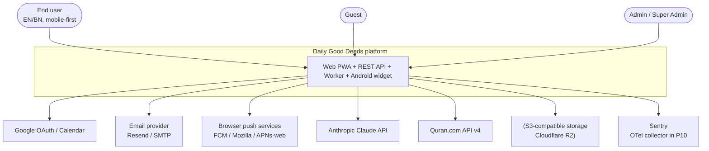
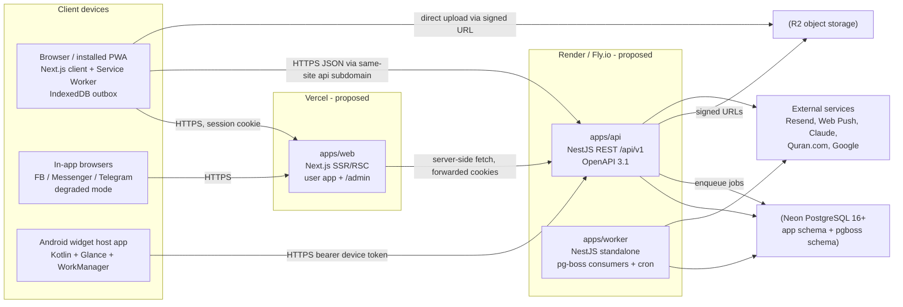
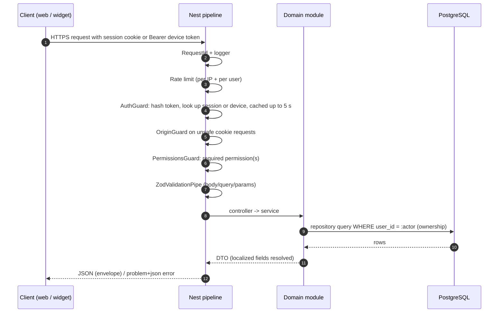

# System Architecture

> Status: **Proposed (planning stage)**. Nothing described here is implemented yet. Decisions reference [ARCHITECTURE_DECISIONS.md](ARCHITECTURE_DECISIONS.md); confirmed decisions D-1…D-8 are listed in [../README.md](../README.md#3-confirmed-decisions-user-approved-2026-10-30).

## 1. Architectural style

The system is a **modular monolith** (ADR-001). It has one NestJS codebase that runs as two processes: the `api` HTTP process and the `worker` job process. Alongside it are a **Next.js PWA** (ADR-002) and a separate **Kotlin widget host app** (ADR-012). All persistent state lives in **one managed PostgreSQL** database (ADR-003). Background work runs on **pg-boss** in that same database (ADR-005).

Why: the product has many domains (deeds, Islamic, community, AI…) but modest initial scale and a small team. Module boundaries inside one deployable unit give clean separation without distributed-system cost. Modules talk only through exported service interfaces and domain events, so any one of them can later be extracted.

## 2. System context (C4 level 1)

## 3. Containers (C4 level 2)

### Container responsibilities

| Container | Responsibilities | Not responsible for |
|---|---|---|
| `apps/web` | Rendering (RSC/SSR for first paint, client components for interactivity), routing, i18n UI, PWA shell, service worker, IndexedDB outbox, admin UI | Business rules, authorization decisions (the UI only hides controls; the API enforces), DB access |
| `apps/api` | Auth, RBAC enforcement, validation, domain logic, persistence, OpenAPI, rate limiting, audit logging, job enqueueing, sync endpoint | Long-running work (> 2 s) or scheduled work |
| `apps/worker` | Reminders, digests, report generation, exports, future-letter delivery, AI batch jobs, streak rebuilds, cleanup, Quran cache refresh | Serving HTTP |
| `apps/android-widget` | Glance widgets, device linking, local cache and offline queue, deep links | Any feature UI beyond widgets and settings (the product stays web) |
| PostgreSQL | System of record, queue (pg-boss), idempotency records | Caching large blobs |
| R2 | Attachments, export files | Anything that must be queried |

## 4. Deployment topology (proposal, ADR-017)

| Environment | Web | API + Worker | DB | Notes |
|---|---|---|---|---|
| Local dev | `next dev` | `nest start --watch` (two processes) | Neon dev branch | No Docker needed |
| Preview (per PR) | Vercel preview | Render preview / Fly machine (API only: **no worker or cron**, so the Neon branch can auto-suspend, DL-026) | Neon branch from staging | Seeded synthetic data only |
| Staging | Vercel | Render/Fly (1× api, 1× worker) | Neon `staging` | Mirrors prod config |
| Production | Vercel (functions pinned to `sin1`) | Render/Fly (≥2× api, 1–2× worker) in Singapore | Neon `main` + PITR (`aws-ap-southeast-1`) | Custom domain: `app.<domain>`, `api.<domain>`. The API uses the pooled URL; the worker and migrations use the direct URL (DL-026) |

**Same-site requirement:** web and API must be served from sibling subdomains of one registrable domain (`app.example.org` and `api.example.org`). The session cookie is then `SameSite=Lax` + `Secure` + `HttpOnly` (DL-012), and same-site requests carry it. Third-party cookie restrictions would break a cross-site API.

## 5. Cross-cutting concerns

| Concern | Approach | Detail doc |
|---|---|---|
| Identity & sessions | Own auth: Argon2id. Opaque, DB-backed session cookie for the web and opaque device tokens for the widget, both stored hashed and revocable immediately. No JWTs (DL-012) | ADR-006/007, [../api/AUTHENTICATION.md](../api/AUTHENTICATION.md) |
| Authorization | Permission-based RBAC (codes in the [catalog](../api/API_SPECIFICATION.md) §0) enforced by Nest guards, plus ownership checks in repositories (`user_id` scoping) | [COMPONENT_ARCHITECTURE.md](COMPONENT_ARCHITECTURE.md) |
| Time & dates | Each activity record stores `local_date` (DATE) in the user's IANA timezone at the time of the action, plus `occurred_at timestamptz` | ADR-008 |
| Localization | UI catalogs in git (`packages/i18n`); content translations in `*_translations` tables; API returns localized content according to `Accept-Language` / user pref | ADR-015/016 |
| Offline & sync | IndexedDB outbox with per-op `opId`; `POST /sync` batch push and `GET /sync/changes` delta pull on a `change_seq` cursor; row-level LWW on `clientTime` (DL-015) | ADR-010, [PWA_ARCHITECTURE.md](PWA_ARCHITECTURE.md) |
| Privacy | Journals encrypted at application level with a single versioned key (DL-030); worship data private by default; AI data minimization | ADR-014, [AI_ARCHITECTURE.md](AI_ARCHITECTURE.md) |
| Observability | Pino JSON logs with request ID and Sentry errors (web, api, worker, Android) from P2. OpenTelemetry traces in P10 (DL-032). `/health/live`, `/health/ready`, pg-boss metrics | — |
| Rate limiting | `@nestjs/throttler` with an in-memory store and 3 tiers. A Postgres counter is used only for login and password reset. Redis comes later, only if needed. Limits are defined in one table (DL-014) | [../api/API_CONVENTIONS.md](../api/API_CONVENTIONS.md) |
| Feature flags | `feature_flags` booleans (optional role allowlist), cached 30 s in-process, evaluated server-side and exposed via `/me`. A/B testing lives only in `experiments` (P10) | F-ADMIN-009, ADR-022 |
| Audit | `audit_logs` is a plain, append-only table with no partitions (ADR-021). The app role has no UPDATE or DELETE grants, except for the nightly retention purge | F-RBAC-005 |
| Backups | Neon PITR (7–30 days per plan) + nightly logical dump to R2 (encrypted), restore drill each release | NFR-BACKUP |

## 6. Request lifecycle (authenticated API call)

## 7. Data flow principles

1. **The API is the only writer** to the database. The web server never connects to the DB directly. This keeps one enforcement point for RBAC.
2. **Derived data is rebuildable.** `streaks`, `growth_snapshots`, and report aggregates can be recomputed from `deed_completions`, which is the source of truth.
3. **Domain events** (in-process `EventEmitter2`, persisted to pg-boss when async work is needed): `completion.recorded`, `goal.completed`, `user.deleted`, `post.reported`, … Modules subscribe instead of calling each other directly across boundaries.
4. **Idempotent writes** for every client-originated mutation that can be retried (`Idempotency-Key` header or `sync_operations.client_op_id`).

## 8. Scalability path (no premature work)

| Trigger (measured) | Action |
|---|---|
| p95 API latency > 300 ms on read aggregates | Materialized aggregates table refreshed by worker; HTTP caching on public content |
| Throttler state contention / > 3 api instances | Introduce Redis (Upstash) for rate limiting + cache (ADR-005 revisit) |
| pg-boss throughput > ~500 jobs/s sustained | Move hot queues to BullMQ/Redis or split worker pools |
| DB CPU > 70 % sustained | Neon autoscaling, read replica for reporting endpoints |
| A module needs an independent release cadence or scaling (likely candidates: AI, notifications) | Extract it as a service using its existing interface |

## 9. Related documents
- [ARCHITECTURE_DECISIONS.md](ARCHITECTURE_DECISIONS.md) · [COMPONENT_ARCHITECTURE.md](COMPONENT_ARCHITECTURE.md) · [API_ARCHITECTURE.md](API_ARCHITECTURE.md) · [INTEGRATION_ARCHITECTURE.md](INTEGRATION_ARCHITECTURE.md) · [PWA_ARCHITECTURE.md](PWA_ARCHITECTURE.md) · [ANDROID_WIDGET_ARCHITECTURE.md](ANDROID_WIDGET_ARCHITECTURE.md) · [AI_ARCHITECTURE.md](AI_ARCHITECTURE.md)
