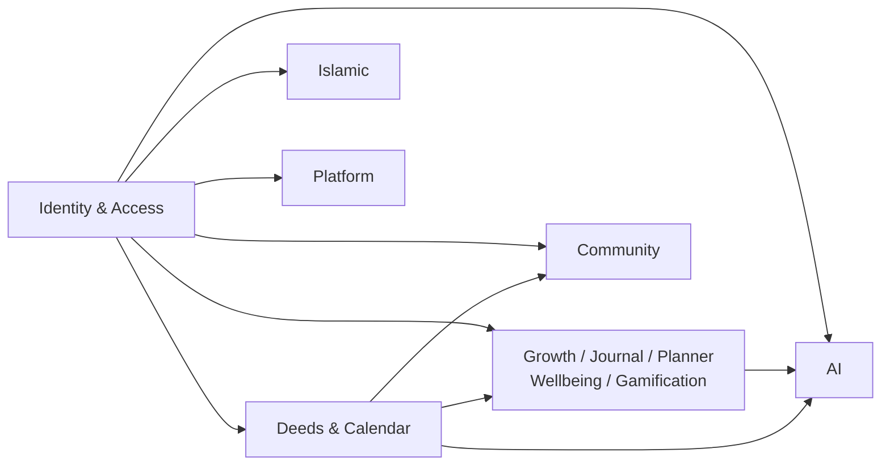
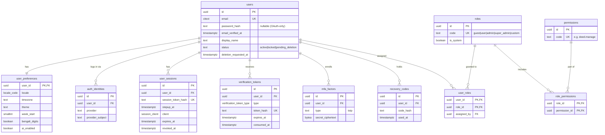
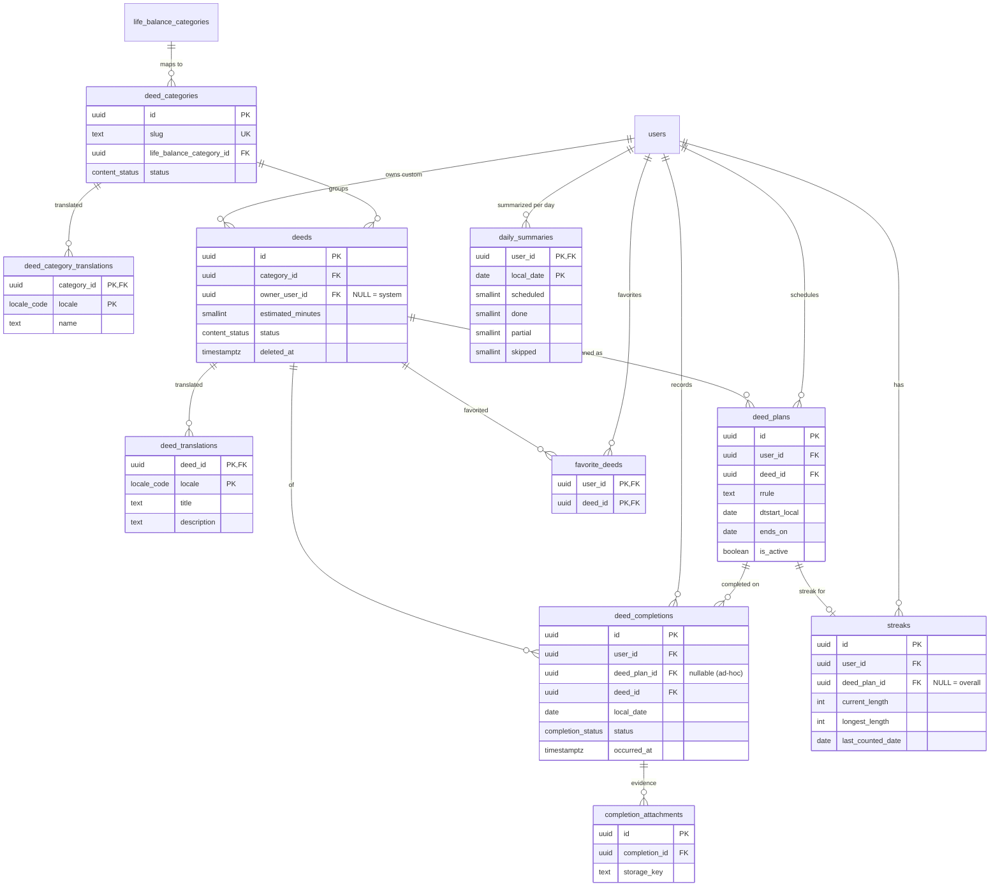
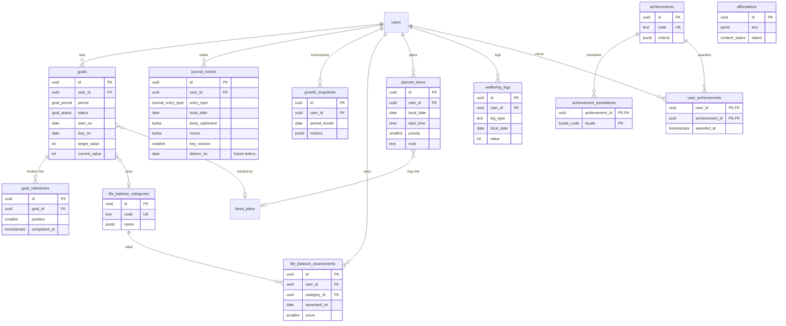
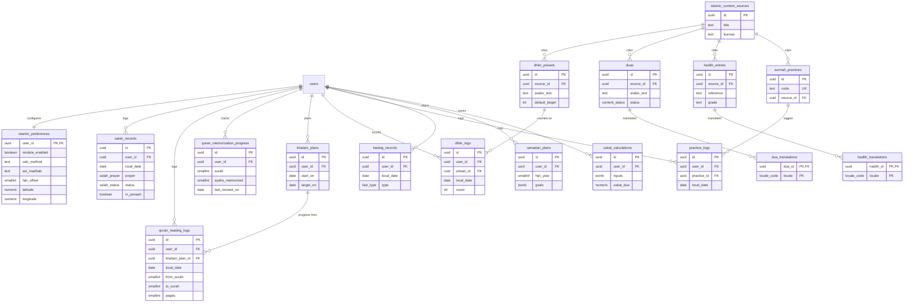
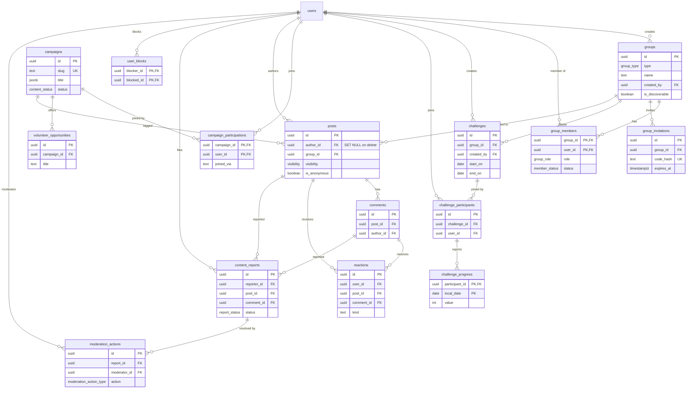
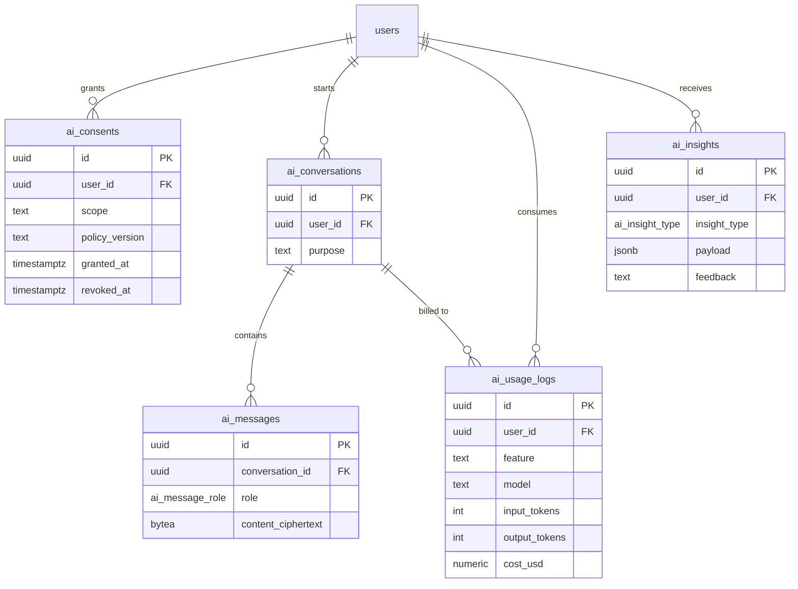

# Entity-Relationship Diagrams

> Status: Specification. The diagrams show keys and the attributes that define relationships. Full columns are in [DATA_DICTIONARY.md](DATA_DICTIONARY.md).
> `users` appears in every domain diagram as the ownership anchor. Except where noted, all user-owned tables are `ON DELETE CASCADE` from `users`.

## 0. Domain overview

Table counts per domain are listed only in [docs/README.md §6](../README.md).

## 1. Identity & access

## 2. Deeds & calendar

## 3. Growth, journal, planner, wellbeing & gamification

## 4. Islamic

## 5. Community

## 6. AI

## 7. Platform

```mermaid
erDiagram
  users ||--o{ notifications : "receives"
  users ||--o{ notification_preferences : "sets"
  users ||--o{ reminders : "schedules"
  users ||--o{ push_subscriptions : "registers"
  users ||--o{ widget_devices : "links"
  users ||--o{ sync_operations : "submits"
  users ||--o{ export_jobs : "requests"
  users ||--o{ api_clients : "owns"
  users ||--o{ audit_logs : "actor"
  users ||--o{ content_versions : "edits"
  users ||--o{ idempotency_keys : "replays"
  users ||--o{ broadcasts : "creates"
  users ||--o{ experiments : "updates"

  notifications {
    uuid id PK
    uuid user_id FK
    text type
    notification_channel channel
    timestamptz read_at
  }
  notification_preferences {
    uuid user_id PK,FK
    text type PK
    notification_channel channel PK
    boolean enabled
  }
  reminders {
    uuid id PK
    uuid user_id FK
    time local_time
    text rrule
    timestamptz next_fire_at
  }
  push_subscriptions {
    uuid id PK
    uuid user_id FK
    text endpoint UK
  }
  widget_devices {
    uuid id PK
    uuid user_id FK
    text token_hash UK
    timestamptz last_seen_at
  }
  sync_operations {
    uuid user_id PK,FK
    uuid op_id PK
    text entity
    jsonb result
  }
  audit_logs {
    uuid id PK
    timestamptz occurred_at
    uuid actor_user_id
    text action
    text entity_type
  }
  system_settings {
    text key PK
    jsonb value
  }
  feature_flags {
    text key PK
    boolean enabled
    text_array allowed_roles
  }
  idempotency_keys {
    uuid user_id PK,FK
    text key PK
    text request_hash
    jsonb response
    timestamptz created_at
  }
  broadcasts {
    uuid id PK
    uuid created_by FK
    text status
    timestamptz scheduled_at
    jsonb translations
  }
  experiments {
    text key PK
    jsonb variants
    text status
    uuid updated_by FK
  }
  content_versions {
    uuid id PK
    text entity_type
    uuid entity_id
    int version
    jsonb snapshot
  }
  export_jobs {
    uuid id PK
    uuid user_id FK
    text kind
    export_status status
  }
  api_clients {
    uuid id PK
    uuid owner_user_id FK
    text key_prefix UK
    text_array scopes
  }
```

Note: `audit_logs` deliberately has **no FK** to `users`, so it survives account purge (rows are pseudonymized instead). The `users ||--o{ audit_logs` line above is logical only.
