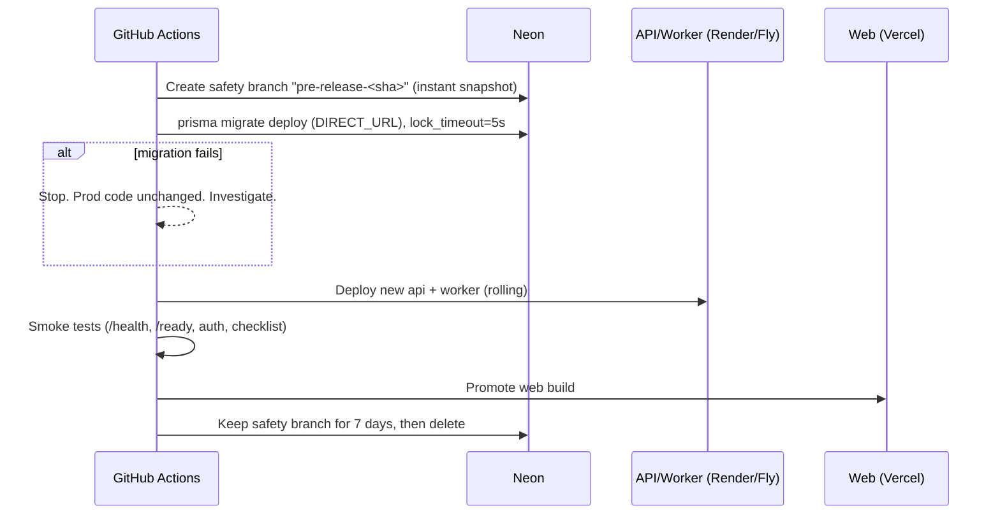

# Migration Strategy

> Status: Specification. Tooling: **Prisma Migrate** against **Neon PostgreSQL 16+**.

## 1. Environments and branches

| Environment | Neon branch | Purpose | Migrations applied by |
|---|---|---|---|
| Local dev | `dev-<developer>` (branched from `staging`) | Individual development | `prisma migrate dev` (developer) |
| CI | Ephemeral `ci-<run-id>` branched from `main`/staging, deleted after the run | Migration and integration tests | `prisma migrate deploy` in CI |
| Preview (per PR) | `preview-pr-<n>`, branched from `staging` (contains anonymized seed data, **never** production data) | Vercel/Render preview deployments | `prisma migrate deploy` in the preview deploy hook. The branch is deleted when the PR closes |
| Staging | `staging` | Pre-release verification | Release pipeline |
| Production | `main` (Neon primary) | Live | Release pipeline, behind a manual approval gate |

Connection strings (DL-026):
- `DATABASE_URL`: the API uses Neon's **pooled** (PgBouncer, transaction mode) endpoint with `?pgbouncer=true&connection_limit=5`, so Prisma disables prepared-statement caching and keeps a small per-instance pool.
- `DIRECT_URL`: the **unpooled** endpoint. Prisma Migrate uses it because it needs session-level advisory locks.
- `WORKER_DATABASE_URL`: the long-lived worker (pg-boss uses `LISTEN`/advisory locks) connects to the **direct** endpoint with a small fixed pool (max 5), and pg-boss runs with a longer polling interval.
- **Preview and CI branches run no worker or cron**, so their Neon compute can auto-suspend.

## 2. Ownership and tooling

- `apps/api/prisma/schema.prisma` is the single schema. Migrations live in `apps/api/prisma/migrations/` and are **committed to git and never edited after merge**.
- Things Prisma cannot express are written as hand-edited SQL in the generated migration file (`prisma migrate dev --create-only`, then edit):
  - partial and expression indexes
  - GIN trigram indexes
  - generated `tsvector` columns
  - CHECK constraints
  - `NULLS NOT DISTINCT`
  - enum `ADD VALUE`
  - database role grants
- Each of these must have a matching assertion in the schema test suite (`apps/api/test/schema/*.spec.ts`). The suite queries `pg_indexes` and `pg_constraint` so that a later `migrate dev` cannot silently drop them (schema drift check).
- The **pg-boss** schema (`pgboss`) is created and migrated by pg-boss itself when the worker starts. It is excluded from Prisma (`schemas = ["public"]`).
- Required extensions (`citext`, `pg_trgm`, `pgcrypto`) are created in the first migration with `CREATE EXTENSION IF NOT EXISTS`.

## 3. Migration rules (reviewed in every PR touching `prisma/`)

1. **Backward compatible with the currently deployed code.** The API is deployed after migrations run, so for a short window the old code runs against the new schema.
2. **Expand → migrate → contract** for any breaking change:
   - **Expand:** add the new column or table as nullable or with a default. Add the new index `CONCURRENTLY`. The code writes to both old and new.
   - **Migrate:** backfill in batches (see §5). The code reads from the new.
   - **Contract:** in a later release (at least 1 deploy later), drop the old column or table.
   - Example, renaming `deeds.title`: add `title_v2` → dual-write → backfill → switch reads → drop `title`. Renames are never done in one step.
3. **No long locks on hot tables:**
   - `CREATE INDEX CONCURRENTLY` (in its own migration file, because it cannot run inside a transaction; mark the file with `-- prisma-migrate: no-transaction`, or run it through the `scripts/migrate-concurrent.ts` helper).
   - Add `NOT NULL` via `CHECK (...) NOT VALID` → `VALIDATE CONSTRAINT` → `SET NOT NULL`.
   - Add FKs with `NOT VALID` and then `VALIDATE`.
   - `SET lock_timeout = '5s'` and `statement_timeout` at the top of each migration.
4. **Enums:** only `ADD VALUE`. Values are never removed or renamed. To retire a value, stop writing it and map it in code.
5. **Destructive operations** (`DROP TABLE`, `DROP COLUMN`, `TRUNCATE`, type narrowing) need the `db-destructive` PR label, a reviewer sign-off, and a verified backup (a Neon branch snapshot taken by the pipeline) right before production apply.
6. **Every migration must pass**, in CI:
   - apply on an empty database
   - apply on a seeded database at `main`
   - the schema assertion suite
   - integration tests

## 4. Deployment sequence (production)

Concurrent-index migrations run as a separate pipeline step before the main `migrate deploy` when they are flagged.

## 5. Data backfills

- Backfills are **pg-boss jobs**, not migrations. They are idempotent and resumable, and run in batches of 1,000–5,000 rows keyed by primary-key ranges. A sleep between batches keeps replication lag and CPU in check.
- Each backfill job lives in `apps/api/src/backfills/<yyyymmdd>-<name>.ts`. It records progress in `system_settings['backfill.<name>']` (`{cursor, done}`) and reports through the job monitor (F-ADMIN-014).
- Derived caches have standing rebuild jobs (`streaks.rebuild:{userId}`, which also rebuilds `daily_summaries`; `growth:snapshot`; `posts:recount`). Any change to the streak algorithm or the snapshot metrics bumps `algorithm_version` and enqueues a rebuild.

## 6. Seed data

Seeds are split into **reference seeds**, which are required in every environment including production, and **demo seeds**, which are allowed only in dev, preview, and CI. Reference seeds are idempotent upserts keyed by `code` or `slug`. They are versioned in `apps/api/prisma/seed/reference/*.ts` and run by `pnpm db:seed:reference` as part of deployment. Demo seeds use clearly fake data (the `@example.test` domain) and are blocked from running when `NODE_ENV=production`, in line with the "no mock data in production" rule.

| Seed | Contents | Source / review | Phase |
|---|---|---|---|
| `roles` | guest, user, admin, super_admin (`is_system = true`, ranks 0/10/50/100) | ADR on RBAC | P2 |
| `permissions` + `role_permissions` | The permission catalog and default role mapping defined in [api/API_SPECIFICATION.md §0](../api/API_SPECIFICATION.md). Roles are fixed and seeded; there is no role editor before P10 (DL-032) | The `access` module's permission registry is the code source of truth. The seed syncs the DB to it | P2 |
| First super admin | **Not seeded.** Created with the CLI `pnpm admin:bootstrap --email …` (one-time, audited, refused if a super admin already exists) | Security | P2 |
| `system_settings` | One row per key in the [Settings registry](DATA_DICTIONARY.md#settings-registry), with its default | Settings registry | P2 |
| `feature_flags` | All flags present as booleans, with safe defaults (`ai` = off, `community.public_feed` = off, `widget.interactive` = off) | | P2 |
| `life_balance_categories` | The 8 categories with EN/BN names | Product owner + BN reviewer | P3 |
| `deed_categories` + translations | About 10 categories (Kindness, Family, Health, Learning, Environment, Community, Spiritual, Self-discipline, Charity, Digital wellbeing) | Product owner + BN reviewer | P3 |
| `deeds` + translations | About 150 curated deeds (EN/BN), each tagged with minutes and effort, published | Product owner + BN reviewer, through the content-versioning workflow | P3 |
| `achievements` + translations | About 30 badges (first deed, 7/30/100-day streaks, category explorer, …). No worship-quantity comparisons between users | Product + ethics review (no shame or comparison) | P4 |
| `affirmations` | About 60 EN/BN affirmations | Product owner + BN reviewer | P4 |
| `islamic_content_sources` | Quran.com API, Sahih al-Bukhari, Sahih Muslim, Riyad as-Salihin, Hisnul Muslim, etc., with license notes | Islamic content reviewer | P5 |
| `sunnah_practices` | About 25 practices including `tahajjud`, each with source references | Islamic content reviewer; kept as `draft` until the reviewer publishes it (`in_review` is reserved for duas, hadith and dhikr presets, DL-031) | P5 |
| `dhikr_presets` | About 15 common adhkar (SubhanAllah, Alhamdulillah, Allahu Akbar, morning/evening adhkar) with sources | Islamic content reviewer | P5 |
| `duas` / `hadith_entries` | Curated starter set (about 100 duas, about 365 hadith for the daily rotation) with sources and gradings | Islamic content reviewer. **Nothing is published without `verified_by`** | P5 |
| Demo seed | 3 demo users, 60 days of completions, journals (encrypted with the dev key), a family group | Dev, preview, and CI only | P2+ |

Quran text and translations are **not seeded**. They are fetched from the Quran.com API and cached (HTTP cache plus an application cache). See `docs/architecture/INTEGRATION_ARCHITECTURE.md`.

## 7. Rollback policy

- **Roll forward by default.** A faulty migration is fixed with a new corrective migration. Prisma has no down migrations, and we do not hand-write them.
- **Application rollback** is always safe, because the expand/contract rule guarantees the previous app version works with the current schema.
- **Catastrophic data corruption:** restore using Neon point-in-time restore to a new branch at a timestamp just before the incident. Verify on that branch, then either repoint `DATABASE_URL` (fast) or copy the affected rows back (surgical). The runbook lives in `docs/implementation/` (it is a RELEASE_CHECKLIST item).
- The pre-release safety branch from §4 gives an immediate snapshot for the 7 days after each deploy.

## 8. Backup and point-in-time recovery

| Mechanism | Retention | RPO | RTO | Verified |
|---|---|---|---|---|
| Neon PITR (WAL history) | 7 days (Launch plan) → **30 days on the Scale plan, recommended for production** | ≈ seconds | Under 15 min (branch from a timestamp, then switch the connection string) | Monthly restore drill on staging |
| Nightly logical dump (`pg_dump -Fc`, excluding `pgboss`) to R2, encrypted (age/GPG) | Per SRS NFR-BACKUP-002 | 24 h | Under 2 h | Weekly automated restore into an ephemeral branch, with row-count checks; status shown in the backup monitor (F-ADMIN-015) |
| Pre-release branch snapshot | 7 days | Release point | Minutes | Each release |

Backup encryption keys are stored separately from database credentials. Journal and AI ciphertext stays encrypted inside the dumps, and the application encryption key is never included in a dump.

## 9. Phase-by-phase schema rollout

Which tables each phase creates is defined only in [docs/README.md §6](../README.md) (the "Tables by creating phase" column). Each phase's first migration creates exactly the tables listed there for that phase, plus:

| Phase | Additional schema work |
|---|---|
| P2 | Extensions; the enums used in P2; reference seeds; the `change_seq_global` sequence and the trigger function that later syncable tables attach to |
| P3 | The `change_seq` trigger on the P3 syncable tables (they carry the sync columns from day one, even though `/sync` ships in P9) |
| P4–P8 | Sync columns and trigger on each new syncable table; `account:purge` extended to the phase's new user-owned tables |
| P9 | `/sync` starts using the existing `change_seq` columns; no backfill is needed |
| P10 | Optional RLS policies; partitioning of any table whose measured trigger is met (DL-027) |
