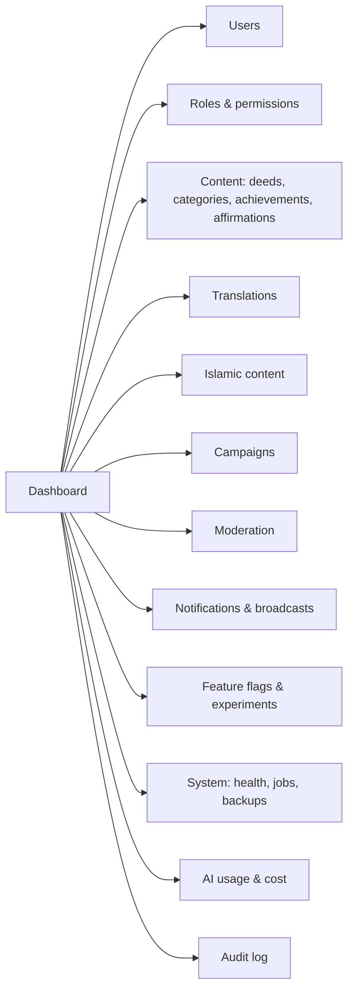

# Navigation Map

All user-facing routes are locale-prefixed (`/en/...`, `/bn/...`). Routes below omit the prefix. Page IDs (`PG-xxx`) refer to [PAGE_SPECIFICATIONS.md](PAGE_SPECIFICATIONS.md).

## 1. Areas & access

| Area | Prefix | Access | Layout |
|---|---|---|---|
| Public | `/`, `/login`, … | Guest (signed-in users are redirected from auth pages to `/today`) | Marketing/auth layout (no app nav) |
| User app | `/today`, `/calendar`, … | Role **User** or higher, email verification required for community and AI features | AppShell (bottom nav / rail / sidebar) |
| Admin | `/admin/...` | Role **Admin** or **Super Admin**, plus step-up re-auth (TOTP) for the session | Admin shell (sidebar + breadcrumbs). Separate from the user app shell. |

Route protection happens in **two places**: Next.js middleware (UX redirect) and the API permission guard (authoritative). The UI hiding a link is never treated as security.

## 2. Sitemap

```mermaid
flowchart TD
  subgraph Public
    L[/ Landing PG-001/]
    LOGIN[/login PG-002/]
    REG[/register PG-003/]
    VER[/verify-email PG-004/]
    FP[/forgot-password PG-005/]
    RP[/reset-password PG-006/]
    LEGAL[/legal/* PG-007/]
    INV[/invite/:code PG-010/]
    CAMP[/c/:slug PG-011/]
    INST[/install PG-052/]
  end

  subgraph App[User app]
    ONB[/onboarding PG-012/]
    TODAY[/today PG-013/]
    DEEDS[/deeds PG-014/] --> DD[/deeds/:id PG-015/]
    DEEDS --> DNEW[/deeds/new PG-016/]
    PLANS[/plans PG-017/] --> DNEW
    CAL[/calendar PG-018/] --> DAY[/calendar/:date PG-019/]
    PROG[/progress PG-020/]
    GROWTH[/growth PG-023/] --> GOALS[/growth/goals PG-021/] --> GOAL[/growth/goals/:id PG-022/]
    GROWTH --> LB[/growth/life-balance PG-024/]
    GROWTH --> REFL[/growth/reflection/:month PG-025/]
    JOUR[/journal PG-026/] --> JE[/journal/:id PG-027/]
    JOUR --> LET[/journal/letters PG-028/]
    PLANNER[/planner PG-029/] --> PW[/planner/week PG-030/]
    ISL[/islamic PG-031/]
    ISL --> SAL[/islamic/salah PG-032/]
    ISL --> QUR[/islamic/quran PG-033/]
    ISL --> DHK[/islamic/dhikr PG-034/]
    ISL --> DUA[/islamic/duas PG-035/]
    ISL --> FAST[/islamic/fasting PG-036/]
    ISL --> ZAK[/islamic/zakat PG-037/]
    ISL --> HIJ[/islamic/hijri PG-038/]
    ISL --> LRN[/islamic/learn PG-039/]
    WELL[/wellbeing PG-040/]
    ACH[/achievements PG-041/]
    FAM[/family PG-042/]
    COMMU[/community PG-043/] --> POST[/community/posts/:id PG-044/]
    CH[/challenges PG-045/]
    VOL[/volunteer PG-046/]
    AI[/ai PG-047/] --> AIW[/ai/weekly PG-048/]
    REP[/reports PG-049/]
    NOTI[/notifications PG-050/]
    SET[/settings/* PG-051/]
  end

  subgraph Admin
    AD[/admin PG-053/]
    AD --> AU[/admin/users PG-054/]
    AD --> AR[/admin/roles PG-055/]
    AD --> AC[/admin/content PG-056/]
    AD --> AT[/admin/translations PG-057/]
    AD --> AI2[/admin/islamic PG-058/]
    AD --> ACA[/admin/campaigns PG-059/]
    AD --> AM[/admin/moderation PG-060/]
    AD --> AN[/admin/notifications PG-061/]
    AD --> AF[/admin/flags PG-062/]
    AD --> AS[/admin/system PG-063/]
    AD --> AA[/admin/audit PG-064/]
    AD --> AAI[/admin/ai PG-065/]
    AV[/admin/verify PG-066/]
  end

  LOGIN --> TODAY
  REG --> VER --> ONB --> TODAY
  INV --> LOGIN
  CAMP --> LOGIN
  AD -.step-up required.-> AV
```

## 3. Primary navigation

### 3.1 Mobile bottom nav (< 768px): 5 items

| # | Item | Route | Icon | EN | BN |
|---|---|---|---|---|---|
| 1 | Today | `/today` | sun | Today | আজ |
| 2 | Calendar | `/calendar` | calendar | Calendar | ক্যালেন্ডার |
| 3 | Islamic* | `/islamic` | book-heart | Islamic | ইসলামিক |
| 4 | Growth | `/growth` | sprout | Growth | উন্নতি |
| 5 | More | opens the More sheet | menu | More | আরও |

**\*Islamic module hidden:** when the user turns off the Islamic module (F-ISL-017) or the `islamic_module` feature flag is off, item 3 is replaced by **Journal** (`/journal`, notebook icon, "Journal" / "জার্নাল"). Islamic routes then return a friendly "This section is turned off. Turn on in Settings" page, not a 404.

**Contextual FAB** (Today, Calendar, Plans): "Add deed" → `/deeds/new`. On Journal: "New entry". On Islamic → Dhikr: hidden.

### 3.2 "More" sheet (mobile) / sidebar groups (desktop)

| Group | Items (route) | Shown when |
|---|---|---|
| **Daily** | Today, Calendar, Planner (`/planner`), My plans (`/plans`), Discover deeds (`/deeds`) | always |
| **Faith** | Islamic home, Salah, Quran, Dhikr, Duas, Fasting & Ramadan, Zakat, Hijri calendar, Learn | Islamic module enabled |
| **Growth** | Growth overview, Goals, Journal, Progress & streaks, Achievements & tree, Wellbeing, Reports | always (Wellbeing only if the flag is on) |
| **Together** | Family, Community, Challenges & campaigns, Volunteer | `community` flag on (Phase 7+) |
| **Assistant** | AI assistant, Weekly AI report | AI enabled globally **and** by the user |
| **Account** | Notifications, Settings, Install app, Help & feedback, Sign out | always |
| **Admin** | Admin console (`/admin`) | role Admin or Super Admin |

### 3.3 Desktop sidebar (≥ 1024px)
Same groups as 3.2, each collapsible, with the active item marked by a primary indicator bar plus `aria-current`. The sidebar collapses to a rail (state persisted locally). The top app bar holds the search (`/` shortcut), language switch, theme toggle, notifications, and the avatar menu.

### 3.4 Tablet rail (768–1023px)
Shows 7 icons: Today, Calendar, Islamic*/Journal, Growth, Journal (or Planner if Journal is already used), Community (if enabled), More.

## 4. Admin navigation

Each admin item is shown only if the admin holds the corresponding permission (e.g. `moderation.read`). Super Admin–only items are Roles & permissions (write), Feature flags (write), and System settings.

## 5. Deep links (from notifications, email, widget)

| Source | Target | Example |
|---|---|---|
| Daily reminder (push/email) | Today | `/today?src=reminder` |
| Prayer reminder | Salah tracker for the date | `/islamic/salah?date=2026-10-30` |
| Widget tap (title) | Today | `https://<domain>/today?src=widget` (Android App Link → browser / installed PWA) |
| Widget tap (deed) | Deed plan detail | `/plans/{planId}` |
| Widget Islamic | `/islamic` |  |
| Invitation | `/invite/{code}` |  |
| Campaign QR | `/c/{slug}` |  |
| Future letter delivery | `/journal/{id}` |  |
| Weekly report email | `/reports?period=week&start=…` or `/ai/weekly` |  |

Unauthenticated deep links go to `/login?next=<path>`. `next` is validated against an allow-list of internal paths (open-redirect protection).

## 6. Back-navigation rules
- Pushed detail pages show a back arrow (browser history first, with the parent route as fallback).
- Sheets and dialogs close on the Android hardware back button (the History API entry is pushed while open).
- The onboarding flow cannot be "backed" into after completion.
