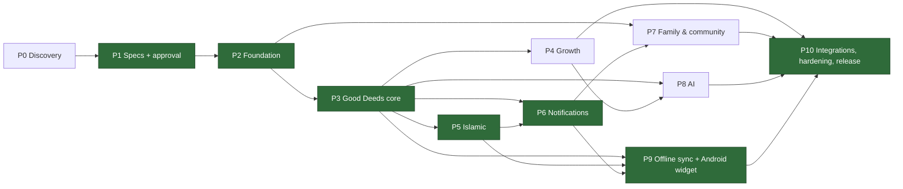

# Implementation Master Plan

> **Status:** Phase 0 is complete. Phase 1 specifications are **awaiting approval**. **No application code has been written.**
> **Scope:** 200 technical tasks and 540 subtasks across Phases 0–10. Every in-scope feature (P2–P10) in [FEATURE_ID_REGISTRY.md](../product/FEATURE_ID_REGISTRY.md) maps to at least one task. The reverse index is in [MASTER_TASK_TRACKER.md](MASTER_TASK_TRACKER.md).
> **ID scheme:** see [docs/README.md §2](../README.md). Tasks are `T-P{phase}-{MOD}-{nnn}`, subtasks are `.n`, risks are `RISK-nnn`.

Besides the feature module codes, the task IDs use these epic codes: **GOV** (governance and planning), **PLAT** (platform, infrastructure, CI, deployment, operations), **UI** (design tokens, component library, shell), and **QA** (cross-cutting test suites).

---

## 1. Phase overview

| Phase | Name | Objective | Features (count) | Depends on | Size |
|---|---|---|---|---|---|
| P0 | Discovery & planning | Understand the repo and environment; set canonical IDs | — | — | S |
| P1 | Specifications | Product, SRS, architecture, DB, API, UX, QA, and plan docs; approval gate | — | P0 | L |
| P2 | Foundation | Monorepo, CI/CD, tokens/UI kit, i18n, PWA shell, auth, RBAC, admin shell, audit, flags, email, staging | AUTH, RBAC, I18N, PWA (shell), ADMIN core, INTG-001 | P1 approval | XL |
| P3 | Good Deeds core | Deed library, custom deeds, recurrence, checklist, completions, calendar, streaks, content admin, translations, versioning | DEED, CAL, ADMIN-003/004/011, I18N-008 | P2 | XL |
| P4 | Personal growth | Goals, journal (encrypted), planner, gamification, basic reports, wellbeing (S) | GROW, JRNL, PLAN, GAME, RPT-001/003/004/005, WELL-003/007, CAL-009 | P3 | L |
| P5 | Islamic lifestyle | Salah, prayer times, Quran, dhikr, duas, fasting, Ramadan, Hijri, zakat, hadith, verified content | ISL, ADMIN-005 | P3 (P4 for journal-linked reflections, soft dependency) | L |
| P6 | Notifications | In-app, reminders, quiet hours, push, digests, prayer reminders, broadcasts, job monitoring | NOTIF, INTG-002, I18N-006, ADMIN-007/014 | P3, P5 (prayer reminders) | M |
| P7 | Family & community | Groups, invitations, challenges, campaigns, stories, moderation, privacy, QR, wellbeing (C) | COMM, WELL (C), GAME-007, NOTIF-007, INTG-006, ADMIN-006/008 | P2, P3, P6 | XL |
| P8 | AI | Gateway, consent, quotas, guardrails, suggestions, coach, reports, voice | AI, JRNL-010 | P3, P4 (P5 for guardrail context) | L |
| P9 | Offline sync & Android widget | IndexedDB cache, outbox, /sync, update flow, widget host and four widgets | PWA-004/005/006/009, WIDGET | P3, P5 (Islamic widget), P6 | XL |
| P10 | Integrations, intelligence & release | Recovery, advanced reports/exports, analytics, calendar, public API, A/B, health/backup/API analytics, then full hardening and production release | AUTH-011, RPT-002/006/007/008, INTG-003/005, PLAN-008, ADMIN-010/012/013/015 | All prior phases | XL |

### 1.1 Reordering rationale (directive §7 allows reordering)
1. **Notifications moved from late to P6, before Community.** Daily reminders (F-NOTIF-002) are what make the deed checklist (P3) and salah tracking (P5) useful day to day. Community challenge notifications (F-NOTIF-007) also need the notification pipeline to exist. Transactional email (F-NOTIF-005) is already delivered in P2 because auth needs it.
2. **The PWA is split between P2 and P9.** Installability, the cached app shell, and the in-app-browser fallback are foundational (P2), because the first users will arrive through Facebook and Messenger links. Offline mutation sync (P9) needs a stable domain model, so it waits until deeds (P3) and Islamic trackers (P5) exist. P9 reuses the `/sync` protocol for the Android widget.
3. **AI (P8) comes after the core data exists.** AI is optional (guardrail 4), and suggestions and insights need real completion, goal, and journal data to be useful.
4. **Wellbeing is split.** The Should items (habit avoidance, affirmations) ship with Growth in P4. The Could items that reuse the challenge engine ship in P7.
5. **Hardening is continuous.** Security, a11y, perf, and authz tests run every phase. P10 is the *full* regression and release gate, not the first time quality is checked.

---

## 2. Dependency graph and critical path



**Critical path:** P1 approval → P2 Foundation (auth, i18n, CI) → P3 deeds and the streak engine → P5 Islamic → P6 reminders → P9 offline sync and widget → P10 release.
P4, P7, and P8 can run in parallel with the critical path if there is capacity:
- P4 needs only P3.
- P7 needs P6.
- P8 needs P4.

**Intra-phase critical tasks:**
- **P2:** T-P2-PLAT-001 → PLAT-003 → AUTH-001 → AUTH-004 → RBAC-002 → ADMIN-001.
- **P3:** CAL-001 → DEED-001 → DEED-006 → DEED-007 → DEED-008/009 → CAL-002.

---

## 3. Working agreements (apply to every task)

**Global Definition of Done.** Every task must meet all of the following, plus its own DoD:
1. Code is merged through a PR with green CI (lint, typecheck, unit, integration, and E2E where there is UI).
2. Every new endpoint declares its permission; the authz matrix test passes.
3. Every user-facing string exists in `en.json` and `bn.json`. Any BN copy that still needs native-speaker review is flagged in KNOWN_ISSUES.
4. Loading, empty, and error states are implemented per [PAGE_SPECIFICATIONS](../design/PAGE_SPECIFICATIONS.md); the axe check passes.
5. OpenAPI is regenerated and the contract drift check passes. Migrations are reviewed (expand/contract).
6. No mock data in production paths. An unconfigured integration has an explicit "not configured" state, and the gap is listed in KNOWN_ISSUES.
7. IMPLEMENTATION_STATUS, CHANGELOG, MASTER_TASK_TRACKER, and TRACEABILITY_MATRIX are updated.
8. The module report (what was implemented, files, DB changes, APIs, tests run with results, remaining issues, next task) is posted at the end of the module (directive §8).

**Workflow.** One phase at a time. Each phase starts with a short kickoff that re-checks scope and open decisions, and ends at an exit gate where the user reviews and approves. Work happens on a feature branch per task (`feat/T-P3-DEED-008-checklist`) and is squash-merged to `main`.

---

## 4. Phases

### P0 — Discovery & planning  *(Size S · Status: complete)*
- **Objectives:** inspect the repo and environment; establish canonical IDs and conventions.
- **Scope:** none (governance).
- **Dependencies:** none.
- **Epics:** EP-GOV.

| Task | Title | Features | Size | Subtasks | Definition of Done |
|---|---|---|---|---|---|
| T-P0-GOV-001 | Repository & environment discovery | — | S | .1 Inspect repo & toolchain<br>.2 Record gaps & credentials needed | PROJECT_DISCOVERY, EXISTING_ARCHITECTURE, TECH_STACK_DECISION, PROJECT_GAPS written from real findings. |
| T-P0-GOV-002 | Canonical feature ID registry & conventions | — | S | .1 Module codes<br>.2 Feature IDs + MoSCoW + phase<br>.3 ID scheme, table & API maps | FEATURE_ID_REGISTRY + docs/README conventions committed. |

- **Deliverables:** `docs/PROJECT_DISCOVERY.md`, `EXISTING_ARCHITECTURE.md`, `TECH_STACK_DECISION.md`, `PROJECT_GAPS.md`, `docs/README.md`, `docs/product/FEATURE_ID_REGISTRY.md`.
- **Database / API / UI changes:** none.
- **Tests:** none (documentation).
- **Risks:** RISK-001.
- **Exit criteria:** findings are factual; the registry has no duplicate IDs (verified by script).
- **Checklist:** [x] repo inspected · [x] toolchain recorded · [x] gaps listed · [x] IDs registered.

### P1 — Specifications & approval  *(Size L · Status: in review)*
- **Objectives:** complete Stages 1–5 plus the UX, QA, and implementation docs; get user approval.
- **Scope:** all 198 features specified.
- **Dependencies:** P0.
- **Epics:** EP-GOV.

| Task | Title | Features | Size | Subtasks | Definition of Done |
|---|---|---|---|---|---|
| T-P1-GOV-001 | Product docs (vision, scope, catalog, stories, ACs) | — | L | .1 Catalog<br>.2 Personas & journeys<br>.3 Stories & ACs<br>.4 Priority matrix & roadmap | All Stage 1 files exist; every F-ID catalogued. |
| T-P1-GOV-002 | SRS | — | L | .1 FRs per module<br>.2 NFRs<br>.3 Constraints & out-of-scope | All 30 sections; every F-ID has ≥1 FR. |
| T-P1-GOV-003 | Architecture, database & API specifications | — | L | .1 Architecture + ADRs<br>.2 ERD + data dictionary<br>.3 API spec + OpenAPI | Stage 3–5 files exist; openapi.yaml lints. |
| T-P1-GOV-004 | UI/UX, QA & implementation plans | — | L | .1 Design system & page specs<br>.2 QA strategy & test plan<br>.3 Master plan & tracker | Design, QA and implementation files exist; traceability matrix complete. |
| T-P1-GOV-005 | Executive summary & approval gate | — | S | .1 Write summary<br>.2 Present for approval | User approves plan or requests changes (recorded in DECISION_LOG). |

- **Deliverables:** all files under `docs/product`, `docs/specifications`, `docs/architecture`, `docs/database`, `docs/api` (including `openapi.yaml`), `docs/design`, `docs/qa`, `docs/implementation`, and `docs/EXECUTIVE_SUMMARY.md`.
- **Database / API / UI changes:** specified only.
- **Tests:** ID-consistency script; OpenAPI lint; Mermaid syntax spot check.
- **Risks:** RISK-001, RISK-002.
- **Exit criteria:** the user approves the plan; open decisions are logged in DECISION_LOG.
- **Checklist:** [ ] traceability complete · [ ] OpenAPI lints · [ ] summary presented · [ ] approval recorded.

### P2 — Foundation  *(Size XL)*
- **Objectives:** a buildable, deployable monorepo with CI. It includes the design tokens and UI kit, full EN/BN infrastructure, the installable PWA shell with the in-app-browser fallback, secure auth (email/password, Google, sessions, deletion), RBAC with audit logging and admin 2FA, the admin shell (users, roles, flags, audit), the email adapter, and a staging environment.
- **Scope:** F-AUTH-001…010 · F-RBAC-001…007 · F-I18N-001/002/003/004/005/007/009 · F-PWA-001/002/003/007/008 · F-ADMIN-001/002/009/016 · F-INTG-001 · F-NOTIF-005 (transactional).
- **Dependencies:**
  - P1 approval.
  - **User actions:** Neon project, GitHub remote, hosting accounts, Resend plus a domain, and a Google OAuth client.
- **Epics:** EP-PLAT, EP-UI, EP-I18N, EP-PWA, EP-AUTH, EP-RBAC, EP-ADMIN, EP-INTG, EP-QA.

| Task | Title | Features | Size | Subtasks | Definition of Done |
|---|---|---|---|---|---|
| T-P2-PLAT-001 | Monorepo scaffold (pnpm via Corepack, Turborepo, packages/config) | — | M | .1 Enable pnpm via Corepack; root package.json & pnpm-workspace.yaml<br>.2 turbo.json pipelines (build, lint, typecheck, test, e2e)<br>.3 packages/config: tsconfig, eslint, prettier presets<br>.4 .editorconfig, .gitattributes (LF), .gitignore, .nvmrc (Node 24) | `pnpm i && pnpm turbo build lint typecheck test` passes on a clean clone (Windows + Linux CI). |
| T-P2-PLAT-002 | apps/api NestJS skeleton | — | M | .1 Nest app with URI versioning /api/v1<br>.2 Zod-validated config module<br>.3 Pino logger with request id + redaction<br>.4 Global problem+json exception filter<br>.5 @nestjs/swagger OpenAPI emission | GET /api/v1/health returns 200 (Supertest); invalid env aborts boot (unit test); /api/v1/openapi.json generated. |
| T-P2-PLAT-003 | Prisma + Neon baseline | — | M | .1 Neon project with dev/staging/prod branches (user action)<br>.2 Prisma schema baseline, UUIDv7 default helper<br>.3 DATABASE_URL (pooled) + DIRECT_URL (migrations)<br>.4 Seed runner framework<br>.5 Readiness check registry (modules register checks; /health/ready aggregates) + DB check | `prisma migrate deploy` succeeds on Neon dev branch; seed is idempotent (run twice → same row counts, test); /health/ready returns 503 DEPENDENCY_UNAVAILABLE when the DB is unreachable (test). |
| T-P2-PLAT-004 | apps/worker with pg-boss | — | M | .1 Worker entrypoint sharing api modules<br>.2 Job registry & typed payloads<br>.3 Retry/backoff defaults, dead-letter logging<br>.4 Heartbeat job | Integration test enqueues a job and observes completion; SIGTERM drains in-flight jobs. |
| T-P2-PLAT-005 | apps/web Next.js skeleton | — | M | .1 App Router + TypeScript strict<br>.2 Tailwind with tokens preset<br>.3 Route groups & layouts<br>.4 Typed API client from packages/contracts | Route groups (public)/(app)/admin render; loading/error boundaries covered by Playwright smoke. |
| T-P2-PLAT-006 | packages/contracts (Zod + generated OpenAPI types) | — | S | .1 Shared Zod schemas<br>.2 openapi-typescript generation<br>.3 Drift check script | CI fails when committed OpenAPI differs from generated (drift check). |
| T-P2-PLAT-007 | CI pipeline (GitHub Actions) | — | M | .1 Workflow with Turborepo cache<br>.2 Neon branch per PR create/delete<br>.3 osv-scanner / pnpm audit<br>.4 gitleaks secret scan<br>.5 `pnpm check` gate: docs drift, plan/spec integrity, OpenAPI draft-vs-implemented overlap; API tests include the OpenAPI contract snapshot (CI=1 never rewrites it)<br>.6 Required status checks documented | PR pipeline green: lint, typecheck, unit, api integration (ephemeral Neon branch), Playwright smoke, dependency & secret scan. |
| T-P2-PLAT-008 | Security baseline middleware | — | M | .1 Helmet + strict CSP with nonces (web)<br>.2 CORS allowlist<br>.3 Rate limiter (@nestjs/throttler, 3 tiers per API_CONVENTIONS; Postgres counter for login/reset only)<br>.4 Body size & JSON depth limits | Security headers & CSP verified by integration test; CORS rejects unknown origin; oversized body → 413. |
| T-P2-PLAT-009 | Observability | — | S | .1 Sentry web/api<br>.2 Structured log field conventions<br>.3 CSP violation reports: report-to endpoint for the web CSP (proxy.ts) | Errors from web & api appear in Sentry with release + request id; PII redaction unit-tested. |
| T-P2-PLAT-010 | Staging deployment (local + Tailscale, DL-040) | — | M | .1 Tailnet node `daily-deeds` (userspace tailscaled) + tailscale funnel (public)<br>.2 Production build of api, worker, web on this machine<br>.3 Secrets in git-ignored apps/api/.env.staging (staging branch)<br>.4 API env per host: WEB_ORIGINS and TRUST_PROXY (proxy hop count; wrong value = one shared rate-limit bucket)<br>.5 Post-deploy smoke script<br>.6 Probes: liveness → /health/live (frequent); /health/ready only for deploy gating, so Neon compute can autosuspend | `pnpm staging` runs a production build of web + api + worker against the Neon staging branch, published with Tailscale Funnel; post-deploy smoke passes; migrations run as release step. |
| T-P2-UI-001 | packages/tokens | — | S | .1 Token JSON source<br>.2 CSS vars + Tailwind preset<br>.3 Android colors export (for P9)<br>.4 Contrast unit test | CSS variables (light/dark) match COLOR_TOKENS; contrast test asserts documented pairs ≥ thresholds. |
| T-P2-UI-002 | packages/ui core components | — | L | .1 Button, Input, Field (label/help/error), Select, Checkbox, Switch<br>.2 Dialog, Sheet, Toast, Tooltip<br>.3 Card, Tabs, Badge, Avatar, Skeleton, EmptyState<br>.4 Storybook (or Ladle) with EN/BN + light/dark | Each component has unit tests + axe check in Storybook/Playwright CT; keyboard behaviour verified. |
| T-P2-UI-003 | App shell & responsive navigation | F-PWA-002 | M | .1 App shell layout<br>.2 Mobile bottom nav, desktop sidebar<br>.3 Offline / in-app-browser banner slots | Bottom nav (<768px) / sidebar (≥1024px) verified at 360/768/1280 widths in Playwright; focus order correct. |
| T-P2-UI-004 | Theme switching (light/dark/system) | F-AUTH-010 | S | .1 Theme provider & pre-paint script<br>.2 Persist to cookie + preferences | No flash of wrong theme on reload (E2E); preference persisted. |
| T-P2-I18N-001 | EN/BN catalogs & next-intl setup | F-I18N-001 | M | .1 packages/i18n en.json/bn.json with namespaces<br>.2 next-intl provider (server + client)<br>.3 API-side message loader for emails/errors | All shipped pages render in EN and BN (E2E snapshot per locale). |
| T-P2-I18N-002 | No-hardcoded-strings lint & missing-key check | F-I18N-001, F-I18N-009 | S | .1 eslint no-literal-string rule<br>.2 Key parity script | CI fails on JSX literal strings and on keys missing from bn.json (allowlist documented). |
| T-P2-I18N-003 | Language switcher & persistence | F-I18N-002, F-I18N-003 | S | .1 Switcher component<br>.2 Guest cookie<br>.3 Sync to user_preferences on login | Switch persists across reload (guest cookie) and across devices (account preference) — E2E. |
| T-P2-I18N-004 | Locale formatting helpers | F-I18N-004 | S | .1 Intl wrappers (date, time, relative, number)<br>.2 Bengali digit option<br>.3 Hijri formatting hook (stub until P5) | Unit tests for dates/times/numbers in en & bn incl. Bengali digits toggle. |
| T-P2-I18N-005 | Bengali typography | F-I18N-005 | S | .1 Font loading & subsetting<br>.2 Locale-specific line-height tokens | BN font loads via next/font with no CLS > 0.05; conjunct rendering visually checked on Android Chrome & iOS Safari. |
| T-P2-I18N-006 | Localized validation & API errors | F-I18N-007 | S | .1 Zod error map → i18n keys<br>.2 problem+json `code` and `i18nKey`<br>.3 Client renderer for field errors<br>.4 Test: every ErrorCode in @dgd/contracts has EN and BN messages (ERROR_HANDLING §4) | Validation errors in both locales asserted by API + UI tests; API returns stable code + i18n key. |
| T-P2-I18N-007 | Fallback & missing-key reporting | F-I18N-009 | S | .1 Fallback chain bn→en<br>.2 Reporter with dedupe | Missing BN key renders EN and reports once to Sentry (test); dev mode throws. |
| T-P2-PWA-001 | Web manifest & installability | F-PWA-001 | S | .1 manifest.webmanifest (EN/BN name)<br>.2 Icons incl. maskable<br>.3 Install prompt UX (deferred, non-nagging) | Lighthouse PWA installability checks pass on staging; maskable icons render. |
| T-P2-PWA-002 | Service worker app shell (Serwist) | F-PWA-003 | M | .1 Serwist integration<br>.2 Precache shell + static assets<br>.3 Offline fallback route<br>.4 SW update strategy (skipWaiting on prompt) | App shell & offline fallback page load with network disabled (Playwright offline test). |
| T-P2-PWA-003 | In-app browser detection & fallback | F-PWA-007 | S | .1 Detection module with fixture tests<br>.2 "Open in browser" banner with per-platform instructions<br>.3 Hide Google OAuth in webviews | UA fixtures for FB, Messenger, Instagram, Telegram, Line, Android WebView detected (unit); banner + hidden Google button (E2E with UA override). |
| T-P2-PWA-004 | Capability detection & graceful degradation | F-PWA-008 | S | .1 capabilities module (push, bgSync, share, persist, install)<br>.2 UI fallbacks documented | Each optional API guarded; app works with push/bg-sync/share undefined (unit + E2E). |
| T-P2-AUTH-001 | Identity schema | F-AUTH-001 | S | .1 Prisma models & migration<br>.2 Unique citext email<br>.3 Repository layer with user scoping<br>.4 FK system_settings.updated_by → users (deferred from T-P2-PLAT-003) | Migration creates users, user_preferences, auth_identities, user_sessions, verification_tokens with constraints from DATA_DICTIONARY, and adds the deferred FK system_settings.updated_by → users ON DELETE SET NULL. |
| T-P2-AUTH-002 | Registration | F-AUTH-001 | M | .1 ZodValidationPipe + @ZodBody(schema): validates bodies (VALIDATION_FAILED) and registers the OpenAPI requestBody from the same @dgd/contracts schema<br>.2 POST /auth/register<br>.3 Argon2id params benchmarked<br>.4 HIBP k-anonymity check<br>.5 Register page (EN/BN)<br>.6 Tests: policy, duplicate, rate limit | Register API + page; Argon2id hash; password policy (≥10 chars + breached-password check, fail-open logged); duplicate email gives non-enumerating response. |
| T-P2-AUTH-003 | Email verification | F-AUTH-004 | S | .1 Token issue/verify<br>.2 Verify page<br>.3 Resend with throttle | Hashed single-use token, 24h expiry, resend throttled; unverified users restricted per SRS — tests. |
| T-P2-AUTH-004 | Login, tokens & sessions | F-AUTH-002 | L | .1 POST /auth/login<br>.2 Session store & per-request lookup (<=5 s cache)<br>.3 Origin guard<br>.4 Login throttling<br>.5 Login page | Opaque session token in a __Host- HttpOnly SameSite=Lax cookie, stored hashed in user_sessions; lifetimes per SRS FR-AUTH-002-03; Origin/Sec-Fetch-Site check rejects cross-site mutations (test); throttling per FR-AUTH-002-02 (DL-012). |
| T-P2-AUTH-005 | Google OAuth (PKCE redirect) | F-AUTH-003 | M | .1 OAuth client config (user action)<br>.2 Authorization code + PKCE<br>.3 auth_identities linking rules<br>.4 Error states | OAuth flow works on staging; account linking only when Google email verified and matches; state/PKCE validated (tests with mocked IdP). |
| T-P2-AUTH-006 | Forgot & reset password | F-AUTH-005 | S | .1 Request/reset endpoints<br>.2 Pages<br>.3 Session revocation | Non-enumerating request; token 30 min single-use; reset revokes all sessions — tests. |
| T-P2-AUTH-007 | Logout & session management | F-AUTH-006, F-AUTH-007 | M | .1 POST /auth/logout (current/all)<br>.2 GET/DELETE /me/sessions<br>.3 Sessions settings page | List sessions with device/last-seen; revoke one/all; a revoked session is rejected on the next request (tests). |
| T-P2-AUTH-008 | Profile management | F-AUTH-008 | S | .1 GET/PATCH /me<br>.2 Profile page | Edit display name and profile fields (tests). Email change deferred to P4 (DL-032). |
| T-P2-AUTH-009 | User preferences | F-AUTH-010 | S | .1 GET/PATCH /me/preferences<br>.2 Timezone picker with detection<br>.3 Preferences page | Language, IANA timezone (auto-detected, user-confirmed), theme, week start, numerals persisted & applied — tests. |
| T-P2-AUTH-010 | Account deletion & data export | F-AUTH-009 | M | .1 POST/DELETE /me/deletion<br>.2 Hard-delete job<br>.3 export_jobs + /me/export<br>.4 Danger-zone UI with re-auth | Deletion request starts 30-day grace; login offers cancel; worker hard-deletes after grace and pseudonymizes audit refs (integration test with clock control); JSON export job delivers account data. |
| T-P2-AUTH-011 | Web auth guards | F-AUTH-002, F-AUTH-007 | S | .1 Next middleware guards<br>.2 Fetch wrapper (401 -> login)<br>.3 Guest landing | Protected routes redirect guests; 401 redirects to login preserving the return path; no token in JS-readable storage (test). |
| T-P2-RBAC-001 | Roles & permission catalog | F-RBAC-001 | S | .1 roles, permissions, user_roles, role_permissions migration<br>.2 Seed<br>.3 Default role on registration | Seeded roles (User, Admin, Super Admin; Guest implicit) and permission catalog match API_SPECIFICATION. |
| T-P2-RBAC-002 | Permission guard (deny by default) | F-RBAC-002 | M | .1 Guard + decorators<br>.2 Route metadata audit test<br>.3 Ownership/scoping helper | Every route declares @Public or @RequirePermission; a test fails if any route lacks metadata; ownership helper prevents cross-user access. |
| T-P2-RBAC-003 | Role assignment | F-RBAC-003 | S | .1 POST/DELETE /admin/users/{id}/roles<br>.2 Invariants<br>.3 Audit events | Only Super Admin grants Admin/Super Admin; last Super Admin cannot be removed; all changes audited (tests). |
| T-P2-RBAC-004 | Admin account management | F-RBAC-004 | S | .1 CLI: create admin<br>.2 Disable/enable | Admins created by seed/CLI command (invite flow in P10, DL-032); Super Admin can disable/enable admins; disabled admin sessions revoked immediately (tests). |
| T-P2-RBAC-005 | Audit logging | F-RBAC-005 | M | .1 audit_logs table (plain, btree on occurred_at; 24-month purge job)<br>.2 AuditService & interceptor<br>.3 DB privilege restriction | Append-only audit_logs (no UPDATE/DELETE grant for app role); catalog of events recorded for auth, roles, admin actions (tests). |
| T-P2-RBAC-006 | Admin step-up re-authentication | F-RBAC-006 | S | .1 Step-up endpoint (user_sessions.stepup_at)<br>.2 Admin route guard | Admin step-up actions require re-auth within the last 10 min (password/TOTP), stored on the session — tests. |
| T-P2-RBAC-007 | Admin TOTP 2FA | F-RBAC-007 | M | .1 mfa_factors<br>.2 Enrollment with QR<br>.3 Verification & backup codes | TOTP mandatory for Admin/Super Admin before admin access; secrets encrypted; replay window enforced (tests). |
| T-P2-RBAC-008 | Authorization test matrix | F-RBAC-002 | S | .1 Matrix generator from route metadata<br>.2 CI integration | Generated test runs every endpoint × {guest,user,admin,super_admin} and asserts expected status. |
| T-P2-ADMIN-001 | Admin shell | F-ADMIN-001 | S | .1 Admin layout<br>.2 Permission-aware nav | /admin layout with nav filtered by permissions; non-admins get 404 (test). |
| T-P2-ADMIN-002 | User management | F-ADMIN-001 | M | .1 GET /admin/users (cursor)<br>.2 User detail & actions<br>.3 Audit on every action | Search, view, disable, force logout, resend verification; never shows journal/worship data (test). |
| T-P2-ADMIN-003 | Role assignment UI (read-only role catalog) | F-ADMIN-002 | S | .1 Roles list (read-only)<br>.2 Assign/revoke role on user detail | Feature ACs pass; unit + integration (+E2E where UI) tests green in CI; EN/BN strings present; authz tested; docs/status updated. |
| T-P2-ADMIN-004 | Feature flags | F-ADMIN-009 | M | .1 feature_flags table<br>.2 Evaluation service + cache<br>.3 useFlag hook<br>.4 Admin UI | Boolean flags with optional role allowlist, evaluated server-side; client hook; admin toggle UI; audited changes (tests). A/B lives in experiments (P10, DL-029). |
| T-P2-ADMIN-005 | Audit log viewer | F-ADMIN-016 | S | .1 Filters (actor, action, date)<br>.2 Detail view | Feature ACs pass; unit + integration (+E2E where UI) tests green in CI; EN/BN strings present; authz tested; docs/status updated. |
| T-P2-ADMIN-006 | System settings service | — | S | .1 Table & typed accessor<br>.2 Admin edit page | system_settings typed keys (Settings registry keys, e.g. completions.edit_window_days=7) readable via service; changes audited. |
| T-P2-INTG-001 | Email adapter & templates | F-INTG-001, F-NOTIF-005 | M | .1 EmailSender interface + adapters<br>.2 React Email templates EN/BN<br>.3 send-email job with retry (defineJob contract + idempotent handler)<br>.4 Wire JobsClient into the API (first API producer; producer-only pg-boss: no workers, no schedules)<br>.5 Unconfigured-provider behaviour documented | Resend + SMTP adapters behind EmailSender; dev file sink; verify/reset/deletion templates in EN/BN; sent via worker with retries (tests). |
| T-P2-QA-001 | Test infrastructure | — | M | .1 Vitest config<br>.2 API test DB lifecycle<br>.3 Playwright projects<br>.4 axe helper | Vitest (unit + API via Supertest, Neon test branch), Playwright (mobile + desktop projects, EN/BN), axe helper all runnable via turbo. |
| T-P2-QA-002 | Phase 2 E2E & regression suite | F-AUTH-001, F-AUTH-002, F-RBAC-006 | S | .1 User auth journey<br>.2 Admin journey<br>.3 Locale run | E2E: register→verify→login→prefs→logout (EN & BN); admin login with TOTP; in-app browser banner. |

- **Deliverables:**
  - `apps/web`, `apps/api`, `apps/worker`, and `packages/{config,contracts,i18n,ui,tokens,domain}`.
  - GitHub Actions CI and a staging URL.
  - Auth, RBAC, and the admin shell, working end to end in EN and BN.
- **Database changes:** `users`, `user_preferences`, `auth_identities`, `user_sessions`, `verification_tokens`, `roles`, `permissions`, `user_roles`, `role_permissions`, `mfa_factors`, `audit_logs`, `feature_flags`, `system_settings`, `idempotency_keys`, `export_jobs`, and the `pgboss` schema.
- **API changes:**
  - `/health`, `/auth/*` (register, login, logout, verify-email, password reset, Google OAuth).
  - `/me`, `/me/preferences`, `/me/sessions`, `/me/export`, `/me/deletion`.
  - `/admin/users`, `/admin/roles`, `/admin/flags`, `/admin/audit-logs`, `/admin/settings`.
- **UI pages:**
  - Public: landing, register, login, verify email, forgot/reset password.
  - Account: profile, preferences, sessions, account deletion.
  - App: empty-state Today page (placeholder shell, no mock data), offline fallback.
  - Admin: dashboard shell, users, user detail, roles, flags, audit log, settings, TOTP enrollment.
- **Tests:**
  - Unit: domain/i18n/capabilities.
  - API integration: auth flows, session revocation, Origin-check CSRF protection, rate limits.
  - Authz matrix.
  - E2E: auth journeys in EN/BN on mobile and desktop, in-app UA banner, offline shell.
  - Quality: axe on all pages, Lighthouse installability, dependency and secret scan.
- **Risks:** RISK-003 (credentials late), RISK-004 (auth security defects), RISK-005 (BN translation lag), RISK-006 (in-app browser OAuth), RISK-017 (Windows/Linux tooling drift).
- **Exit criteria:**
  - A new user can register, verify, log in (email or Google), set language and timezone, see the shell in BN, log out everywhere, and request deletion on staging.
  - An admin with TOTP can manage roles and flags, and every action is audited.
  - CI is green; no High/Critical vulnerabilities.
- **Checklist:** [ ] CI green on main · [ ] staging deployed · [ ] authz matrix 100% routes · [ ] EN/BN key parity · [ ] axe clean · [ ] KNOWN_ISSUES updated · [ ] user sign-off.

### P3 — Good Deeds core, calendar & streaks  *(Size XL)*
- **Objectives:** the core value loop. Users discover deeds, build a routine with recurrence, complete the daily checklist, and see their calendar, heatmap, and streaks. All of it is correct in the user's timezone. Admins manage bilingual, versioned content.
- **Scope:** F-DEED-001…014 · F-CAL-001…008, 010, 011 · F-ADMIN-003/004/011 · F-I18N-008.
- **Dependencies:**
  - P2 (auth, i18n, UI kit, admin shell, settings).
  - **User actions:** R2 bucket; content sign-off for the seed library.
- **Epics:** EP-DEED, EP-CAL, EP-ADMIN, EP-I18N, EP-QA.

| Task | Title | Features | Size | Subtasks | Definition of Done |
|---|---|---|---|---|---|
| T-P3-CAL-001 | Local-date & timezone domain utilities | F-CAL-010 | M | .1 localDateFor(instant, tz)<br>.2 Day boundary & DST tests<br>.3 Timezone change handling | packages/domain local_date functions property-tested across DST transitions & 30+ IANA zones; timezone-change policy (SRS) unit-tested. |
| T-P3-DEED-001 | Deeds schema | F-DEED-001, F-DEED-002 | M | .1 Prisma models<br>.2 Constraints & indexes per INDEXING_STRATEGY<br>.3 Repository scoping tests | Migration for deed_categories(+translations), deeds(+translations), deed_plans, deed_completions, completion_attachments, favorite_deeds; unique (deed_plan_id, local_date); check constraints. |
| T-P3-I18N-001 | Content translation pattern & locale resolution | F-I18N-008 | S | .1 Translation join helper<br>.2 Fallback flag in responses | API resolves Accept-Language/user locale with bn→en fallback for *_translations; tests. |
| T-P3-DEED-002 | Deed library seed (EN/BN) | F-DEED-001, F-DEED-013 | M | .1 Content spreadsheet<br>.2 Seed import script<br>.3 Review sign-off | 8 categories and ≥150 deeds with EN/BN text, five-minute tag, reviewed by product owner & BN reviewer. |
| T-P3-DEED-003 | Categories API & UI | F-DEED-002 | S | .1 GET /categories<br>.2 Category chips/filter UI | Feature ACs pass; unit + integration (+E2E where UI) tests green in CI; EN/BN strings present; authz tested; docs/status updated. |
| T-P3-DEED-004 | Deed discovery (browse/search/filter) | F-DEED-011 | M | .1 GET /deeds with q/filters/cursor<br>.2 Discover page<br>.3 Empty & error states | Locale-aware search (pg_trgm on translations) with category/duration filters; p95 < 300 ms on seeded data. |
| T-P3-DEED-005 | Custom deeds | F-DEED-003 | S | .1 POST/PATCH/DELETE /deeds (owner)<br>.2 Create/edit form | CRUD scoped to owner (cross-user → 404 test); limit 200 active custom deeds; validation per SRS. |
| T-P3-DEED-006 | Recurrence engine | F-DEED-005 | L | .1 Parser & validator<br>.2 occursOn(rule, localDate)<br>.3 Human-readable EN/BN description<br>.4 Property-based tests | RRULE subset (DAILY, WEEKLY+BYDAY, MONTHLY+BYMONTHDAY, INTERVAL, UNTIL/COUNT) parse/validate/expand per local_date; property tests; shared web/api. |
| T-P3-DEED-007 | Plans (my routine) | F-DEED-005 | M | .1 /plans CRUD<br>.2 Recurrence picker UI<br>.3 Pause/archive semantics | Add deed with recurrence, pause, archive; plan edits do not rewrite past completions (test). |
| T-P3-DEED-008 | Daily checklist & Today page | F-DEED-004 | L | .1 Checklist service<br>.2 GET /today composite builder<br>.3 Today page<br>.4 Progress ring<br>.5 Loading/empty/error states | /checklist/{localDate} computed from plans+completions in user tz; GET /today composite (ETag) shares its builder with /widget/snapshot (DL-025); Today page completes items in ≤1 tap with optimistic UI; LCP < 2.5s mid-tier mobile. |
| T-P3-DEED-009 | Completions (status & notes) | F-DEED-009, F-DEED-008 | M | .1 PUT /completions<br>.2 Idempotency store<br>.3 Note editor | Upsert by (plan, local_date) with Idempotency-Key; status done/partial/skipped; note ≤ 1000 chars; outside edit window → 422 (tests). |
| T-P3-DEED-010 | Favorites | F-DEED-006 | S | .1 PUT/DELETE /deeds/{id}/favorite<br>.2 Favorites filter | Feature ACs pass; unit + integration (+E2E where UI) tests green in CI; EN/BN strings present; authz tested; docs/status updated. |
| T-P3-DEED-011 | Activity history | F-DEED-007 | S | .1 GET /completions?from&to (cursor)<br>.2 History page with filters | Feature ACs pass; unit + integration (+E2E where UI) tests green in CI; EN/BN strings present; authz tested; docs/status updated. |
| T-P3-DEED-012 | Evidence attachments | F-DEED-010 | M | .1 Storage adapter (R2) + unconfigured mode<br>.2 Add the R2 public origin to the web CSP img-src<br>.3 Upload/confirm endpoints<br>.4 Re-encode job<br>.5 Attachment UI | Signed upload (≤5 MB, jpeg/png/webp, magic-byte check), EXIF stripped by re-encode job, private signed GET; deleted with completion/account (tests). |
| T-P3-DEED-013 | Random good deed generator | F-DEED-012 | S | .1 GET /deeds/random (weighted, excludes done today)<br>.2 "Surprise me" UI | Feature ACs pass; unit + integration (+E2E where UI) tests green in CI; EN/BN strings present; authz tested; docs/status updated. |
| T-P3-DEED-014 | Five-minute deeds collection | F-DEED-013 | S | .1 Filter duration≤5<br>.2 Collection view | Feature ACs pass; unit + integration (+E2E where UI) tests green in CI; EN/BN strings present; authz tested; docs/status updated. |
| T-P3-DEED-015 | Rule-based recommendations | F-DEED-014 | M | .1 Rules engine<br>.2 GET /deeds/recommendations<br>.3 Recommendation cards | Recommends from under-served categories & favorites; deterministic rules unit-tested; no AI dependency. |
| T-P3-CAL-002 | Streak engine & cache | F-CAL-007, F-CAL-008 | L | .1 Pure streak calculator in packages/domain<br>.2 daily_summaries table & write path<br>.3 Incremental update (today/yesterday)<br>.4 Debounced rebuild job<br>.5 GET /streaks | Streak rules exactly per SRS §7.5.1; daily_summaries updated in the completion transaction; streaks updated in place for today/yesterday and via a debounced streaks.rebuild:{userId} job for past edits and rule changes (DL-023); rebuild matches cache (property test). |
| T-P3-CAL-003 | Daily completion rate | F-CAL-006 | S | .1 Rate = done(+0.5 partial)/scheduled per SRS<br>.2 Exposed in checklist & calendar | Feature ACs pass; unit + integration (+E2E where UI) tests green in CI; EN/BN strings present; authz tested; docs/status updated. |
| T-P3-CAL-004 | Daily/weekly/monthly calendar | F-CAL-001, F-CAL-002, F-CAL-003 | M | .1 Aggregate queries<br>.2 Calendar views<br>.3 Responsive layouts | GET /calendar?view=day\|week\|month reads daily_summaries; week start honors preference; keyboard-navigable grid. |
| T-P3-CAL-005 | Yearly history & heatmap | F-CAL-004, F-CAL-005 | M | .1 GET /heatmap?year<br>.2 Heatmap component<br>.3 Accessible alternative | Heatmap reads daily_summaries; accessible table alternative and non-color cue; p95 per NFR-PERFORMANCE-009. |
| T-P3-CAL-006 | Past-day editing | F-CAL-011 | S | .1 Window from completions.edit_window_days<br>.2 Edit past day UI<br>.3 Enqueue debounced streak rebuild | Feature ACs pass; unit + integration (+E2E where UI) tests green in CI; EN/BN strings present; authz tested; docs/status updated. |
| T-P3-ADMIN-001 | Deed & category content admin | F-ADMIN-003 | M | .1 /admin/deeds, /admin/categories<br>.2 Admin forms<br>.3 Publish workflow | CRUD, publish/unpublish, ordering; permission content.deeds.manage; audited. |
| T-P3-ADMIN-002 | Content translation management | F-ADMIN-004, F-I18N-008 | M | .1 Translation editor<br>.2 Missing report<br>.3 Publish gate | Side-by-side EN/BN editor; missing-translation report; publishing blocked when required locale missing (configurable). |
| T-P3-ADMIN-003 | Content versioning | F-ADMIN-011 | M | .1 content_versions table<br>.2 Snapshot hook<br>.3 Diff & rollback UI | Every publish writes content_versions snapshot; diff view; rollback creates new version (tests). |
| T-P3-QA-001 | Phase 3 E2E & performance checks | F-DEED-004, F-CAL-007 | S | .1 Journeys<br>.2 Timezone scenarios<br>.3 k6 baseline | E2E: onboarding → add deeds → complete → streak (EN/BN, mobile/desktop); DST scenario; /checklist load test baseline. |

- **Deliverables:** deed library (≥150 EN/BN deeds), routine builder, Today checklist, history, calendar views, heatmap, streaks, content admin with translations and versions.
- **Database changes:** `deed_categories`, `deed_category_translations`, `deeds`, `deed_translations`, `deed_plans`, `deed_completions`, `completion_attachments`, `favorite_deeds`, `streaks`, `daily_summaries`, `content_versions`.
- **API changes:** `/categories`, `/deeds` (+`/random`, `/recommendations`, `/{id}/favorite`), `/plans`, `/completions`, `/checklist/{localDate}`, `/calendar`, `/streaks`, `/heatmap`, `/admin/deeds`, `/admin/categories`, `/admin/content-versions`.
- **UI pages:** Today, Discover, Deed detail, Create/edit custom deed, My routine, History, Calendar (day/week/month), Year heatmap, admin deed/category list and editor, translation editor, version history.
- **Tests:**
  - Property tests: recurrence and streak engines.
  - DST and timezone-change scenarios.
  - Edit-window enforcement.
  - Idempotent completion replays.
  - Cross-user isolation.
  - E2E: core loop in EN/BN.
  - k6 baseline for `/checklist`.
  - axe on the calendar and heatmap.
- **Risks:** RISK-007 (streak/timezone correctness), RISK-008 (seed content quality/translation), RISK-009 (calendar aggregate performance).
- **Exit criteria:**
  - Streaks and completion rates match the SRS rules on the test fixtures, including DST.
  - Today page LCP < 2.5 s (mid-tier mobile, 4G profile).
  - `/checklist` p95 < 300 ms at the baseline load.
  - Content publishes in EN/BN with a version history.
- **Checklist:** [ ] engines property-tested · [ ] seed content signed off · [ ] perf budget met · [ ] admin content audited · [ ] user sign-off.

### P4 — Personal growth, journal, planner, gamification  *(Size L)*
- **Objectives:** goals and milestones, a private encrypted journal, a daily planner, achievements and the Good Deeds Tree, personal reports, and the Should-priority wellbeing items. Everything uses neutral, non-judgmental framing.
- **Scope:** F-GROW-001…009 · F-JRNL-001…009 · F-PLAN-001…007 · F-GAME-001…006, 008 · F-CAL-009 · F-RPT-001/003/004/005 · F-WELL-003/007.
- **Dependencies:** P3 (completions, recurrence engine, streaks).
- **Epics:** EP-GROW, EP-JRNL, EP-PLAN, EP-GAME, EP-RPT, EP-WELL.

| Task | Title | Features | Size | Subtasks | Definition of Done |
|---|---|---|---|---|---|
| T-P4-GROW-001 | Goals, weekly/monthly goals & milestones | F-GROW-001, F-GROW-002, F-GROW-003 | M | .1 goals, goal_milestones<br>.2 /goals API<br>.3 Goals pages | Feature ACs pass; unit + integration (+E2E where UI) tests green in CI; EN/BN strings present; authz tested; docs/status updated. |
| T-P4-GROW-002 | Life balance tracker | F-GROW-009 | M | .1 life_balance_categories seed (8)<br>.2 life_balance_assessments<br>.3 Radar/bar chart + table alt | Feature ACs pass; unit + integration (+E2E where UI) tests green in CI; EN/BN strings present; authz tested; docs/status updated. |
| T-P4-GROW-003 | Consistency analysis & weak habit identification | F-GROW-005, F-GROW-006 | M | .1 Consistency metrics in packages/domain<br>.2 Neutral copy review (no worth judgment) | Feature ACs pass; unit + integration (+E2E where UI) tests green in CI; EN/BN strings present; authz tested; docs/status updated. |
| T-P4-GROW-004 | Growth snapshots & timeline | F-GROW-004 | M | .1 growth_snapshots monthly job<br>.2 Timeline page | Feature ACs pass; unit + integration (+E2E where UI) tests green in CI; EN/BN strings present; authz tested; docs/status updated. |
| T-P4-GROW-005 | Rule-based growth insights | F-GROW-007 | S | .1 Insight rules<br>.2 Insight cards | Feature ACs pass; unit + integration (+E2E where UI) tests green in CI; EN/BN strings present; authz tested; docs/status updated. |
| T-P4-GROW-006 | Monthly reflection | F-GROW-008 | S | .1 Reflection flow<br>.2 Stored as journal_entries type reflection | Feature ACs pass; unit + integration (+E2E where UI) tests green in CI; EN/BN strings present; authz tested; docs/status updated. |
| T-P4-JRNL-001 | Journal storage with application-level encryption | F-JRNL-007 | L | .1 Key service (env KEK, KMS-ready)<br>.2 journal_entries model<br>.3 Rotation job<br>.4 Privacy tests | Bodies stored as ciphertext (AES-256-GCM, envelope key, key_version); DB dump contains no plaintext (test); admin APIs cannot read journals (authz test). |
| T-P4-JRNL-002 | Journal, intention, evening reflection, gratitude | F-JRNL-001, F-JRNL-002, F-JRNL-003, F-JRNL-004 | M | .1 /journal CRUD by entry_type<br>.2 Editors & prompts EN/BN | Feature ACs pass; unit + integration (+E2E where UI) tests green in CI; EN/BN strings present; authz tested; docs/status updated. |
| T-P4-JRNL-003 | Future-self letters | F-JRNL-005 | S | .1 pg-boss job with startAfter = deliver_at<br>.2 Delivery notification/email | Feature ACs pass; unit + integration (+E2E where UI) tests green in CI; EN/BN strings present; authz tested; docs/status updated. |
| T-P4-JRNL-004 | Learning notes | F-JRNL-006 | S | .1 entry_type learning_note<br>.2 Tags | Feature ACs pass; unit + integration (+E2E where UI) tests green in CI; EN/BN strings present; authz tested; docs/status updated. |
| T-P4-JRNL-005 | Journal search & filtering | F-JRNL-008 | M | .1 Server filter on type/date/tags<br>.2 Body search per INDEXING_STRATEGY | Feature ACs pass; unit + integration (+E2E where UI) tests green in CI; EN/BN strings present; authz tested; docs/status updated. |
| T-P4-JRNL-006 | Journal export | F-JRNL-009 | S | .1 export_jobs Markdown/JSON<br>.2 Download via signed URL | Feature ACs pass; unit + integration (+E2E where UI) tests green in CI; EN/BN strings present; authz tested; docs/status updated. |
| T-P4-PLAN-001 | Daily planner with priorities & time blocks | F-PLAN-001, F-PLAN-004, F-PLAN-005 | M | .1 planner_items<br>.2 /planner API<br>.3 Planner page | Feature ACs pass; unit + integration (+E2E where UI) tests green in CI; EN/BN strings present; authz tested; docs/status updated. |
| T-P4-PLAN-002 | Morning planning & evening review flows | F-PLAN-002, F-PLAN-003 | S | .1 Guided flows<br>.2 Carry-over of unfinished items | Feature ACs pass; unit + integration (+E2E where UI) tests green in CI; EN/BN strings present; authz tested; docs/status updated. |
| T-P4-PLAN-003 | Recurring planner activities & weekly planning | F-PLAN-006, F-PLAN-007 | M | .1 Reuse recurrence engine<br>.2 Weekly view | Feature ACs pass; unit + integration (+E2E where UI) tests green in CI; EN/BN strings present; authz tested; docs/status updated. |
| T-P4-GAME-001 | Achievements & milestones engine | F-GAME-001, F-GAME-002, F-CAL-009 | M | .1 achievements(+translations), user_achievements<br>.2 Event-driven evaluator<br>.3 Badge UI | Feature ACs pass; unit + integration (+E2E where UI) tests green in CI; EN/BN strings present; authz tested; docs/status updated. |
| T-P4-GAME-002 | Streak display & positive recognition | F-GAME-003, F-GAME-008 | S | .1 Streak widgets<br>.2 Copy review against non-shaming guide | Feature ACs pass; unit + integration (+E2E where UI) tests green in CI; EN/BN strings present; authz tested; docs/status updated. |
| T-P4-GAME-003 | Good Deeds Tree | F-GAME-004 | M | .1 Growth stage model<br>.2 SVG tree (reduced-motion safe) | Feature ACs pass; unit + integration (+E2E where UI) tests green in CI; EN/BN strings present; authz tested; docs/status updated. |
| T-P4-GAME-004 | Random challenges & surprise deeds (personal) | F-GAME-005, F-GAME-006 | S | .1 Challenge picker<br>.2 Opt-out setting | Feature ACs pass; unit + integration (+E2E where UI) tests green in CI; EN/BN strings present; authz tested; docs/status updated. |
| T-P4-RPT-001 | Personal summaries & reports | F-RPT-001, F-RPT-003, F-RPT-004, F-RPT-005 | M | .1 /reports/daily\|weekly\|categories\|consistency\|goals<br>.2 Report pages with chart + table alternatives | Feature ACs pass; unit + integration (+E2E where UI) tests green in CI; EN/BN strings present; authz tested; docs/status updated. |
| T-P4-WELL-001 | Avoid-bad-habits tracker | F-WELL-003 | S | .1 wellbeing_logs<br>.2 Tracker UI | Feature ACs pass; unit + integration (+E2E where UI) tests green in CI; EN/BN strings present; authz tested; docs/status updated. |
| T-P4-WELL-002 | Positive affirmations | F-WELL-007 | S | .1 affirmations seed EN/BN<br>.2 Daily affirmation card | Feature ACs pass; unit + integration (+E2E where UI) tests green in CI; EN/BN strings present; authz tested; docs/status updated. |
| T-P4-AUTH-001 | Email change flow | F-AUTH-008 | S | .1 Email change endpoints<br>.2 Verification + notice emails<br>.3 Profile UI | New address re-verified; notice sent to the old address (tests). Deferred from P2 (DL-032). |
| T-P4-I18N-001 | Translator handoff export | F-I18N-001 | S | .1 Export script<br>.2 Import with validation | CSV/XLIFF export and re-import with key-parity check. Deferred from P2 (DL-032). |
| T-P4-QA-001 | Phase 4 privacy & regression tests | F-JRNL-007 | S | .1 Encryption-at-rest test<br>.2 Cross-user isolation tests<br>.3 Regression run | Feature ACs pass; unit + integration (+E2E where UI) tests green in CI; EN/BN strings present; authz tested; docs/status updated. |

- **Deliverables:** growth hub, journal suite, planner, badges/tree, reports.
- **Database changes:** `goals`, `goal_milestones`, `growth_snapshots`, `life_balance_categories`, `life_balance_assessments`, `journal_entries`, `planner_items`, `achievements`, `achievement_translations`, `user_achievements`, `wellbeing_logs`, `affirmations`.
- **API changes:** `/goals` (+`/milestones`), `/life-balance`, `/growth/*`, `/journal`, `/planner`, `/achievements`, `/tree`, `/wellbeing/*`, `/reports/*`.
- **UI pages:** Goals list and detail, Life balance, Growth timeline, Monthly reflection, Journal (list, editor, entry types), Future letters, Planner (day/week), Morning and evening flows, Achievements, Tree, Reports, Wellbeing tracker.
- **Tests:**
  - Encryption at rest (no plaintext in a DB dump).
  - Admin cannot read journals.
  - Achievement rules.
  - Copy review against the non-shaming guide.
  - E2E journeys.
- **Risks:** RISK-010 (journal key management), RISK-011 (gamification turning manipulative or shaming).
- **Exit criteria:** journal privacy proven by tests; reports render with accessible table alternatives; all GROW/JRNL Must ACs pass.
- **Checklist:** [ ] key rotation tested · [ ] copy reviewed EN/BN · [ ] reports accessible · [ ] user sign-off.

### P5 — Islamic lifestyle  *(Size L)*
- **Objectives:** a respectful, configurable, source-referenced Islamic toolkit that users can turn off entirely.
- **Scope:** F-ISL-001…018 · F-ADMIN-005 (+ the Hijri part of F-I18N-004).
- **Dependencies:**
  - P3 (tracker patterns, content admin, versioning).
  - **User actions:** confirm Quran.com API terms and translation licenses (especially BN); appoint an Islamic content reviewer.
- **Epics:** EP-ISL, EP-ADMIN.

| Task | Title | Features | Size | Subtasks | Definition of Done |
|---|---|---|---|---|---|
| T-P5-ISL-001 | Islamic preferences & module opt-out | F-ISL-017 | S | .1 islamic_preferences<br>.2 Opt-out hides nav/widgets/notifications | Feature ACs pass; unit + integration (+E2E where UI) tests green in CI; EN/BN strings present; authz tested; docs/status updated. |
| T-P5-ISL-002 | Prayer times | F-ISL-002 | M | .1 adhan in packages/domain<br>.2 Method, madhab, per-prayer adjustments<br>.3 Location (manual city or consented geolocation) | Times match reference tables for 5 cities × 3 methods within ±1 min (test); works offline client-side. |
| T-P5-ISL-003 | Hijri calendar | F-ISL-013, F-I18N-004 | S | .1 Intl islamic-umalqura + user offset<br>.2 Hijri display in calendar | Feature ACs pass; unit + integration (+E2E where UI) tests green in CI; EN/BN strings present; authz tested; docs/status updated. |
| T-P5-ISL-004 | Salah tracker | F-ISL-001 | M | .1 salah_records<br>.2 /islamic/salah<br>.3 Salah day view (private) | Feature ACs pass; unit + integration (+E2E where UI) tests green in CI; EN/BN strings present; authz tested; docs/status updated. |
| T-P5-ISL-005 | Quran metadata cache & reading tracker | F-ISL-003 | M | .1 Quran.com API adapter + cache table<br>.2 quran_reading_logs<br>.3 Reading log UI | Feature ACs pass; unit + integration (+E2E where UI) tests green in CI; EN/BN strings present; authz tested; docs/status updated. |
| T-P5-ISL-006 | Memorization tracker | F-ISL-004 | S | .1 quran_memorization_progress<br>.2 Revision status | Feature ACs pass; unit + integration (+E2E where UI) tests green in CI; EN/BN strings present; authz tested; docs/status updated. |
| T-P5-ISL-007 | Khatam planner | F-ISL-005 | S | .1 khatam_plans<br>.2 Daily target calculation | Feature ACs pass; unit + integration (+E2E where UI) tests green in CI; EN/BN strings present; authz tested; docs/status updated. |
| T-P5-ISL-008 | Daily dhikr & tasbih counter | F-ISL-006, F-ISL-007 | M | .1 dhikr_presets, dhikr_logs<br>.2 Offline-first counter (local state, sync later) | Feature ACs pass; unit + integration (+E2E where UI) tests green in CI; EN/BN strings present; authz tested; docs/status updated. |
| T-P5-ISL-009 | Dua collection | F-ISL-008 | S | .1 duas(+translations)<br>.2 Arabic + transliteration + EN/BN + reference | Feature ACs pass; unit + integration (+E2E where UI) tests green in CI; EN/BN strings present; authz tested; docs/status updated. |
| T-P5-ISL-010 | Sunnah & tahajjud trackers | F-ISL-009, F-ISL-010 | S | .1 sunnah_practices seed, practice_logs<br>.2 Tracker UI | Feature ACs pass; unit + integration (+E2E where UI) tests green in CI; EN/BN strings present; authz tested; docs/status updated. |
| T-P5-ISL-011 | Fasting tracker & Ramadan planner | F-ISL-011, F-ISL-012 | M | .1 fasting_records, ramadan_plans<br>.2 Ramadan dashboard | Feature ACs pass; unit + integration (+E2E where UI) tests green in CI; EN/BN strings present; authz tested; docs/status updated. |
| T-P5-ISL-012 | Zakat calculator | F-ISL-014 | M | .1 Calculator in packages/domain<br>.2 zakat_calculations (opt-in save)<br>.3 Calculator UI | Pure function tested against worked examples; nisab basis selectable; disclaimer shown; nothing stored unless saved. |
| T-P5-ISL-013 | Hadith of the Day & learning hub | F-ISL-015, F-ISL-016 | M | .1 hadith_entries(+translations) with grading<br>.2 Daily rotation<br>.3 Learning hub articles | Feature ACs pass; unit + integration (+E2E where UI) tests green in CI; EN/BN strings present; authz tested; docs/status updated. |
| T-P5-ISL-014 | Content sources & references | F-ISL-018 | S | .1 islamic_content_sources<br>.2 Reference rendering component | Feature ACs pass; unit + integration (+E2E where UI) tests green in CI; EN/BN strings present; authz tested; docs/status updated. |
| T-P5-ADMIN-001 | Islamic content admin & verification workflow | F-ADMIN-005 | M | .1 Workflow states<br>.2 Permission content.islamic.verify<br>.3 Admin UI | Draft → reviewed → verified → published; verifier ≠ author; unverified content never served (tests). |

- **Deliverables:** prayer times, salah/Quran/dhikr/sunnah/fasting trackers, Ramadan planner, Hijri calendar, zakat calculator, dua and hadith library, verification workflow.
- **Database changes:** `islamic_preferences`, `salah_records`, `quran_reading_logs`, `quran_memorization_progress`, `khatam_plans`, `dhikr_presets`, `dhikr_logs`, `duas`, `dua_translations`, `hadith_entries`, `hadith_translations`, `sunnah_practices`, `practice_logs`, `fasting_records`, `ramadan_plans`, `zakat_calculations`, `islamic_content_sources` (+ Quran metadata cache).
- **API changes:** `/islamic/{preferences, prayer-times, salah, quran/*, dhikr, duas, sunnah, fasting, ramadan-plans, zakat, hijri, hadith/today}`, `/admin/islamic/*`.
- **UI pages:** Islamic hub, Prayer times, Salah tracker, Quran reading, Memorization, Khatam planner, Dhikr and Tasbih, Duas, Sunnah/Tahajjud, Fasting, Ramadan planner, Hijri calendar, Zakat calculator, Hadith of the Day, Learning hub, Islamic settings, and the admin content verification queue.
- **Tests:**
  - Prayer-time accuracy against reference tables.
  - Zakat worked examples.
  - Unverified content never served.
  - Module opt-out hides all Islamic surfaces.
  - Worship data never visible to admins or other users.
- **Risks:** RISK-012 (religious content accuracy/licensing), RISK-013 (prayer time disputes), RISK-007.
- **Exit criteria:**
  - All content shown has a source.
  - Opting out removes Islamic nav, widgets, and reminders.
  - Prayer times are within ±1 min of the references.
- **Checklist:** [ ] licenses confirmed · [ ] reviewer sign-off · [ ] disclaimers EN/BN · [ ] user sign-off.

### P6 — Notifications & reminders  *(Size M)*
- **Objectives:** reliable, respectful reminders across in-app, email, and Web Push. Delivery honours timezone and quiet hours, and admins can see job health.
- **Scope:** F-NOTIF-001…006, 008, 009, 010 · F-INTG-002 · F-I18N-006 · F-ADMIN-007/014.
- **Dependencies:** P2 (worker, email), P3 (checklist), P5 (prayer times).
- **Epics:** EP-NOTIF, EP-INTG, EP-I18N, EP-ADMIN.

| Task | Title | Features | Size | Subtasks | Definition of Done |
|---|---|---|---|---|---|
| T-P6-NOTIF-001 | In-app notification center | F-NOTIF-001 | M | .1 notifications table<br>.2 /notifications API<br>.3 Bell + center UI | Feature ACs pass; unit + integration (+E2E where UI) tests green in CI; EN/BN strings present; authz tested; docs/status updated. |
| T-P6-NOTIF-002 | Notification preferences & quiet hours | F-NOTIF-008, F-NOTIF-009 | M | .1 notification_preferences<br>.2 Quiet hours in user tz<br>.3 Preferences UI | Feature ACs pass; unit + integration (+E2E where UI) tests green in CI; EN/BN strings present; authz tested; docs/status updated. |
| T-P6-NOTIF-003 | Reminder scheduler | F-NOTIF-002, F-NOTIF-003 | L | .1 reminders table + next_fire_at partial index<br>.2 Single-scan scheduler job<br>.3 Reminder editor | reminders.next_fire_at computed in user tz on write and after firing, DST-safe; one indexed claim scan per minute; idempotent per occurrence (tests with fake clock) (DL-024). |
| T-P6-NOTIF-004 | Incomplete-task reminders | F-NOTIF-004 | S | .1 Max 1/day, gentle copy<br>.2 Respects quiet hours | Feature ACs pass; unit + integration (+E2E where UI) tests green in CI; EN/BN strings present; authz tested; docs/status updated. |
| T-P6-NOTIF-005 | Prayer time reminders | F-NOTIF-010 | M | .1 Derived from prayer prefs via the same next_fire_at path<br>.2 Suppressed if Islamic module off | Feature ACs pass; unit + integration (+E2E where UI) tests green in CI; EN/BN strings present; authz tested; docs/status updated. |
| T-P6-NOTIF-006 | Email digests | F-NOTIF-005 | S | .1 Weekly digest job<br>.2 One-click unsubscribe | Feature ACs pass; unit + integration (+E2E where UI) tests green in CI; EN/BN strings present; authz tested; docs/status updated. |
| T-P6-INTG-001 | Web Push (VAPID) | F-INTG-002, F-NOTIF-006 | M | .1 push_subscriptions<br>.2 Subscribe UX + iOS install guidance<br>.3 Expired subscription cleanup | Feature ACs pass; unit + integration (+E2E where UI) tests green in CI; EN/BN strings present; authz tested; docs/status updated. |
| T-P6-I18N-001 | Localized notification templates | F-I18N-006 | S | .1 Template catalog EN/BN<br>.2 Locale at send time | Feature ACs pass; unit + integration (+E2E where UI) tests green in CI; EN/BN strings present; authz tested; docs/status updated. |
| T-P6-ADMIN-001 | Broadcast scheduling | F-ADMIN-007 | M | .1 Targeting by locale/role<br>.2 Preview & rate limit<br>.3 Audit | Feature ACs pass; unit + integration (+E2E where UI) tests green in CI; EN/BN strings present; authz tested; docs/status updated. |
| T-P6-ADMIN-002 | Background job monitoring | F-ADMIN-014 | S | .1 Queue stats<br>.2 Failed jobs & retry | Feature ACs pass; unit + integration (+E2E where UI) tests green in CI; EN/BN strings present; authz tested; docs/status updated. |

- **Deliverables:** notification center, reminder scheduler, push, digests, broadcast tool, job monitor.
- **Database changes:** `notifications`, `notification_preferences`, `reminders`, `push_subscriptions`, `broadcasts`.
- **API changes:** `/notifications`, `/notification-preferences`, `/reminders`, `/push-subscriptions`, `/admin/broadcasts`, `/admin/jobs`.
- **UI pages:** Notification center, Notification settings (channels, quiet hours), Reminder editor, Push permission explainer (including iOS install guidance), Admin broadcasts, Admin jobs.
- **Tests:**
  - Scheduler with a fake clock across DST.
  - Quiet-hours suppression.
  - Push payload localization.
  - Expired subscription cleanup.
  - At-most-once per occurrence (idempotency).
- **Risks:** RISK-014 (push platform limits / iOS), RISK-015 (notification fatigue).
- **Exit criteria:** reminders fire within ±1 min of schedule in the user's tz; quiet hours honoured; no duplicate sends under worker restarts.
- **Checklist:** [ ] fake-clock tests · [ ] VAPID keys in secrets · [ ] unsubscribe works · [ ] user sign-off.

### P7 — Family, community & moderation  *(Size XL)*
- **Objectives:** private-by-default family groups and challenges, plus moderated community spaces for stories, campaigns, and volunteering. Anonymous sharing and reporting/blocking are included.
- **Scope:** F-COMM-001…014 · F-GAME-007 · F-NOTIF-007 · F-INTG-006 · F-ADMIN-006/008 · F-WELL-001/002/004/005/006.
- **Dependencies:** P2 (RBAC, flags), P3, P6 (notifications).
- **Release gate:** community features stay behind feature flags until F-COMM-012/013 and F-ADMIN-008 pass.
- **Epics:** EP-COMM, EP-ADMIN, EP-INTG, EP-NOTIF, EP-WELL.

| Task | Title | Features | Size | Subtasks | Definition of Done |
|---|---|---|---|---|---|
| T-P7-COMM-001 | Family groups & invitations | F-COMM-001, F-COMM-002 | M | .1 groups, group_members, group_invitations<br>.2 Expiring invite link/code<br>.3 Family pages | Feature ACs pass; unit + integration (+E2E where UI) tests green in CI; EN/BN strings present; authz tested; docs/status updated. |
| T-P7-COMM-002 | Privacy & sharing controls framework | F-COMM-014 | L | .1 Visibility model<br>.2 Share dialogs<br>.3 Sharing audit | Nothing shared without explicit per-item action; visibility checks on every read (authz tests). |
| T-P7-COMM-003 | Challenges | F-COMM-003 | M | .1 challenges, challenge_participants, challenge_progress<br>.2 Challenge pages | Feature ACs pass; unit + integration (+E2E where UI) tests green in CI; EN/BN strings present; authz tested; docs/status updated. |
| T-P7-COMM-004 | Shared family calendar & family achievements | F-COMM-004, F-COMM-005 | M | .1 Shared items only<br>.2 Family badges | Feature ACs pass; unit + integration (+E2E where UI) tests green in CI; EN/BN strings present; authz tested; docs/status updated. |
| T-P7-COMM-005 | Community groups | F-COMM-006 | M | .1 type=community<br>.2 Join/leave, roles | Feature ACs pass; unit + integration (+E2E where UI) tests green in CI; EN/BN strings present; authz tested; docs/status updated. |
| T-P7-COMM-006 | Campaigns | F-COMM-007 | M | .1 campaigns, campaign_participations<br>.2 Campaign pages | Feature ACs pass; unit + integration (+E2E where UI) tests green in CI; EN/BN strings present; authz tested; docs/status updated. |
| T-P7-COMM-007 | Volunteer opportunities | F-COMM-008 | S | .1 volunteer_opportunities<br>.2 Listing & interest | Feature ACs pass; unit + integration (+E2E where UI) tests green in CI; EN/BN strings present; authz tested; docs/status updated. |
| T-P7-COMM-008 | Kindness stories & anonymous sharing | F-COMM-009, F-COMM-010 | L | .1 posts, comments, reactions<br>.2 Anonymous display (author retained server-side for moderation) | Feature ACs pass; unit + integration (+E2E where UI) tests green in CI; EN/BN strings present; authz tested; docs/status updated. |
| T-P7-COMM-009 | Recognition & appreciation | F-COMM-011, F-GAME-007 | S | .1 Appreciations (no rankings) | Feature ACs pass; unit + integration (+E2E where UI) tests green in CI; EN/BN strings present; authz tested; docs/status updated. |
| T-P7-COMM-010 | Reporting & blocking | F-COMM-013 | M | .1 content_reports, user_blocks<br>.2 Report/block UI | Feature ACs pass; unit + integration (+E2E where UI) tests green in CI; EN/BN strings present; authz tested; docs/status updated. |
| T-P7-COMM-011 | Moderation pipeline | F-COMM-012 | L | .1 Pre-moderation for new accounts<br>.2 Text filter<br>.3 moderation_actions | Feature ACs pass; unit + integration (+E2E where UI) tests green in CI; EN/BN strings present; authz tested; docs/status updated. |
| T-P7-ADMIN-001 | Moderation console | F-ADMIN-008 | M | .1 Queue, actions, appeals note<br>.2 Audit | Feature ACs pass; unit + integration (+E2E where UI) tests green in CI; EN/BN strings present; authz tested; docs/status updated. |
| T-P7-ADMIN-002 | Campaign management | F-ADMIN-006 | S | .1 Campaign CRUD & publish | Feature ACs pass; unit + integration (+E2E where UI) tests green in CI; EN/BN strings present; authz tested; docs/status updated. |
| T-P7-INTG-001 | QR campaign participation | F-INTG-006 | S | .1 Signed expiring codes<br>.2 Scan → join flow | Feature ACs pass; unit + integration (+E2E where UI) tests green in CI; EN/BN strings present; authz tested; docs/status updated. |
| T-P7-NOTIF-001 | Challenge notifications | F-NOTIF-007 | S | .1 Challenge events → notifications | Feature ACs pass; unit + integration (+E2E where UI) tests green in CI; EN/BN strings present; authz tested; docs/status updated. |
| T-P7-WELL-001 | Screen-time journal & social media goals (self-reported) | F-WELL-001, F-WELL-002 | S | .1 Manual entry only; copy states no monitoring | Feature ACs pass; unit + integration (+E2E where UI) tests green in CI; EN/BN strings present; authz tested; docs/status updated. |
| T-P7-WELL-002 | Procrastination tracker & anger reflection | F-WELL-004, F-WELL-005 | S | .1 wellbeing_logs types<br>.2 Reflection prompts | Feature ACs pass; unit + integration (+E2E where UI) tests green in CI; EN/BN strings present; authz tested; docs/status updated. |
| T-P7-WELL-003 | Digital detox challenges | F-WELL-006 | S | .1 Reuse challenges engine | Feature ACs pass; unit + integration (+E2E where UI) tests green in CI; EN/BN strings present; authz tested; docs/status updated. |

- **Deliverables:** families, challenges, community groups, campaigns, volunteer listings, stories feed, moderation console, QR join.
- **Database changes:** `groups`, `group_members`, `group_invitations`, `challenges`, `challenge_participants`, `challenge_progress`, `campaigns`, `campaign_participations`, `volunteer_opportunities`, `posts`, `comments`, `reactions`, `content_reports`, `user_blocks`, `moderation_actions` (+ `wellbeing_logs` types).
- **API changes:** `/groups`, `/groups/{id}/members`, `/invitations`, `/challenges`, `/campaigns`, `/volunteer-opportunities`, `/posts`, `/reports`, `/blocks`, `/admin/moderation`, `/admin/campaigns`.
- **UI pages:** Family home, Invite, Family challenge, Shared calendar, Community groups, Campaign detail and QR join, Volunteer listings, Stories feed, Post composer (anonymous toggle), Report dialog, Blocked users, Sharing settings, Admin moderation queue, Admin campaigns, Wellbeing journals (C).
- **Tests:**
  - Visibility and authz matrix for group roles.
  - No automatic sharing of journals or worship.
  - Anonymous posts never expose the author to other users.
  - Moderation workflow.
  - Abuse rate limits.
- **Risks:** RISK-016 (harmful UGC / moderation load), RISK-018 (privacy leakage through sharing).
- **Exit criteria:** privacy tests pass; moderation SLA tooling in place; flags allow staged rollout.
- **Checklist:** [ ] privacy review · [ ] moderation runbook · [ ] community guidelines EN/BN · [ ] user sign-off.

### P8 — AI-powered intelligence  *(Size L)*
- **Objectives:** optional AI features behind a provider-agnostic gateway (default provider: Anthropic Claude). The gateway handles consent, data minimization, quotas, cost control, and religious guardrails.
- **Scope:** F-AI-001…013 · F-JRNL-010.
- **Dependencies:**
  - P3, P4 (data for insights); P5 (guardrail scope).
  - **User actions:** Anthropic API key and a monthly budget cap.
- **Epics:** EP-AI, EP-JRNL.

| Task | Title | Features | Size | Subtasks | Definition of Done |
|---|---|---|---|---|---|
| T-P8-AI-001 | AI gateway & Anthropic adapter | F-AI-001 | L | .1 Interface & adapter<br>.2 Model routing config<br>.3 SSE streaming<br>.4 Unconfigured mode | AiProvider interface; Claude adapter with model routing via env; timeouts/retries; SSE streaming; app fully works with AI flag off (E2E). |
| T-P8-AI-002 | Consent, privacy & disable | F-AI-002 | M | .1 ai_consents per feature<br>.2 Global flag + per-user toggle<br>.3 Data-use disclosure EN/BN | Feature ACs pass; unit + integration (+E2E where UI) tests green in CI; EN/BN strings present; authz tested; docs/status updated. |
| T-P8-AI-003 | Quotas & cost monitoring | F-AI-003 | M | .1 ai_usage_logs<br>.2 Per-user daily limits<br>.3 Monthly budget circuit breaker<br>.4 Admin usage view | Feature ACs pass; unit + integration (+E2E where UI) tests green in CI; EN/BN strings present; authz tested; docs/status updated. |
| T-P8-AI-004 | Safety filters & religious guardrails | F-AI-013 | L | .1 Versioned prompt templates<br>.2 PII redaction<br>.3 No-fatwa guardrail + refusal copy<br>.4 Eval suite in CI | Feature ACs pass; unit + integration (+E2E where UI) tests green in CI; EN/BN strings present; authz tested; docs/status updated. |
| T-P8-AI-005 | AI deed suggestions | F-AI-004 | M | .1 Minimized context<br>.2 ai_insights storage | Feature ACs pass; unit + integration (+E2E where UI) tests green in CI; EN/BN strings present; authz tested; docs/status updated. |
| T-P8-AI-006 | Reflection prompts & motivational messages | F-AI-006, F-AI-012 | S | .1 Prompt templates<br>.2 Non-shaming tone evals | Feature ACs pass; unit + integration (+E2E where UI) tests green in CI; EN/BN strings present; authz tested; docs/status updated. |
| T-P8-AI-007 | Weekly report narrative & growth insights | F-AI-007, F-AI-009 | M | .1 Batch job<br>.2 Aggregate-only inputs | Feature ACs pass; unit + integration (+E2E where UI) tests green in CI; EN/BN strings present; authz tested; docs/status updated. |
| T-P8-AI-008 | Habit coach & personal assistant | F-AI-005, F-AI-010 | L | .1 ai_conversations, ai_messages<br>.2 Retention & delete | Feature ACs pass; unit + integration (+E2E where UI) tests green in CI; EN/BN strings present; authz tested; docs/status updated. |
| T-P8-AI-009 | Natural-language task generation | F-AI-008 | M | .1 Structured output<br>.2 User confirms before create | Feature ACs pass; unit + integration (+E2E where UI) tests green in CI; EN/BN strings present; authz tested; docs/status updated. |
| T-P8-AI-010 | Voice journal | F-AI-011 | M | .1 MediaRecorder capture<br>.2 STT adapter (unconfigured state)<br>.3 Encrypted storage via journal | Feature ACs pass; unit + integration (+E2E where UI) tests green in CI; EN/BN strings present; authz tested; docs/status updated. |
| T-P8-JRNL-001 | AI journal summaries (opt-in) | F-JRNL-010 | S | .1 Explicit per-request consent<br>.2 Summary not stored by provider (zero-retention config noted) | Feature ACs pass; unit + integration (+E2E where UI) tests green in CI; EN/BN strings present; authz tested; docs/status updated. |

- **Deliverables:** AI gateway, consent center, usage dashboard, suggestions, reflections, weekly narrative, coach/assistant, NL task creation, voice journal (adapter).
- **Database changes:** `ai_consents`, `ai_conversations`, `ai_messages`, `ai_usage_logs`, `ai_insights`.
- **API changes:** `/ai/{suggestions, conversations, reflections, weekly-report, consent, usage}`, `/admin/ai/usage`.
- **UI pages:** AI settings and consent, Suggestions panel, Coach chat, Weekly report, Voice journal recorder, Admin AI usage.
- **Tests:**
  - Prompt regression and eval suite (tone, no fatwa, PII redaction).
  - Quota and budget breaker.
  - The app works with AI disabled (full E2E run with the flag off).
  - Provider failure falls back gracefully.
- **Risks:** RISK-019 (AI cost overrun), RISK-020 (unsafe or religiously inappropriate output), RISK-021 (privacy of AI inputs).
- **Exit criteria:** evals pass their thresholds; budget breaker verified; consent is required before any personal data goes to the provider.
- **Checklist:** [ ] eval suite in CI · [ ] budget cap set · [ ] privacy notice EN/BN · [ ] user sign-off.

### P9 — Offline sync & Android widget  *(Size XL)*
- **Objectives:** completing deeds and salah offline with safe sync, and native Android home-screen widgets that use the same backend.
- **Scope:** F-PWA-004/005/006/009 · F-WIDGET-001…009.
- **Dependencies:**
  - P3 (completions), P5 (Islamic widget data), P6.
  - **User actions:** `ANDROID_HOME` configured; Play Console account; domain for App Links.
- **Epics:** EP-PWA, EP-WIDGET.

| Task | Title | Features | Size | Subtasks | Definition of Done |
|---|---|---|---|---|---|
| T-P9-PWA-001 | IndexedDB read cache | F-PWA-004 | M | .1 Browser→API calls: add the API origin to the web CSP connect-src<br>.2 idb schema<br>.3 Cache today/checklist/recent<br>.4 Logout clears data | Feature ACs pass; unit + integration (+E2E where UI) tests green in CI; EN/BN strings present; authz tested; docs/status updated. |
| T-P9-PWA-002 | Outbox queue & optimistic UI | F-PWA-005 | L | .1 Outbox with client op ids<br>.2 Optimistic state & rollback | Feature ACs pass; unit + integration (+E2E where UI) tests green in CI; EN/BN strings present; authz tested; docs/status updated. |
| T-P9-PWA-003 | /sync endpoint & conflict handling | F-PWA-006 | L | .1 sync_operations<br>.2 change_seq sequence & triggers<br>.3 Batch apply<br>.4 Delta pull<br>.5 Conflict toast | POST /sync (<=100 ops) with op-id dedup in one query; row-level LWW on clientTime with the losing value logged; GET /sync/changes by change_seq cursor, 304 when unchanged (DL-015); integration tests incl. concurrent devices. |
| T-P9-PWA-004 | Flush triggers | F-PWA-005 | S | .1 Background Sync where supported<br>.2 online/focus/startup fallback | Feature ACs pass; unit + integration (+E2E where UI) tests green in CI; EN/BN strings present; authz tested; docs/status updated. |
| T-P9-PWA-005 | App update flow | F-PWA-009 | S | .1 Update available prompt<br>.2 Safe reload preserving outbox | Feature ACs pass; unit + integration (+E2E where UI) tests green in CI; EN/BN strings present; authz tested; docs/status updated. |
| T-P9-WIDGET-001 | Android project scaffold | F-WIDGET-001 | M | .1 Gradle/Kotlin/Glance, minSdk 26<br>.2 CI build & lint<br>.3 Host activity (link/settings only) | Feature ACs pass; unit + integration (+E2E where UI) tests green in CI; EN/BN strings present; authz tested; docs/status updated. |
| T-P9-WIDGET-002 | Device linking & token storage | F-WIDGET-001 | M | .1 widget_devices<br>.2 Web-issued link code (verification_tokens widget_link) + App Link QR<br>.3 Keystore-backed encrypted device token<br>.4 Revocation | Feature ACs pass; unit + integration (+E2E where UI) tests green in CI; EN/BN strings present; authz tested; docs/status updated. |
| T-P9-WIDGET-003 | Widget snapshot API & cache | F-WIDGET-006 | M | .1 /widget/snapshot (builder shared with /today, pre-build ETag)<br>.2 DataStore cache<br>.3 30-min refresh per FR-WIDGET-006 | Feature ACs pass; unit + integration (+E2E where UI) tests green in CI; EN/BN strings present; authz tested; docs/status updated. |
| T-P9-WIDGET-004 | Small progress widget | F-WIDGET-002 | S | .1 Glance layout<br>.2 Progress ring | Feature ACs pass; unit + integration (+E2E where UI) tests green in CI; EN/BN strings present; authz tested; docs/status updated. |
| T-P9-WIDGET-005 | Medium interactive checklist widget | F-WIDGET-003 | M | .1 actionRunCallback<br>.2 Local queue → WorkManager sync | Feature ACs pass; unit + integration (+E2E where UI) tests green in CI; EN/BN strings present; authz tested; docs/status updated. |
| T-P9-WIDGET-006 | Large detailed widget | F-WIDGET-004 | S | .1 Detailed layout | Feature ACs pass; unit + integration (+E2E where UI) tests green in CI; EN/BN strings present; authz tested; docs/status updated. |
| T-P9-WIDGET-007 | Islamic tracker widget | F-WIDGET-005 | S | .1 Next prayer + salah ticks<br>.2 Hidden if module off | Feature ACs pass; unit + integration (+E2E where UI) tests green in CI; EN/BN strings present; authz tested; docs/status updated. |
| T-P9-WIDGET-008 | Offline queue, retry & stale indicator | F-WIDGET-006, F-WIDGET-007 | M | .1 Exponential backoff<br>.2 Stale badge after threshold | Feature ACs pass; unit + integration (+E2E where UI) tests green in CI; EN/BN strings present; authz tested; docs/status updated. |
| T-P9-WIDGET-009 | Widget EN/BN localization | F-WIDGET-008 | S | .1 values/ & values-bn/<br>.2 Follow server language pref | Feature ACs pass; unit + integration (+E2E where UI) tests green in CI; EN/BN strings present; authz tested; docs/status updated. |
| T-P9-WIDGET-010 | Deep links / App Links | F-WIDGET-009 | S | .1 assetlinks.json<br>.2 Intent to web routes | Feature ACs pass; unit + integration (+E2E where UI) tests green in CI; EN/BN strings present; authz tested; docs/status updated. |

- **Deliverables:** offline-capable PWA, `/sync` protocol, Android widget app (small, medium, large, Islamic).
- **Database changes:** `sync_operations`, `widget_devices`, plus the `change_seq` sequence, columns and triggers on syncable tables.
- **API changes:** `/sync`, `/widget/link`, `/widget/snapshot`, `/me/devices` (revocation).
- **UI pages:**
  - Web: offline indicator, conflict notice, update prompt, Linked devices / Link widget (code + QR).
  - Android: link screen, widget configuration.
- **Tests:**
  - Offline E2E: complete offline → reconnect → server state correct.
  - Duplicate replay idempotency.
  - Two-device conflict.
  - Android: Glance UI tests, WorkManager retry tests, revoked-token handling, EN/BN.
- **Risks:** RISK-022 (sync conflicts/data loss), RISK-023 (Android OEM background restrictions), RISK-014.
- **Exit criteria:**
  - No lost or duplicated completions across offline/online transitions in the test matrix.
  - Widget shows a stale indicator when data is older than the threshold.
  - Widget completions sync within one WorkManager cycle once online.
- **Checklist:** [ ] sync test matrix · [ ] OEM devices tested (Samsung, Xiaomi, Pixel) · [ ] Play pre-launch report clean · [ ] user sign-off.

### P10 — Integrations, admin intelligence, hardening & release  *(Size XL)*
- **Objectives:** the remaining Could/Should integrations and admin intelligence, then a full quality gate and production launch.
- **Scope:** F-AUTH-011 · F-RPT-002/006/007/008 · F-INTG-003/005 · F-PLAN-008 · F-ADMIN-010/012/013/015.
- **Out of scope (Won't Have, initial release):** F-INTG-004, F-ADMIN-017.
- **Dependencies:** all prior phases.
- **Epics:** EP-AUTH, EP-RPT, EP-INTG, EP-ADMIN, EP-QA, EP-PLAT.

| Task | Title | Features | Size | Subtasks | Definition of Done |
|---|---|---|---|---|---|
| T-P10-AUTH-001 | Account recovery (codes / secondary email) | F-AUTH-011 | M | .1 recovery_codes<br>.2 Recovery flow | Feature ACs pass; unit + integration (+E2E where UI) tests green in CI; EN/BN strings present; authz tested; docs/status updated. |
| T-P10-RPT-001 | Monthly & yearly reports | F-RPT-002 | M | .1 Report generation job<br>.2 Report pages | Feature ACs pass; unit + integration (+E2E where UI) tests green in CI; EN/BN strings present; authz tested; docs/status updated. |
| T-P10-RPT-002 | CSV & PDF export | F-RPT-006, F-RPT-007 | M | .1 export_jobs CSV<br>.2 PDF rendering with BN fonts | Feature ACs pass; unit + integration (+E2E where UI) tests green in CI; EN/BN strings present; authz tested; docs/status updated. |
| T-P10-RPT-003 | Privacy-conscious product analytics | F-RPT-008 | M | .1 Consent banner<br>.2 Aggregate events only, no journal/worship content | Feature ACs pass; unit + integration (+E2E where UI) tests green in CI; EN/BN strings present; authz tested; docs/status updated. |
| T-P10-INTG-001 | Google Calendar export/sync | F-INTG-003, F-PLAN-008 | M | .1 ICS feed (tokenized)<br>.2 Optional OAuth sync | Feature ACs pass; unit + integration (+E2E where UI) tests green in CI; EN/BN strings present; authz tested; docs/status updated. |
| T-P10-INTG-002 | Public API | F-INTG-005 | L | .1 api_clients & scoped tokens<br>.2 Rate limits<br>.3 Public docs | Feature ACs pass; unit + integration (+E2E where UI) tests green in CI; EN/BN strings present; authz tested; docs/status updated. |
| T-P10-ADMIN-001 | A/B testing | F-ADMIN-010 | M | .1 experiments table & sticky-hash assignment<br>.2 Exposure counts<br>.3 Aggregate results | Feature ACs pass; unit + integration (+E2E where UI) tests green in CI; EN/BN strings present; authz tested; docs/status updated. |
| T-P10-ADMIN-002 | System health dashboard | F-ADMIN-012 | S | .1 Health probes<br>.2 Dashboard | Feature ACs pass; unit + integration (+E2E where UI) tests green in CI; EN/BN strings present; authz tested; docs/status updated. |
| T-P10-ADMIN-003 | API analytics | F-ADMIN-013 | S | .1 Route latency/error aggregates | Feature ACs pass; unit + integration (+E2E where UI) tests green in CI; EN/BN strings present; authz tested; docs/status updated. |
| T-P10-ADMIN-004 | Backup monitoring & restore drills | F-ADMIN-015 | S | .1 Neon PITR status<br>.2 Restore drill log | Feature ACs pass; unit + integration (+E2E where UI) tests green in CI; EN/BN strings present; authz tested; docs/status updated. |
| T-P10-RBAC-001 | Role & permission editor and admin invites | F-ADMIN-002, F-RBAC-004 | M | .1 Role editor UI & API<br>.2 Admin invite flow | Super Admin can create custom roles from the permission catalog and invite admins by email; all audited (tests). Deferred from P2 (DL-032). |
| T-P10-ADMIN-005 | Audit log CSV export | F-ADMIN-016 | S | .1 CSV export (audit.read, step-up) | Feature ACs pass; unit + integration (+E2E where UI) tests green in CI; EN/BN strings present; authz tested; docs/status updated. |
| T-P10-PLAT-003 | OpenTelemetry tracing | — | S | .1 OTel SDK in api/worker<br>.2 Exporter config | Traces across web, api and worker with request-id correlation. |
| T-P10-QA-001 | Full regression | — | M | .1 Regression run<br>.2 Defect triage | All automated suites green on release candidate. |
| T-P10-QA-002 | Security verification | — | L | .1 ZAP baseline + authenticated scan<br>.2 Authz matrix<br>.3 Dependency audit<br>.4 Manual OWASP checklist | No open High/Critical findings. |
| T-P10-QA-003 | Performance verification | — | M | .1 Spike: hash-based CSP (experimental.sri) to make public pages static/CDN-cacheable again (DL-038)<br>.2 k6 load<br>.3 Lighthouse CI budgets | k6 & Lighthouse budgets met. |
| T-P10-QA-004 | Accessibility audit | — | M | .1 axe sweep<br>.2 TalkBack/VoiceOver/NVDA pass | WCAG 2.2 AA: no axe violations; manual SR pass EN/BN. |
| T-P10-QA-005 | Cross-browser, in-app & PWA matrix | — | M | .1 Browser matrix<br>.2 In-app browsers<br>.3 Install/offline checks | Matrix in QA_STRATEGY executed and recorded. |
| T-P10-PLAT-001 | Production environment & operations | — | L | .1 Prod infra<br>.2 Alerts & on-call<br>.3 Runbooks<br>.4 Restore drill | Prod deployed; alerts; runbooks; restore drill passed. |
| T-P10-PLAT-002 | Release & widget store submission | — | M | .1 Release checklist<br>.2 Play Store listing EN/BN | RELEASE_CHECKLIST complete; widget published. |

- **Deliverables:** recovery, advanced reports and exports, consented analytics, calendar feed/sync, public API (beta), A/B testing, health/API/backup dashboards, production environment, release.
- **Database changes:** `recovery_codes`, `api_clients`, `experiments`.
- **API changes:** `/auth/recovery/*`, `/reports/monthly|yearly`, `/exports`, `/public/*`, `/admin/{experiments, health, api-analytics, backups}`.
- **UI pages:** Recovery setup, Reports (monthly/yearly), Export center, Calendar connect, Developer/API tokens (C), Admin experiments, Admin health, Admin API analytics, Admin backups.
- **Tests:** full regression; ZAP authenticated scan; k6 load at target concurrency; Lighthouse CI budgets; WCAG 2.2 AA audit including manual screen readers in EN/BN; cross-browser, in-app, and PWA matrix; restore drill.
- **Risks:** RISK-024 (release-blocking defects found late), RISK-003.
- **Exit criteria:** [qa/RELEASE_CHECKLIST.md](../qa/RELEASE_CHECKLIST.md) is fully satisfied, with no open High/Critical issues and directive §11 success criteria met.
- **Checklist:** [ ] regression green · [ ] security sign-off · [ ] perf budgets · [ ] a11y sign-off · [ ] restore drill · [ ] docs reflect the as-built system · [ ] production launch approved.

---

## 5. Global risk register

| ID | Risk | Likelihood | Impact | Mitigation | Owner | Phase |
|---|---|---|---|---|---|---|
| RISK-001 | Scope is very large (198 features); delivery stretches or quality drops | High | High | Strict MoSCoW, phase gates, Could items deferrable without breaking dependencies | PM | All |
| RISK-002 | Specs drift from implementation | Medium | Medium | Generated tracker, traceability matrix updated per task, contract drift check | Tech lead | All |
| RISK-003 | External credentials and accounts arrive late (DB, OAuth, email, R2, AI, Play) | High | Medium | Adapters with explicit "unconfigured" states; credential checklist in PROJECT_GAPS ahead of each phase | User / PM | P2, P3, P8, P9 |
| RISK-004 | Security defects in custom auth (token handling, CSRF, enumeration) | Medium | Critical | Proven libraries (argon2, jose), security test plan, authz matrix, external review before launch | Security | P2 |
| RISK-005 | Bengali translations lag behind or are machine-quality | High | Medium | Key-parity CI, translator handoff exports, native reviewer sign-off per phase | PM | All |
| RISK-006 | OAuth and push blocked inside in-app browsers | High | Medium | Detection + "open in browser"; email login in webviews; documented limits | Frontend | P2, P6 |
| RISK-007 | Timezone/DST/streak bugs undermine trust | Medium | High | `local_date` model, pure domain engines with property tests, rebuildable caches | Backend | P3, P5 |
| RISK-008 | Seed deed content is thin or culturally off | Medium | Medium | Content workstream with review; admin CMS allows fast fixes | Content | P3 |
| RISK-009 | Calendar/heatmap aggregate queries are slow | Low | Medium | Indexes per INDEXING_STRATEGY, streak cache, k6 baseline | Backend | P3 |
| RISK-010 | Journal encryption key loss or mishandling | Low | Critical | Envelope encryption with versioned keys, KMS-ready, backup of KEK in secrets manager, rotation tests | Security | P4 |
| RISK-011 | Gamification feels manipulative or shaming | Medium | Medium | Non-shaming copy guide, no worship rankings, opt-outs, review gate | Design | P4, P7 |
| RISK-012 | Religious content inaccurate or improperly licensed | Medium | High | Verified-source workflow, two-person verification, license confirmation before P5 | Content | P5 |
| RISK-013 | Prayer times differ from local mosque timings | High | Low | Selectable method/madhab, per-prayer minute adjustments, disclaimer | Product | P5 |
| RISK-014 | Web Push limitations (iOS needs installed PWA; some browsers lack support) | High | Medium | In-app + email fallbacks; capability detection; install guidance | Frontend | P6, P9 |
| RISK-015 | Notification fatigue causes uninstalls | Medium | Medium | Conservative defaults, quiet hours, max frequency caps, easy opt-out | Product | P6 |
| RISK-016 | Harmful user-generated content / moderation workload | Medium | High | Pre-moderation for new accounts, reporting/blocking, flags for staged rollout | Trust & safety | P7 |
| RISK-017 | Windows dev vs Linux CI differences (line endings, paths) | Medium | Low | .gitattributes LF, CI on Linux plus a Windows smoke job | DevOps | P2 |
| RISK-018 | Privacy leakage through sharing/family features | Low | Critical | Default-private model, per-item share, visibility tests on every read | Security | P7 |
| RISK-019 | AI cost overrun | Medium | Medium | Per-user quotas, monthly budget breaker, cheap-model routing, caching | Backend | P8 |
| RISK-020 | Unsafe or religiously inappropriate AI output | Medium | High | Guardrail system prompts, output filters, eval suite, no-fatwa policy, report button | AI lead | P8 |
| RISK-021 | Personal data sent to the AI provider without adequate consent | Low | High | Per-feature consent, data minimization/redaction, disclosure, global kill switch | Security | P8 |
| RISK-022 | Offline sync conflicts cause data loss or duplicates | Medium | High | Idempotency keys, row-level LWW on clientTime with conflict log (DL-015), sync test matrix | Backend | P9 |
| RISK-023 | Android OEM battery optimizations delay widget sync | High | Medium | WorkManager constraints, on-demand refresh on tap, stale indicator | Android | P9 |
| RISK-024 | Critical defects found only at release | Medium | High | Continuous quality gates every phase; P10 is confirmation, not discovery | QA | P10 |

---

## 6. Relative complexity summary

| Size | Meaning (relative, not time-boxed) | Phases |
|---|---|---|
| S | Contained; few moving parts | P0 |
| M | One module, moderate integration | P6 |
| L | Several modules or tricky domain logic | P1, P4, P5, P8 |
| XL | Cross-cutting, multiple platforms, or high correctness risk | P2, P3, P7, P9, P10 |

No calendar estimates are given until team capacity is known. They will be added at the P2 kickoff.

---

## 7. Module completion report template (directive §8)

```
### Module report — <EP-XXX / task range>
- Implemented: …
- Files created/modified: …
- Database changes (migrations): …
- APIs created/changed: …
- Tests executed (command) and results (pass/fail counts, links): …
- Remaining issues (KNOWN_ISSUES IDs): …
- Next recommended task: …
```
