# Product Roadmap

Phases match [IMPLEMENTATION_MASTER_PLAN.md](../implementation/IMPLEMENTATION_MASTER_PLAN.md). Durations are **relative sizes**, not committed dates. Each phase ends only when the phase's exit criteria pass (see the master plan).

```mermaid
gantt
    title Daily Good Deeds — relative roadmap (units = sprint-weeks, indicative)
    dateFormat  X
    axisFormat  %s
    section Planning
    P0 Discovery & planning          :done, p0, 0, 1
    P1 Specifications & approval     :active, p1, 1, 2
    section Foundation
    P2 Monorepo, CI, design system, i18n, auth, RBAC, PWA shell :p2, 2, 6
    section Core
    P3 Good deeds, categories, checklist, calendar, streaks     :p3, 6, 10
    P4 Goals, journal, planner, gamification, wellbeing, basic reports :p4, 10, 14
    P5 Islamic lifestyle                                        :p5, 14, 18
    P6 Notifications & reminders                                :p6, 18, 20
    section Social & Intelligence
    P7 Family, community, campaigns, moderation                 :p7, 20, 25
    P8 AI services                                              :p8, 25, 28
    section Platform
    P9 Offline sync & Android widget                            :p9, 28, 33
    P10 Integrations, advanced reports, admin intelligence, hardening, release :p10, 33, 38
```

## Phase themes and outcomes

| Phase | Theme | User-visible outcome | Release |
|---|---|---|---|
| P0 | Discovery & planning | — | — |
| P1 | Specifications | An approved spec set | — |
| P2 | Foundation | Users sign up and in (EN/BN), set preferences, and install the PWA shell. Admins manage users and roles. | Internal alpha |
| P3 | Good Deeds core | Daily checklist, library, custom and recurring deeds, calendar, heatmap, streaks | Internal alpha |
| P4 | Personal growth | Goals, journal (private, encrypted), planner, badges, Good Deeds Tree, summaries | Closed beta |
| P5 | Islamic lifestyle | Salah, prayer times, Quran, dhikr/tasbih, duas, fasting, Ramadan, Hijri, zakat, hadith | Closed beta |
| P6 | Notifications | Reminders, web push, email digests, quiet hours, prayer reminders | Closed beta |
| P7 | Community | Families, challenges, campaigns, QR join, stories, moderation | v1.0 RC |
| P8 | AI | Suggestions, reflection prompts, weekly narratives, coach (flagged) | v1.0 RC |
| P9 | Offline & widget | Full offline completion with sync; Android widgets | v1.0 RC |
| P10 | Hardening & release | Monthly/yearly reports, exports, calendar sync, public API, health dashboards, security/performance/accessibility sign-off | **v1.0 GA** |

## Why the order differs from the directive's suggestion
1. **Notifications move to P6, ahead of community.** Reminders support the retention of everything built in P3–P5, and P7 challenges depend on the notification infrastructure.
2. **The PWA shell and in-app-browser fallback move to P2.** Most BN users arrive through Messenger and Facebook links, so first-load behaviour must work from day one. Full offline sync stays in P9 because it needs stable data contracts.
3. **Basic reports move to P4.** Personal summaries come from the same aggregates as growth insights. Monthly/yearly reports, PDF export, and product analytics stay in P10.
4. **Wellbeing Should items (F-WELL-003/007) go into P4.** The Could items that depend on challenges go into P7.

These choices are recorded in [DECISION_LOG.md](../implementation/DECISION_LOG.md).

## Milestone gates
| Gate | Criteria |
|---|---|
| Alpha | P2+P3 exit criteria pass; staging deployed; zero critical axe violations; auth security tests pass |
| Closed beta | P4–P6 complete; BN translation review of all beta strings; Islamic content verified by a reviewer |
| v1.0 RC | P7–P9 complete; moderation tooling live before any public UGC; widget is in internal Play testing |
| v1.0 GA | Release checklist ([RELEASE_CHECKLIST.md](../qa/RELEASE_CHECKLIST.md)) fully green |
