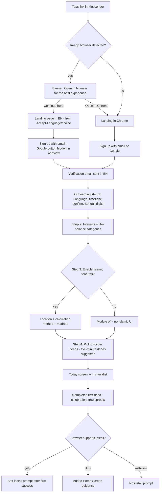
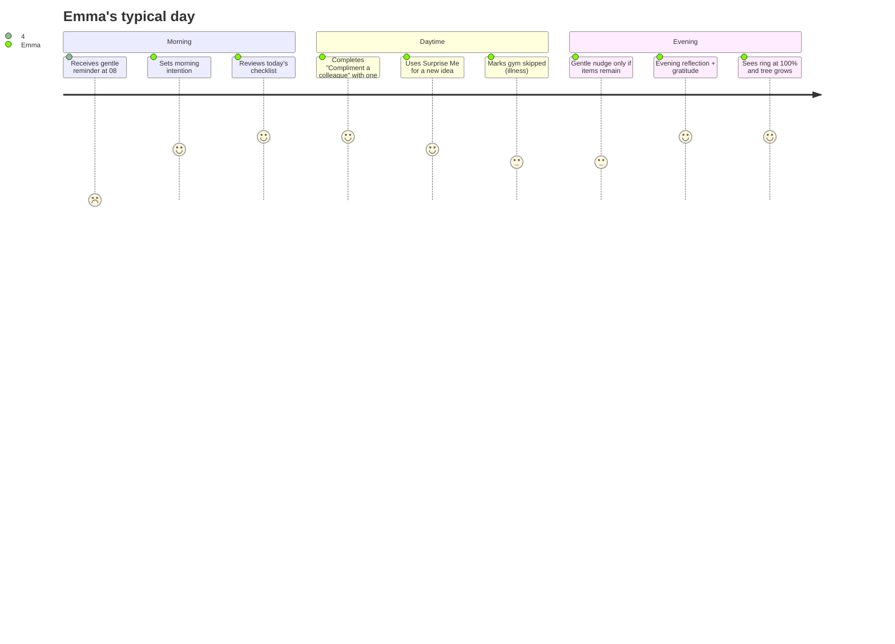
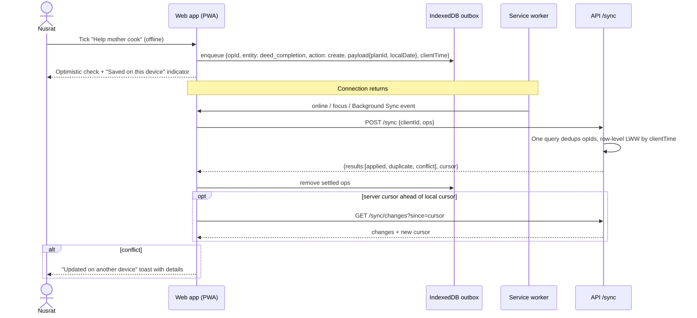
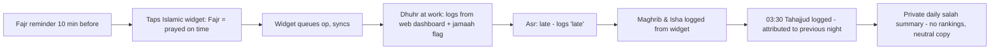
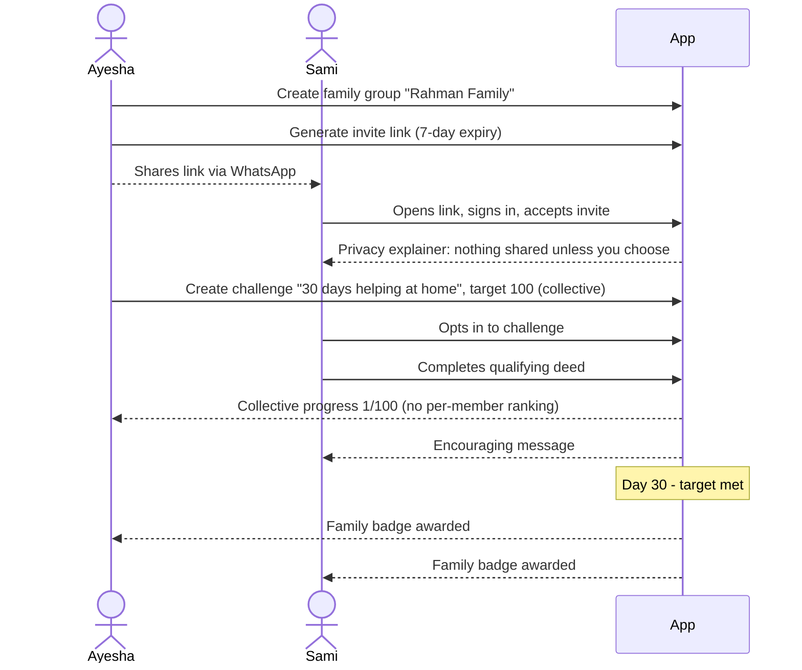
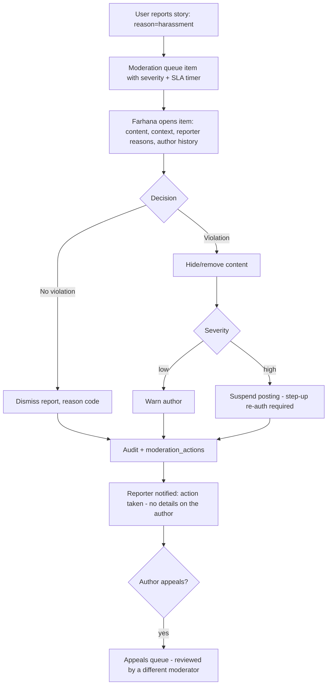
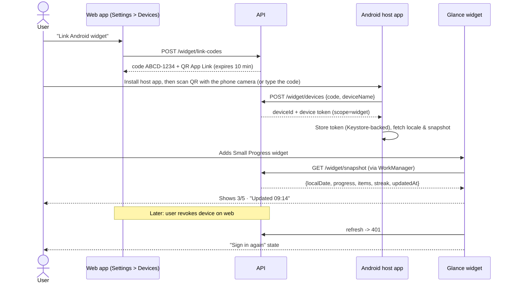

# User Journeys

The journeys below cover the most important end-to-end flows. Each journey lists the feature IDs it exercises, and each one becomes an E2E test scenario in [TEST_PLAN.md](../qa/TEST_PLAN.md).

---

## J1 — Onboarding (from a Messenger link to the first completed deed)
**Persona:** Nusrat (BN, mid-range Android, opens the link inside Messenger).
**Features:** F-PWA-007, F-I18N-002/003, F-AUTH-001/004, F-AUTH-010, F-ISL-017, F-DEED-013, F-DEED-004, F-PWA-001.

**Success:** a first completion within 3 minutes of landing. **Failure paths:** the verification email is delayed (the user can keep going with limited features); the user denies geolocation (city search is offered instead).

---

## J2 — Daily checklist loop
**Persona:** Emma. **Features:** F-NOTIF-002, F-DEED-004/009, F-CAL-006/007, F-GAME-004/008, F-JRNL-003.

---

## J3 — Offline completion and sync (PWA)
**Persona:** Nusrat, offline on a bus. **Features:** F-PWA-003/004/005/006, F-CAL-010.

---

## J4 — A salah day
**Persona:** Rafiq. **Features:** F-ISL-001/002/010/013, F-NOTIF-010, F-WIDGET-005.

**Edge cases:** after travelling to a new time zone, the prayer times recompute from the new location only after the user confirms it. An "excused" status is never shown as missed.

---

## J5 — Family challenge
**Persona:** Ayesha (organizer) and Sami (teen). **Features:** F-COMM-001/002/003/014, F-NOTIF-007, F-COMM-005.

---

## J6 — Admin moderation
**Persona:** Farhana (moderator). **Features:** F-COMM-013, F-COMM-012, F-ADMIN-008, F-RBAC-005/006.

---

## J7 — Linking the Android widget
**Persona:** Nusrat. **Features:** F-WIDGET-001/002/006/007/008, F-AUTH-007.

---

## J8 — Account deletion (privacy)
**Features:** F-AUTH-009, F-RPT-006.
1. Settings → Privacy → Delete account.
2. The user is offered "Export my data first" and an export job runs.
3. The user re-authenticates and picks how to handle their community posts: anonymize or delete.
4. The account is deactivated and a 30-day grace period begins, with an email confirming it.
5. If the user logs in during the grace period, they see a "Cancel deletion" option.
6. When the 30-day grace period ends (FR-AUTH-009-01), a purge job runs. Every step is recorded in the audit log under a pseudonymous ID.
