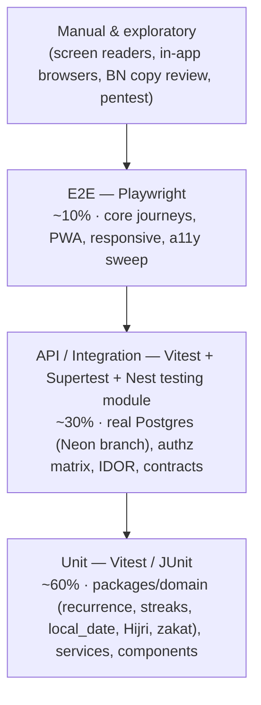

# QA Strategy

> **Status:** Planning draft. No test code exists and nothing has been executed. This document defines how quality will be built in and verified from Phase 2 onward.
>
> Related: [TEST_PLAN.md](TEST_PLAN.md) (test cases: see its header), [SECURITY_TEST_PLAN.md](SECURITY_TEST_PLAN.md), [TRACEABILITY_MATRIX.md](TRACEABILITY_MATRIX.md), [RELEASE_CHECKLIST.md](RELEASE_CHECKLIST.md). Requirements: [../specifications/SRS.md](../specifications/SRS.md).

## 1. Quality goals

1. Every requirement (FR/NFR) is verified by at least one test case or recorded inspection, and the link is machine-checkable (FR IDs appear in test names).
2. A feature is **Done** only when backend logic, validation, permissions, persistence, EN/BN UI and its tests are complete. A UI that merely exists is not Done.
3. Per-user data never leaks across users, groups, logs or AI prompts.
4. The product behaves correctly across timezones, DST, both locales, light/dark themes, and the supported browser/webview matrix.
5. No claim of a passing test unless the run is recorded (CI run URL or manual record with date, tester, build).

## 2. Test pyramid

Principles:
- **Domain logic is pure and lives in `packages/domain`.** It is tested exhaustively at the unit level, including property-based tests (fast-check) for recurrence expansion, streak computation, `local_date` derivation and zakat arithmetic.
- **API tests hit a real Postgres** (Neon branch per PR), not mocks, because data isolation and constraints are core requirements.
- **E2E tests cover journeys, not permutations.** Permutations belong in unit/API tests.
- External providers (email, push, AI, Quran.com, R2) are replaced by **in-process fakes behind the same adapter interfaces** in unit/API/E2E tests. Contract tests against real sandboxes run nightly, and are never used as data sources in production paths.

## 3. Tooling

| Concern | Tool | Where / when |
|---|---|---|
| Unit (TS) | **Vitest** everywhere in TypeScript (packages, web, api — api via unplugin-swc for decorator metadata; DL-035) | Every PR |
| Property-based | fast-check | `packages/domain`, every PR |
| API / integration | **Vitest + Supertest**, `@nestjs/testing`, Prisma against Neon PR branch | Every PR |
| Contract | OpenAPI drift check (generated vs committed); response schema validation in API tests | Every PR |
| Component | Playwright Component Testing or Storybook test runner, with axe | Every PR (`packages/ui`) |
| E2E | **Playwright** — Chromium, Firefox, WebKit; mobile emulation (Pixel 7, iPhone 14, Galaxy S9+ 360 px); **in-app-browser UA simulation** (FBAN/FBAV, Messenger, Instagram, Telegram UA strings) to exercise detection & fallback | PR (smoke on Chromium), main (full matrix), nightly |
| Accessibility | **axe-core** via `@axe-core/playwright`; manual NVDA, VoiceOver, TalkBack | Every E2E run; manual per release |
| Performance (web) | **Lighthouse CI** (budgets: LCP, INP proxy/TBT, CLS, JS size), `size-limit` | PR (budget), main |
| Load | **k6** (API scenarios at NFR-PERFORMANCE-009 load) | Weekly on staging, before release |
| SAST | **CodeQL** (JS/TS, Kotlin) and **Semgrep** (custom rules: no `$queryRawUnsafe`, no unguarded controller, no `dangerouslySetInnerHTML` outside sanitizer) | Every PR |
| DAST | **OWASP ZAP** baseline (unauthenticated) per staging deploy; authenticated full scan before release | Staging |
| Dependencies | `pnpm audit` + **OSV-Scanner**, **Dependabot** (or Renovate), Gradle dependency verification | PR + daily |
| Secrets | **gitleaks** in CI + GitHub secret scanning / push protection | PR + push |
| Android | **JUnit** (pure Kotlin: sync queue, snapshot parsing), **Glance testing** (`glance-appwidget-testing` for composition/state), **Espresso** (host app linking flow), Robolectric where useful; Android Lint | PR (unit), nightly (instrumented on emulator API 26 & 35) |
| Visual | Playwright screenshots for EN/BN × light/dark on key pages (diff threshold 0.2 %) | main + nightly |

## 4. Environments & test data

| Environment | Database | Data | Purpose |
|---|---|---|---|
| Local | Neon dev branch per developer (or child branch) | Factories + reference seed | Dev loop |
| **PR** | **Ephemeral Neon branch created per PR, deleted on close** | Migrations from scratch + reference seed + per-test factories | All PR checks |
| Staging | Neon `staging` branch | Synthetic dataset generator (≈1,000 users, 1 year of history, EN/BN mix, multiple timezones) | E2E full matrix, ZAP, k6, manual |
| Production | Neon `main` | Real data | Smoke checks only (read-only synthetic monitor account) |

Rules:
- **Never copy production data** into any other environment. No anonymised dumps either, unless a documented DPIA approves it.
- Factories (`packages/testing`) create users, plans, completions, journal entries, groups etc. with explicit timezone and locale. Every test creates its own data and uses unique emails (`+run-id` tags).
- Time is controlled: domain tests inject a clock; API tests use a fake clock provider; Playwright uses `page.clock`.
- Reference seed (roles, permissions, categories, deeds, sunnah practices, dhikr presets) is idempotent and verified by TC-PLAT-003-01.

## 5. Coverage targets

| Area | Line coverage gate | Notes |
|---|---|---|
| `packages/domain` | **≥ 90 %** lines, ≥ 85 % branches | Exceeds the SRS floor (NFR-MAINTAINABILITY-003: ≥ 80 %); CI gate set at the stricter value |
| `apps/api` modules | **≥ 80 %** lines | SRS floor is ≥ 70 %; gate at 80 % |
| `apps/web` | ≥ 60 % for hooks/lib; components covered via CT/E2E | Coverage not a goal by itself |
| `apps/android-widget` | ≥ 70 % for sync/queue/data layers | |
| Requirements | **100 %** of in-scope FRs linked to ≥ 1 passing test before the phase exits | Checked by script against the traceability matrix |

Coverage is a ratchet: a PR may not lower module coverage by more than 0.5 percentage points.

## 6. Entry & exit criteria per phase

| Phase | Entry | Exit (in addition to the phase's own acceptance criteria in the master plan) |
|---|---|---|
| P2 Foundation | Plan approved; Neon + git remote available | CI green incl. SAST, secret scan, dependency scan; auth & RBAC permission matrix 100 % pass; axe 0 serious on shipped pages; EN/BN parity 100 %; staging deployed and smoke-tested |
| P3 Deeds & calendar | P2 exit | IDOR suite covers all new endpoints; timezone/DST matrix green; checklist perf baseline recorded |
| P4 Growth & journal | P3 exit | Journal encryption-at-rest verified; privacy-leakage suite green; neutral-copy review signed off |
| P5 Islamic | P4 exit; content licences confirmed | Prayer-time results within ±1 min of reference tables for 5 cities × 3 methods; Hijri offset tests; every published content item has a verified source |
| P6 Notifications | P5 exit | Reminder accuracy ≥ 99 % within ±2 min in a simulated 24 h run across the timezone matrix; quiet hours honoured; DST transitions covered |
| P7 Community | P6 exit | Group isolation & moderation suites green; XSS corpus on posts/comments passes; reporting/blocking E2E green |
| P8 AI | P7 exit; Anthropic key + budget cap | Consent/disable/quota tests green; prompt-injection corpus passes; redaction verified; non-AI fallbacks for every AI feature |
| P9 PWA offline & widget | P8 exit | Offline outbox replay idempotent; conflict cases covered; widget instrumented tests on API 26 & 35; battery check recorded |
| P10 Release | P9 exit | Full regression, security verification (no open High/Critical), perf budgets, WCAG audit, cross-browser/in-app matrix, restore drill, RELEASE_CHECKLIST complete |

A phase cannot exit with failing tests that have been marked `skip` unless each skip has a linked KNOWN_ISSUES entry approved by the product owner.

## 7. Defect management

| Severity | Definition | Release rule |
|---|---|---|
| S1 Critical | Data loss, cross-user data exposure, auth bypass, crash of core flow | Blocks release; hotfix immediately |
| S2 Major | Core feature broken with no workaround; wrong religious content; wrong streak/date | Blocks release |
| S3 Minor | Workaround exists; cosmetic issue in core flow | Allowed with KNOWN_ISSUES entry |
| S4 Trivial | Cosmetic, non-core | Allowed |

Every fixed S1/S2 defect gets a regression test with the defect ID in its name.

## 8. Flaky-test policy

1. A test that fails and then passes on retry in CI is flagged flaky automatically (Playwright retries = 1 on CI only; reports annotate flaky results).
2. Flaky tests are **quarantined within 24 h** (moved to a `@quarantine` tag that runs in a non-blocking job) and an issue is opened with an owner.
3. Quarantine limit: 14 days or 2 % of the suite, whichever comes first. Above that, feature work in the owning module pauses until fixed.
4. Never "fix" flakiness with arbitrary sleeps. Use web-first assertions, fake clocks and deterministic data.
5. Security, authz and IDOR tests may **never** be quarantined. A flaky security test blocks merge until fixed.

## 9. Bilingual (EN/BN) testing

| Check | Method | Gate |
|---|---|---|
| Key parity | Script compares `en.json` and `bn.json` key sets and ICU argument names | CI, 100 % (NFR-LOCALIZATION-001) |
| No hardcoded strings | ESLint rule (`i18next/no-literal-string`-style) on JSX text/attributes in `apps/web` and `packages/ui` | CI |
| **BN pseudo-locale** `bn-XA` | Generated from `en` with Bengali glyph padding (+40 % length), wrapped in markers `⟦…⟧`. Playwright runs the E2E smoke in `bn-XA` and asserts: no element overflow (`scrollWidth > clientWidth` on text containers), no clipped text, no visible raw keys, all markers present (proves no untranslated hardcoded strings) | Nightly + before release |
| Real BN rendering | Visual snapshots of key pages in `bn` at 360 px and 1280 px; conjunct rendering spot-check (Hind Siliguri) | main |
| Numerals & dates | Unit tests for `Intl` formatting with `bn-BD`, Bengali digits on/off, Hijri display, week start (Saturday default) | PR |
| Emails & notifications | Snapshot both locales for each template; push title ≤ 50 / body ≤ 120 chars in both | PR |
| Native review | Every BN string reviewed by a native reviewer before release (NFR-LOCALIZATION-002) | Release |

## 10. Timezone & DST test matrix

Applied to `packages/domain` (unit), `/checklist`, `/completions`, `/streaks`, reminder scheduler, prayer-time and Hijri logic.

| Zone | Why | Scenarios |
|---|---|---|
| **Asia/Dhaka** (UTC+6, no DST) | Primary audience | Day boundary at 00:00 local = 18:00 UTC previous day; completion at 23:59 vs 00:01 |
| **America/New_York** (DST) | DST transitions | Spring-forward day (23 h) and fall-back day (25 h): no duplicate/missing `local_date`; reminders at 02:30 on spring-forward fire once at the next valid time; streak unaffected |
| **Pacific/Kiritimati** (UTC+14) | Extreme ahead | Server ±1 day `local_date` tolerance accepts valid dates; weekly report boundaries |
| **UTC** | Baseline / server | Server-side computations never depend on server TZ (tests run with `TZ` set to each zone to prove it) |
| Timezone change | Travel | User moves Dhaka → New York: existing `local_date` records never shift (SRS §7.5.2); new records use new zone; streak continuity rules hold |

CI runs the domain suite four times with `TZ` set to each zone.

## 11. Cross-browser, device & webview matrix

| Target | Engine | Level | Expectations |
|---|---|---|---|
| Chrome (latest 2), Android & desktop | Blink | Automated (Playwright Chromium) + manual on a real mid-tier Android | Full: install, push, background sync, offline |
| Edge, Samsung Internet (latest 2) | Blink | Automated (Chromium proxy) + manual Samsung | Full |
| Firefox (latest 2) desktop/Android | Gecko | Automated | No install prompt on desktop; push supported; no Background Sync (flush on focus) |
| Safari macOS / iOS (latest 2) | WebKit | Automated (Playwright WebKit) + manual iPhone | No install prompt (A2HS instructions); push only when installed (16.4+) |
| **iOS Safari standalone (Home-Screen PWA)** | WebKit | Manual on device | Push permission flow, safe-area insets, offline launch, storage persistence |
| **Facebook in-app browser** (Android & iOS) | WebView | UA-simulated in Playwright + manual | Banner "Open in browser" shown; email login works; Google OAuth button replaced by guidance; core checklist flow works (NFR-COMPATIBILITY-002) |
| **Messenger in-app browser** | WebView | Same as above | Same |
| **Telegram in-app browser** | WebView | Same as above | Same |
| Instagram in-app browser | WebView | Same as above | Same |
| Android widget host | Android 8.0 (API 26) → latest | Emulator API 26 & 35 + real Samsung / Pixel | Widgets render, tap-to-complete, offline queue, stale indicator, EN/BN |

Viewports (Playwright projects): 320, 360, 390, 768, 1024, 1280, 1920 px. Orientation: portrait + landscape on 360/768.

## 12. PWA tests

| Area | Tests |
|---|---|
| Installability | Lighthouse PWA checks; manifest fields (EN/BN name, icons, maskable, `start_url`, `scope`, shortcuts) |
| Service worker | Precache size ≤ 3 MB; never caches `/api/v1/auth/*`, `/admin/*` or `no-store` responses (NFR-SECURITY-010); cache partitioned per user and purged on logout (NFR-PRIVACY-001) |
| Offline | `context.setOffline(true)`: app shell loads; today's checklist readable; completion queued in IndexedDB outbox; reconnect → replay applied exactly once (idempotency key) |
| Conflicts | Two devices edit the same completion offline → row-level LWW on `clientTime` applied (DL-015); losing value logged in `sync_operations.conflict`; user sees a toast |
| Journal | Journal pages show "online only" state when offline; no journal content in IndexedDB or caches |
| Update flow | New SW version → "Update available" prompt; no data loss in outbox across update |
| Fallbacks | Background Sync unavailable → flush on `online`/focus/startup; Push unavailable → in-app + email |

## 13. Regression strategy

| Suite | Content | Trigger | Runtime budget |
|---|---|---|---|
| PR | Unit + API (affected modules via Turborepo filters) + E2E smoke (Chromium, EN) + a11y on touched pages | Every PR | ≤ 15 min |
| Main | Full unit/API; E2E on Chromium/Firefox/WebKit + mobile projects; EN + BN; visual snapshots | Merge to main | ≤ 40 min |
| Nightly | Everything + `bn-XA` pseudo-locale, timezone matrix, Android instrumented, provider contract tests, ZAP baseline | Nightly | ≤ 2 h |
| Release | Nightly + k6 load, authenticated ZAP, manual matrix (§11), screen readers, restore drill | Release candidate | — |

Regression selection: tests are tagged `@module:<MOD>` and `@phase:<n>`. Changes to `packages/domain`, auth, RBAC or sync always trigger the full API suite.

## 14. Reporting

- CI publishes JUnit + Playwright HTML reports and coverage to the PR.
- `docs/implementation/IMPLEMENTATION_STATUS.md` records, per completed task, the CI run used as evidence.
- The traceability check script fails CI if an in-scope FR has no tagged test once its phase has started.
