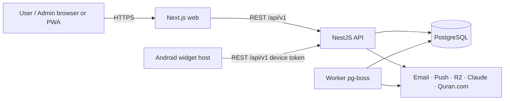

# Software Requirements Specification (SRS) — Daily Good Deeds

| Field | Value |
|---|---|
| Version | 0.1 (planning draft, awaiting approval) |
| Date | 2026-10-30 |
| Status | Draft. No implementation exists. |
| Canonical feature IDs | [../product/FEATURE_ID_REGISTRY.md](../product/FEATURE_ID_REGISTRY.md) |
| Conventions | [../README.md](../README.md) |

**Verification methods:** **T** = Test (automated or manual), **I** = Inspection (code/config/doc review), **A** = Analysis (measurement, calculation, audit), **D** = Demonstration.
**Priority** is inherited from the parent feature (M/S/C/W), unless a requirement states otherwise.
**Keywords:** "shall" is mandatory, "should" is recommended, "may" is optional.

---

## 1. Introduction

### 1.1 Purpose
This document states the functional and non-functional requirements of **Daily Good Deeds**: a bilingual (English/Bengali) web platform and PWA for personal growth, good deeds, the Islamic lifestyle, and community impact, plus a companion Android home-screen widget. The requirements are written to be testable and form the basis for design, implementation, and acceptance.

### 1.2 Intended audience
Product owner, engineers (web, API, Android), QA, security reviewers, content reviewers (Bengali language; Islamic content).

### 1.3 Definitions

| Term | Definition |
|---|---|
| **Local date** (`local_date`) | A calendar date (`YYYY-MM-DD`) in the user's configured IANA timezone at the moment an action is recorded. All daily logic keys on it. |
| **Day boundary** | 00:00 local time in the user's timezone. Users may optionally set a day-start offset of 0–4 h (default 0) so that late-night activity counts toward the previous day. |
| **Deed plan** | A user's commitment to a deed with a recurrence rule. It produces checklist items on the dates where it is due. |
| **Due day** | A local date on which a deed plan is scheduled. |
| **Completion** | A record of `done`, `partial`, or `skipped` for a (plan, local_date) pair. |
| **Missed** | A due day that has passed (past the local day boundary and past the edit window) with no `done`/`partial` completion and no `skipped` record. |
| **Rest day** | A due day that the user explicitly marked `skipped` with reason `rest`/`excused`, or a day the user marked as a global rest day. |
| **Streak** | The number of consecutive due days that are satisfied (see §7.5.1). |
| **Device token** | A long-lived, revocable credential issued to a linked Android widget device. |
| **Outbox** | The client-side queue of mutations that have not yet been sent to the server. |
| **Idempotency key** | A client-generated UUID that makes repeating a mutation safe. |
| **Guest** | A visitor who is not authenticated. |

### 1.4 References
Directive (master project directive, 2026-10-30); [TECH_STACK_DECISION.md](../TECH_STACK_DECISION.md); [PROJECT_GAPS.md](../PROJECT_GAPS.md); OWASP ASVS 4.0.3 Level 2; WCAG 2.2; RFC 9457 (Problem Details); RFC 5545 (RRULE); W3C Web App Manifest; Push API; Android App Widgets / Jetpack Glance documentation.

---

## 2. Product overview

Daily Good Deeds helps people build positive habits and do meaningful good deeds every day. It also supports personal reflection and Islamic practice, and connects families and communities around kindness.

- **Primary product:** a responsive web app and installable PWA (Next.js), with an admin area at `/admin`.
- **Backend:** a NestJS modular-monolith REST API (`/api/v1`) plus a pg-boss worker on managed PostgreSQL.
- **Companion:** a native Kotlin Android app whose only purpose is to host home-screen widgets. It is not a second product.
- **Optional intelligence:** AI features (Anthropic Claude through a provider abstraction) that the user can disable. The core works fully without AI.

---

## 3. Business objectives

| ID | Objective | Measure (target 6 months after launch) |
|---|---|---|
| BO-1 | Encourage daily positive habits | ≥ 35 % of monthly active users (MAU) log ≥ 1 completion on ≥ 4 days per week |
| BO-2 | Serve Bengali- and English-speaking users equally | 100 % UI string coverage in both locales; BN users' retention ≥ 90 % of EN users' |
| BO-3 | Build trust through privacy | 0 confirmed incidents of private data exposure; journals private by default |
| BO-4 | Support Islamic practice with reliable content | 100 % of published religious content has a recorded source and verification status |
| BO-5 | Enable positive social impact | ≥ 10 % of MAU join at least one family group or campaign |
| BO-6 | Sustainable operations | AI cost per active AI user ≤ the configured monthly cap; infrastructure scales without re-architecture to 100 k registered users |

---

## 4. Scope

**In scope:** modules AUTH, RBAC, I18N, DEED, CAL, GROW, JRNL, PLAN, ISL, NOTIF, COMM, WELL, GAME, AI, PWA, WIDGET, RPT, INTG, and ADMIN, as listed in the feature registry. Each feature is delivered according to its MoSCoW priority and phase.

**Out of scope for the initial release (W):** F-INTG-004 wearables and F-ADMIN-017 subscription management. See §30 for the full list of out-of-scope items.

---

## 5. Stakeholders

| Stakeholder | Interest |
|---|---|
| End users (individuals, families, Muslims practising daily worship, volunteers) | Easy daily tracking, privacy, bilingual UX |
| Product owner | Vision, prioritisation, acceptance |
| Admins / content editors | Managing deeds, translations, campaigns, moderation |
| Super Admin | Platform configuration, role governance, security |
| Islamic content reviewer | Accuracy and sourcing of religious content |
| Bengali language reviewer | Translation quality |
| Community moderators (Admins with the moderation permission) | Safe community spaces |
| Engineering / QA / DevOps | Maintainability, testability, operability |
| Third-party providers | Neon, Resend, Anthropic, Quran.com, Google, R2, hosting |

---

## 6. User roles

| Role | Description | Key capabilities |
|---|---|---|
| **Guest** | Not authenticated | Landing page, about/privacy pages, public campaign pages (QR), register/login, language switch, read-only sample deeds (marketing). No personal data is stored server-side. |
| **User** | A registered, email-verified account. Unverified accounts get limited access (see FR-AUTH-004-03). | All personal features, plus family and community features subject to privacy rules |
| **Admin** | A staff account with a subset of permissions | Admin console within the permissions granted (content, moderation, campaigns, users read/suspend) |
| **Super Admin** | Platform owner | All permissions, including role and permission management, feature flags, system settings, and Admin management |

Group-scoped roles (`owner`, `guardian`, `member` for family groups; `owner`, `moderator`, `member` for community groups) are **contextual** roles that apply only within that group and never grant platform permissions.

---

## 7. Functional requirements

Every row's **Feature** column refers to the canonical registry. Format: `ID | Requirement | Feature | Pri | Ver`.

### 7.1 AUTH — Authentication & Identity

| ID | Requirement | Feature | Pri | Ver |
|---|---|---|---|---|
| FR-AUTH-001-01 | The system shall allow a Guest to register with email, password, display name, preferred language (en/bn), and timezone (auto-detected from the browser, editable). | F-AUTH-001 | M | T |
| FR-AUTH-001-02 | The system shall reject passwords shorter than 10 characters or longer than 128 characters. It shall also reject passwords found in the breached-password corpus (k-anonymity HIBP range check; if the check service is unavailable, it fails open and logs the event). | F-AUTH-001 | M | T |
| FR-AUTH-001-03 | Email addresses shall be normalised (trimmed and lowercased) and unique across accounts. Registering an existing email shall return the same generic response as a successful registration, and an "account exists" email is sent instead, to prevent account enumeration. | F-AUTH-001 | M | T |
| FR-AUTH-001-04 | Registration shall require acceptance of the Terms and Privacy Policy, recorded with version and timestamp. | F-AUTH-001 | M | T |
| FR-AUTH-001-05 | Registration shall be rate-limited to 5 attempts per IP per hour and shall support an invisible challenge (Cloudflare Turnstile) when a threshold is exceeded. | F-AUTH-001 | M | T |
| FR-AUTH-002-01 | The system shall authenticate users with email and password, hashed with Argon2id (m=19 MiB, t=2, p=1 minimum). | F-AUTH-002 | M | T/I |
| FR-AUTH-002-02 | Failed logins shall return a generic error. After 5 consecutive failures for an account, further attempts shall be delayed progressively (exponential back-off up to 15 min). After 20 failures per IP per 15 min, the IP shall be throttled. | F-AUTH-002 | M | T |
| FR-AUTH-002-03 | Successful login shall create a server-side session and issue an **opaque session token** (256 random bits). The server stores only its SHA-256 hash in `user_sessions` and looks it up on every request (in-process cache ≤ 5 s). User sessions shall have a 30-day absolute lifetime and a 7-day idle timeout; sessions of users holding an admin role, a 12 h absolute lifetime and a 30 min idle timeout. No JWTs are used (DL-012). | F-AUTH-002 | M | T |
| FR-AUTH-002-04 | Web clients shall receive the session token only as a `__Host-dgd_session` cookie (`HttpOnly; Secure; SameSite=Lax; Path=/`); it shall never be exposed to JavaScript. Unsafe methods (POST/PUT/PATCH/DELETE) using cookie auth shall be rejected unless `Origin` matches the allowed web origin (or `Sec-Fetch-Site` is `same-origin`/`same-site`). This is the CSRF protection. | F-AUTH-002 | M | I/T |
| FR-AUTH-002-05 | The session token shall be rotated (new token, old one invalidated) on login, privilege change and step-up re-authentication, to prevent session fixation. The idle timestamp is extended at most once per minute per session to limit writes. | F-AUTH-002 | M | T |
| FR-AUTH-003-01 | The system shall support Google sign-in through the OAuth 2.0 Authorization Code flow with PKCE and `state`/`nonce` validation, using full-page redirects (no popups). | F-AUTH-003 | S | T |
| FR-AUTH-003-02 | If a Google identity's verified email matches an existing account, linking shall require the user to authenticate to the existing account first. There shall be no silent auto-linking. | F-AUTH-003 | S | T |
| FR-AUTH-003-03 | Inside detected in-app browsers (FR-PWA-007-01), the Google button shall be replaced by an "Open in browser to use Google" notice, and email login shall remain available. | F-AUTH-003 | S | T |
| FR-AUTH-004-01 | On registration, the system shall send a verification email containing a single-use link token (256-bit random, stored hashed, valid for 24 h). | F-AUTH-004 | M | T |
| FR-AUTH-004-02 | Verification resends shall be limited to 1 per 60 s and 5 per 24 h per account. | F-AUTH-004 | M | T |
| FR-AUTH-004-03 | Unverified accounts may use personal tracking for up to 7 days. They shall not join groups, post community content, use AI, or receive email digests until verified. | F-AUTH-004 | M | T |
| FR-AUTH-005-01 | The forgot-password flow shall always return the same response whether or not the email exists, and shall send a reset token (single-use, hashed, valid for 30 min). | F-AUTH-005 | M | T |
| FR-AUTH-005-02 | A successful reset shall revoke all of the user's sessions and device tokens, and shall send a "password changed" notification email. | F-AUTH-005 | M | T |
| FR-AUTH-005-03 | Reset requests shall be limited to 3 per account per hour and 10 per IP per hour. | F-AUTH-005 | M | T |
| FR-AUTH-006-01 | Logout shall revoke the current session server-side (effective immediately), clear the session cookie, and clear user-scoped client caches (IndexedDB and Cache Storage entries tagged as user data). | F-AUTH-006 | M | T |
| FR-AUTH-006-02 | Users shall be able to "log out of all devices". This revokes all sessions **and** widget device tokens, effective on the next request. | F-AUTH-006 | M | T |
| FR-AUTH-007-01 | Users shall be able to list active sessions and linked widget devices, with device label, browser/OS, approximate location (country from IP), created time, and last-used time. | F-AUTH-007 | M | T |
| FR-AUTH-007-02 | Users shall be able to revoke any individual session or device. Revocation takes effect on the next request (subject only to the ≤ 5 s session cache). | F-AUTH-007 | M | T |
| FR-AUTH-007-03 | The system shall allow at most 20 concurrent sessions per user. Creating a 21st session evicts the least recently used one. | F-AUTH-007 | M | T |
| FR-AUTH-008-01 | Users shall be able to view and edit display name (1–60 chars), avatar (JPEG/PNG/WebP ≤ 2 MB, re-encoded server-side, EXIF stripped), bio (≤ 280 chars), and an optional public handle (3–30 chars `[a-z0-9_]`, unique). | F-AUTH-008 | M | T |
| FR-AUTH-008-02 | Changing email shall require the current password (or a recent re-auth), plus verification of the new address. The old address is notified. Delivered in P4 (DL-032); until then, support changes the email through the admin user tools. | F-AUTH-008 | M | T |
| FR-AUTH-008-03 | Changing password shall require the current password and shall revoke all other sessions. | F-AUTH-008 | M | T |
| FR-AUTH-009-01 | Users shall be able to request account deletion after re-authenticating. The account enters `pending_deletion` with a **30-day grace period**, during which login offers cancellation. | F-AUTH-009 | M | T |
| FR-AUTH-009-02 | When deletion is requested, the system shall offer a full data export (FR-RPT-006-02) and shall immediately hide the user's community content and remove them from groups. | F-AUTH-009 | M | T |
| FR-AUTH-009-03 | After the grace period, a worker job shall hard-delete all personal data: profile, journals, completions, worship records, AI data, sessions, attachments in object storage, and push subscriptions. Audit-log rows shall keep only a pseudonymous actor ID (HMAC of the user ID with a rotating secret) and no PII. | F-AUTH-009 | M | T/I |
| FR-AUTH-009-04 | Community posts by deleted users shall be either deleted or anonymised as "Former member", according to a choice the user makes at deletion time (default: delete). | F-AUTH-009 | M | T |
| FR-AUTH-010-01 | Users shall be able to set language (en/bn), timezone (IANA), theme (light/dark/system), week start (Sat/Sun/Mon; BN default Sat), numeral style (Latin/Bengali), day-start offset (0–4 h), and date display (Gregorian, Gregorian + Hijri). | F-AUTH-010 | M | T |
| FR-AUTH-010-02 | Preference changes shall apply in the UI within 1 s without a full reload, and shall persist server-side and across devices. | F-AUTH-010 | M | T |
| FR-AUTH-010-03 | A timezone change shall not rewrite existing `local_date` values. It only affects records created after the change (see §7.5.2). | F-AUTH-010 | M | T |
| FR-AUTH-011-01 | Users may generate 10 single-use recovery codes (stored hashed) and/or register a verified secondary email for account recovery. | F-AUTH-011 | C | T |

### 7.2 RBAC — Roles & Permissions

| ID | Requirement | Feature | Pri | Ver |
|---|---|---|---|---|
| FR-RBAC-001-01 | The system shall define the platform roles Guest (implicit), User, Admin, and Super Admin. Every registered account shall hold the User role. | F-RBAC-001 | M | T |
| FR-RBAC-001-02 | At least one active Super Admin shall exist at all times. Removing the last Super Admin role shall be rejected. | F-RBAC-001 | M | T |
| FR-RBAC-002-01 | Every API endpoint shall declare its required permission(s) as `resource.action` strings from the catalog in [API_SPECIFICATION §0](../api/API_SPECIFICATION.md) (e.g. `content.deeds.manage`, `users.manage`). Endpoints without a declaration shall fail a build-time/CI check. | F-RBAC-002 | M | I/T |
| FR-RBAC-002-02 | Authorization shall be enforced server-side on every request. UI hiding is cosmetic only. A missing permission returns 403 without revealing whether the resource exists (404 for resources owned by other users). | F-RBAC-002 | M | T |
| FR-RBAC-002-03 | Per-user resources shall be scoped by the authenticated `user_id` in the data access layer (repository-level guard), so that one user's data is never returned to another. | F-RBAC-002 | M | T/I |
| FR-RBAC-003-01 | Super Admins shall be able to assign and revoke the Admin and Super Admin roles, and create custom roles from the permission catalogue. Admins shall not change their own roles. | F-RBAC-003 | M | T |
| FR-RBAC-003-02 | Role and permission changes shall take effect within 60 s (permissions are loaded with the session and cached ≤ 60 s). Revoking an admin role shall also revoke that user's sessions immediately. | F-RBAC-003 | M | T |
| FR-RBAC-004-01 | Admin accounts shall be created with a seed/CLI command (`pnpm admin:create`, audit-logged) and must enrol TOTP on first login. Super Admins shall be able to suspend or reactivate admin accounts in the UI. An email invitation flow (72 h validity) is delivered in P10 (DL-032). | F-RBAC-004 | M | T |
| FR-RBAC-005-01 | The system shall write an append-only audit record for: login success/failure, password/email change, session revocation, role/permission changes, admin CRUD on content/users, moderation actions, feature-flag/settings changes, data exports, and account deletion. | F-RBAC-005 | M | T |
| FR-RBAC-005-02 | Each audit record shall include timestamp (UTC), actor ID (or pseudonym), actor role, action, target type/ID, outcome, IP (truncated /24 for IPv4, /48 for IPv6), user agent, request ID, and a before/after diff with secrets and journal content redacted. | F-RBAC-005 | M | I/T |
| FR-RBAC-005-03 | The application DB role shall have no UPDATE or DELETE privilege on `audit_logs`. Audit logs shall be retained for 2 years. | F-RBAC-005 | M | I |
| FR-RBAC-006-01 | `/admin` routes (web) and `/api/v1/admin/*` (API) shall require an admin permission plus a **step-up re-authentication** (password or TOTP) no older than **10 min** for destructive or privileged actions (role changes, user deletion, flag changes, broadcasts). | F-RBAC-006 | M | T |
| FR-RBAC-006-02 | Admin sessions shall have an idle timeout of 30 min and an absolute lifetime of 12 h. | F-RBAC-006 | M | T |
| FR-RBAC-007-01 | Admin and Super Admin accounts shall be able to enrol TOTP (RFC 6238, 30 s, SHA-1, 6 digits, ±1 step tolerance). Enforcement can be switched on globally; it is on by default in production. | F-RBAC-007 | S | T |

### 7.3 I18N — Bilingual Localization

| ID | Requirement | Feature | Pri | Ver |
|---|---|---|---|---|
| FR-I18N-001-01 | All user-facing strings in web, API (errors, emails, push), and widget shall come from locale message catalogs (`packages/i18n`, Android `strings.xml`). CI shall fail when a hardcoded JSX text literal is detected by lint rule. | F-I18N-001 | M | I/T |
| FR-I18N-001-02 | Messages shall use ICU MessageFormat, with plural rules for `en` and `bn`. | F-I18N-001 | M | T |
| FR-I18N-001-03 | CI shall fail if any key exists in `en` but not in `bn` (or vice versa), unless it is listed in an allow-list file with an expiry date. | F-I18N-001 | M | T |
| FR-I18N-002-01 | A language switcher shall be reachable from the header/profile menu on every page and on auth pages. Switching shall not lose form input or scroll position on the current page. | F-I18N-002 | M | T |
| FR-I18N-003-01 | Language shall be resolved in this order: authenticated user preference → `NEXT_LOCALE` cookie → `Accept-Language` → `en`. Changing it while signed in persists it to the account. | F-I18N-003 | M | T |
| FR-I18N-003-02 | URLs shall carry a locale prefix (`/en/...`, `/bn/...`) for public and SEO pages. Authenticated app routes may resolve the locale from preference without a prefix. | F-I18N-003 | M | T |
| FR-I18N-004-01 | Dates, times, numbers, and percentages shall be formatted with `Intl` using locale `bn-BD` or `en`. When the "Bengali numerals" preference is on, digits shall render as ০-৯. | F-I18N-004 | M | T |
| FR-I18N-004-02 | Where enabled, the Hijri date shall be displayed alongside the Gregorian date using the Umm al-Qura calendar plus the user's Hijri offset (FR-ISL-013-02). | F-I18N-004 | M | T |
| FR-I18N-004-03 | Users shall be able to enter numbers in Bengali digits in numeric inputs. Input shall be normalised to Latin digits before validation. | F-I18N-004 | M | T |
| FR-I18N-005-01 | Bengali text shall use the font stack `"Hind Siliguri", "Noto Sans Bengali", system-ui` with a line-height ≥ 1.6, and shall never be rendered with artificial letter-spacing or forced uppercase. | F-I18N-005 | M | I |
| FR-I18N-005-02 | Arabic text (Quran, Duas) shall use a dedicated Arabic font (e.g. Amiri Quran / Noto Naskh Arabic) with `dir="rtl"` and `lang="ar"`. | F-I18N-005 | M | I |
| FR-I18N-006-01 | Emails, push notifications, and in-app notifications shall be rendered in the recipient's preferred language at send time, not the sender's. | F-I18N-006 | M | T |
| FR-I18N-007-01 | API validation errors shall return a stable machine code per field (e.g. `password.too_short`). Clients shall localise messages from the code. The API shall also include a localised `detail` based on `Accept-Language`. | F-I18N-007 | M | T |
| FR-I18N-008-01 | Admin-managed content (deeds, categories, achievements, duas, hadith, campaigns, affirmations, notification templates) shall store per-locale translations in `*_translations` tables, keyed by `(entity_id, locale)`. | F-I18N-008 | M | T |
| FR-I18N-008-02 | Content shall not be published unless an EN translation exists. A missing BN translation shall be flagged in the admin UI. | F-I18N-008 | M | T |
| FR-I18N-009-01 | If a BN UI key or content translation is missing, the EN value shall be shown, the element marked `lang="en"`, and the miss reported (rate-limited) to monitoring. | F-I18N-009 | M | T |

### 7.4 DEED — Good Deeds Management

| ID | Requirement | Feature | Pri | Ver |
|---|---|---|---|---|
| FR-DEED-001-01 | The system shall provide a library of system deeds (owner = NULL). Each has an EN/BN title (≤ 80 chars), description (≤ 500), category, estimated minutes (1–240), effort tag, `is_five_minute` flag, optional life-balance category, and active/inactive status. | F-DEED-001 | M | T |
| FR-DEED-001-02 | Deactivating a system deed shall hide it from discovery but shall not affect existing plans or history. | F-DEED-001 | M | T |
| FR-DEED-002-01 | Categories shall have EN/BN names, an icon key, a colour token, and a sort order. Deeds belong to exactly one category. At launch there shall be at least 8 categories mapped to the 8 life-balance categories. | F-DEED-002 | M | T |
| FR-DEED-003-01 | Users shall be able to create, edit, archive, and delete custom deeds (title 1–80 chars, optional description ≤ 500, category, estimated minutes). Custom deeds are visible only to their owner unless shared through a group challenge. | F-DEED-003 | M | T |
| FR-DEED-003-02 | Users may have at most 200 active custom deeds. | F-DEED-003 | M | T |
| FR-DEED-003-03 | Deleting a custom deed that has completions shall require confirmation. The user chooses between archiving (keep history) and permanently deleting the history. | F-DEED-003 | M | T |
| FR-DEED-004-01 | For each local date, the system shall compute a checklist of all active deed plans due that day, each with its status (`pending`, `done`, `partial`, `skipped`). | F-DEED-004 | M | T |
| FR-DEED-004-02 | Marking an item done or undone shall respond optimistically in the UI within 100 ms. The server shall persist it idempotently (see §19). | F-DEED-004 | M | T |
| FR-DEED-004-03 | Users shall be able to reorder checklist items. The order persists per plan. | F-DEED-004 | M | T |
| FR-DEED-004-04 | Users shall be able to add a one-off deed for a single day without creating a recurring plan. | F-DEED-004 | M | T |
| FR-DEED-004-05 | The Today page shall load its data in **one** request, `GET /api/v1/today` (checklist, streak summary, next prayer if ISL is enabled, affirmation, suggestion), with an ETag. It shall share its builder with the widget snapshot (FR-WIDGET-006-01), so both return the same statuses for the same user-day. | F-DEED-004 | M | T |
| FR-DEED-005-01 | Deed plans shall support recurrence: daily; specific weekdays; every N days (N 1–30); weekly X times (target count per week, 1–7); monthly on day-of-month or nth weekday. Recurrence is stored as a constrained RRULE subset plus a start date and an optional end date. | F-DEED-005 | M | T |
| FR-DEED-005-02 | Plans may define a daily target count (1–100, e.g. "give salam 5 times"). An item is `done` when the count reaches the target and `partial` when 0 < count < target. | F-DEED-005 | M | T |
| FR-DEED-005-03 | Editing a plan's recurrence shall apply from the edit date forward and shall not alter past due days. | F-DEED-005 | M | T |
| FR-DEED-005-04 | A user may have at most 100 active plans. | F-DEED-005 | M | T |
| FR-DEED-006-01 | Users shall be able to favorite or unfavorite any visible deed. Favorites appear first in the add-deed picker and have a dedicated filter. | F-DEED-006 | S | T |
| FR-DEED-007-01 | Users shall be able to view their completion history paginated by date (cursor-based, 30 days per page), filter by category, deed, and status, and open any past day. | F-DEED-007 | M | T |
| FR-DEED-008-01 | Users may attach a private note (≤ 1,000 chars) to any completion. | F-DEED-008 | S | T |
| FR-DEED-009-01 | Completion status shall be one of `done`, `partial`, or `skipped`. `skipped` requires a reason code (`rest`, `excused`, `not_applicable`, `other`) and may include free text (≤ 200 chars). The absence of a record means pending/missed. | F-DEED-009 | M | T |
| FR-DEED-010-01 | Users may attach up to 3 images (JPEG/PNG/WebP/HEIC, ≤ 5 MB each) to a completion, uploaded through pre-signed URLs. Files shall be content-type sniffed, re-encoded, EXIF-stripped, and private (signed GET URLs valid for 10 min). | F-DEED-010 | C | T |
| FR-DEED-010-02 | Attachments shall never be required to mark a deed done. | F-DEED-010 | C | T |
| FR-DEED-011-01 | Users shall be able to browse the library by category, search titles and descriptions in the current locale (case- and diacritic-insensitive, and Bengali-aware through normalised Unicode NFC), and filter by duration and effort. | F-DEED-011 | S | T |
| FR-DEED-012-01 | The "random deed" action shall return one active system or owned deed, excluding deeds already completed today and deeds shown in the last 3 random draws. It shall be weighted toward under-represented life-balance categories of the last 14 days. | F-DEED-012 | S | T |
| FR-DEED-013-01 | The system shall present a "5-minute deeds" collection: deeds with `estimated_minutes ≤ 5`, shuffled daily per user. | F-DEED-013 | S | T |
| FR-DEED-014-01 | Rule-based recommendations shall suggest up to 5 deeds from categories with the lowest completion share over the last 30 days, excluding deeds the user already plans. No AI is required. | F-DEED-014 | S | T |

### 7.5 CAL — Calendar & Habit Tracking

| ID | Requirement | Feature | Pri | Ver |
|---|---|---|---|---|
| FR-CAL-001-01 | The daily view shall show the checklist, completion rate, Hijri date (if enabled), and planner items for a selected local date, with previous/next/today navigation. | F-CAL-001 | M | T |
| FR-CAL-002-01 | The weekly view shall show 7 days starting at the user's week start, with per-day completion rate and per-plan status cells. | F-CAL-002 | M | T |
| FR-CAL-003-01 | The monthly view shall show a calendar grid with a per-day completion indicator (4 levels + none) and markers for rest days and fasts (if ISL is enabled). | F-CAL-003 | M | T |
| FR-CAL-004-01 | The yearly view shall show 12 month summaries with completion rate, total completions, and best streak per month, for any year since account creation. | F-CAL-004 | S | T |
| FR-CAL-005-01 | The heatmap shall render up to 365 days of daily completion rate in 5 buckets (0, 1–25, 26–50, 51–75, 76–100 %). Each cell shall have an accessible text alternative and keyboard focus. | F-CAL-005 | S | T |
| FR-CAL-006-01 | Daily completion rate = (done + 0.5 × partial) ÷ (due items − skipped items), rounded to an integer %. If the denominator is 0, the rate is "n/a" (not 0 %). | F-CAL-006 | M | T |
| FR-CAL-006-02 | Per-day aggregates (scheduled, done, partial, skipped) shall be kept in a derived `daily_summaries` table. It is updated in the same transaction as each completion and recomputed from today forward when a plan changes. Calendar, heatmap, yearly and overall-streak reads shall use it. It shall be rebuildable from completions. | F-CAL-006 | M | T |
| FR-CAL-007-01 | The system shall compute a streak for each plan, and an overall streak (any `done` completion on the day), according to §7.5.1. | F-CAL-007 | M | T |
| FR-CAL-007-02 | Streaks shall be computed from completions in the `domain` package (shared by client and server). The server cache table `streaks` shall be rebuildable from completions. | F-CAL-007 | M | T/I |
| FR-CAL-008-01 | The system shall store and display the longest streak per plan and overall, with start and end dates. | F-CAL-008 | M | T |
| FR-CAL-009-01 | Reaching streak milestones of 3, 7, 14, 30, 60, 100, 180, and 365 days shall emit a `streak.milestone` domain event exactly once per plan per milestone per streak run. | F-CAL-009 | S | T |
| FR-CAL-010-01 | Every completion and dated record shall store `local_date` computed **on the client** from the user's timezone and day-start offset at the moment of the action. The server shall validate that `local_date` is within ±1 day of the server's computation for the user's timezone and the request time; otherwise it returns 422 `LOCAL_DATE_OUT_OF_RANGE` (see [ERROR_HANDLING](../api/ERROR_HANDLING.md)). | F-CAL-010 | M | T |
| FR-CAL-010-02 | Records shall also store `occurred_at` (UTC timestamptz) and the `tz` used, for auditing. | F-CAL-010 | M | I |
| FR-CAL-011-01 | Users may create or edit completions for past local dates up to **7 days** back (setting `completions.edit_window_days`, configurable by Super Admin, 0–30). Older dates are read-only. Future dates cannot be completed. | F-CAL-011 | S | T |

#### 7.5.1 Streak rules (normative)
1. A streak is evaluated over the plan's **due days**, in order. Days that are not due are ignored. They neither break nor extend the streak.
2. A due day is **satisfied** if it has a `done` completion, or a `partial` completion with count ≥ 50 % of the target.
3. A due day with `skipped` + reason `rest`/`excused`/`not_applicable`, or a user-wide rest day, is **neutral**: it does not break the streak and does not increment it. A user may have at most **4 neutral days per rolling 30 days per plan**; additional skips count as missed.
4. A due day is **missed** when it is not satisfied, not neutral, and its edit window (7 days) has closed. **The current local day and days still inside the edit window never break a streak.** The UI shows them as "still open".
5. The current streak = the count of satisfied due days since the most recent missed due day. The streak breaks only on a missed day.
6. For "X times per week" plans, the unit is the week (by the user's week start): a week is satisfied if completions ≥ the target, and the streak counts weeks.
7. Overall streak: consecutive local days with ≥ 1 `done` completion of any plan. Global rest days are neutral (same 4-per-30 cap).
8. Streak copy shall never shame. A broken streak is presented as "start a new run" with the longest streak preserved.
9. The neutral-day cap (4 per rolling 30 days) and the partial threshold (≥ 50 %) are **domain constants** in `packages/domain`, not runtime settings. Only the edit window is configurable (FR-CAL-011-01).

#### 7.5.2 Timezone semantics (normative)
- `local_date` is immutable once written, except by explicit user edits within the edit window.
- If a user changes timezone or travels, past records keep their dates. Today's checklist uses the new timezone. Duplicate completion of the same plan on the same `local_date` is prevented by a unique `(plan_id, local_date)` constraint.
- DST transitions do not affect `local_date` logic because it is date-based.

### 7.6 GROW — Personal Growth

| ID | Requirement | Feature | Pri | Ver |
|---|---|---|---|---|
| FR-GROW-001-01 | Users shall be able to create goals with title (1–120), description (≤ 1,000), life-balance category, type (`outcome` or `habit-linked`), optional linked deed plans, target date, and status (`active`, `achieved`, `paused`, `abandoned`). At most 50 active goals. | F-GROW-001 | M | T |
| FR-GROW-001-02 | A habit-linked goal's progress shall be computed automatically from linked plan completions in the goal period. Outcome-goal progress shall be set manually (0–100 %) or through milestones. | F-GROW-001 | M | T |
| FR-GROW-002-01 | Goals may have a period of `week` or `month` (aligned to the user's week start / calendar month) and shall appear in the corresponding planning views. Unfinished periodic goals can be rolled over in one click. | F-GROW-002 | S | T |
| FR-GROW-003-01 | Goals may have up to 20 ordered milestones (title, optional due date, done flag). Outcome-goal progress = done milestones ÷ total when milestones exist. | F-GROW-003 | S | T |
| FR-GROW-004-01 | The growth timeline shall list, in reverse chronological order, achievements, goal completions, longest-streak records, monthly reflections, and user-pinned journal entries (pinned entries show the title only; content is never shown outside the journal). | F-GROW-004 | S | T |
| FR-GROW-005-01 | Consistency analysis shall show, per plan, the completion rate over 7/30/90 days and the weekday distribution. It shall flag a trend (`improving`, `steady`, `declining`) when the 30-day rate differs from the previous 30 days by ≥ 10 percentage points. | F-GROW-005 | S | T |
| FR-GROW-006-01 | Plans with a 30-day rate below 40 % (and at least 8 due days) shall be listed as "needs support", with neutral suggestions (reduce frequency, change time, pair with another habit). Copy shall not use judgmental language (checked by content review). | F-GROW-006 | S | T/I |
| FR-GROW-007-01 | The system shall generate rule-based insights weekly (e.g. "Your strongest day is Friday") from a fixed, translatable template set. There shall be no AI dependency. | F-GROW-007 | S | T |
| FR-GROW-008-01 | At the start of each month, users shall be prompted (in-app, and through notification if enabled) to complete a monthly reflection: guided questions plus a life-balance self-assessment. The reflection is stored as a private journal entry of type `monthly_reflection`. | F-GROW-008 | S | T |
| FR-GROW-009-01 | The life balance tracker shall cover the 8 fixed categories (Spiritual Growth, Family & Relationships, Health & Fitness, Knowledge & Learning, Social Responsibility, Personal Discipline, Environmental Responsibility, Emotional Wellbeing). It combines a self-rating (1–5, at most once per week) with an activity share derived from completions, displayed as a radar chart with an accessible data table. | F-GROW-009 | S | T |
| FR-GROW-009-02 | Life-balance results shall be described as "where your attention went", never as a score of the person. | F-GROW-009 | S | I |

### 7.7 JRNL — Journal & Reflection

| ID | Requirement | Feature | Pri | Ver |
|---|---|---|---|---|
| FR-JRNL-001-01 | Users shall be able to create, edit, and delete journal entries (`entry_type` = `journal`) for any local date, with title (≤ 120), body (≤ 20,000 chars, plain text with limited Markdown: bold, italic, lists, links), mood (1–5, optional), and tags (≤ 10, each ≤ 30 chars). | F-JRNL-001 | M | T |
| FR-JRNL-001-02 | The editor shall autosave the draft to the server at most every 15 s while editing. Unsaved text is held in memory only (never persisted to IndexedDB or localStorage). If the connection drops, the editor shows "Waiting for connection, keep this page open" and retries; journals are online-only in v1 (ADR-010, ADR-014). | F-JRNL-001 | M | T |
| FR-JRNL-002-01 | Users shall be able to record one morning intention per local date (≤ 500 chars). The intention is shown on that day's dashboard. | F-JRNL-002 | S | T |
| FR-JRNL-003-01 | Users shall be able to record an evening reflection per local date using 3 configurable prompts. The reflection links to that day's completion summary. | F-JRNL-003 | S | T |
| FR-JRNL-004-01 | Users shall be able to record gratitude entries (1–5 items per entry, each ≤ 200 chars). | F-JRNL-004 | S | T |
| FR-JRNL-005-01 | Users shall be able to write a future-self letter with a delivery date 1 month to 10 years ahead. The letter stays sealed (body hidden in the UI) until delivery. On the delivery date at 09:00 local time, it is delivered in-app and by email (email shows a link only, never the body). | F-JRNL-005 | C | T |
| FR-JRNL-006-01 | Users shall be able to save learning notes (`learning_note`) with an optional source/link and tags. | F-JRNL-006 | C | T |
| FR-JRNL-007-01 | Journal entries shall be private to their owner. No API route (including admin routes) shall return journal bodies of another user. Admin tooling shows only counts. | F-JRNL-007 | M | T |
| FR-JRNL-007-02 | Journal `title` and `body` shall be encrypted at the application level with AES-256-GCM, using a single versioned application key from the secret store or KMS. `key_version` and a unique nonce are stored per row. This is in addition to storage encryption (DL-030). | F-JRNL-007 | M | I/T |
| FR-JRNL-007-03 | Journal content shall never be written to logs, analytics, error trackers, or AI requests, except an AI request the user explicitly initiates (FR-JRNL-010-01). | F-JRNL-007 | M | I/T |
| FR-JRNL-008-01 | Users shall be able to filter entries by type, date range, mood, and tag, and search full text. Because content is encrypted, full-text search shall decrypt and scan the requesting user's own entries in memory within the request (capped at the 2,000 most recent entries, filtered first by type/date/tag); no plaintext index is stored (ADR-014). | F-JRNL-008 | S | T |
| FR-JRNL-009-01 | Users shall be able to export all their journal entries as Markdown (zip) or JSON. The export is generated within 5 min and downloadable for 24 h through a single-use signed URL. | F-JRNL-009 | S | T |
| FR-JRNL-010-01 | When the AI master switch and the user's AI consent are on, users may request a summary of selected entries (≤ 31 days). Before sending, the UI shall show exactly which entries will be sent. Summaries are stored as user-owned private `ai_insights`. | F-JRNL-010 | C | T |

### 7.8 PLAN — Daily Planning

| ID | Requirement | Feature | Pri | Ver |
|---|---|---|---|---|
| FR-PLAN-001-01 | Users shall be able to create planner items for a local date: title (1–120), optional time block (start/end, 5-minute granularity), priority, optional linked deed plan or goal, and done status. At most 50 items per day. | F-PLAN-001 | S | T |
| FR-PLAN-002-01 | The morning planning flow (available until 12:00 local by default) shall guide the user through intention (FR-JRNL-002-01), choosing up to 3 top priorities, and reviewing today's checklist, in ≤ 4 steps. | F-PLAN-002 | S | T/D |
| FR-PLAN-003-01 | The evening review flow shall show completed and unfinished items, let the user move unfinished planner items to tomorrow in one action, and link to the evening reflection. | F-PLAN-003 | S | T |
| FR-PLAN-004-01 | Planner items shall support priority `must`/`should`/`could` and manual drag-and-drop ordering (with keyboard alternative). At most 3 items per day may be "top priority". | F-PLAN-004 | S | T |
| FR-PLAN-005-01 | Time-blocked items shall appear in a day timeline. Overlapping blocks shall be visually flagged but allowed. | F-PLAN-005 | S | T |
| FR-PLAN-006-01 | Planner items may recur using the same recurrence engine as deed plans (FR-DEED-005-01). | F-PLAN-006 | S | T |
| FR-PLAN-007-01 | The weekly planning view shall show 7 days of planner items and periodic goals, and allow moving items between days. | F-PLAN-007 | C | T |
| FR-PLAN-008-01 | External calendar integration shall be delivered through F-INTG-003 (see FR-INTG-003-01). | F-PLAN-008 | C | I |

### 7.9 ISL — Islamic Lifestyle

General rule: the ISL module is **optional**. Users can switch it off in preferences (FR-ISL-017-01). Worship records are private and are never ranked or shared automatically.

| ID | Requirement | Feature | Pri | Ver |
|---|---|---|---|---|
| FR-ISL-001-01 | Users shall be able to record each of the 5 fard prayers per local date with status `on_time`, `late`, `qada` (made up later) or `not_prayed`, plus optional flags `jamaah` and `in_mosque`. Optional sunnah, witr and nafl prayers can be logged with a rak'ah count. | F-ISL-001 | M | T |
| FR-ISL-001-02 | Salah records shall support an "excused" status (menstruation/postnatal) that is shown only if the user enables it. Excused days shall be neutral for streaks and statistics. | F-ISL-001 | M | T |
| FR-ISL-001-03 | Salah statistics shall be visible only to the user. They shall never appear in groups, challenges or leaderboards, and shall carry no judgmental copy. | F-ISL-001 | M | T/I |
| FR-ISL-002-01 | Prayer times shall be computed **on the client** with the `adhan` library. Inputs are the user's location (GPS with permission, or a manually chosen city or coordinates), the calculation method, the Asr madhab (Shafi'i or Hanafi) and the high-latitude rule. Supported methods shall include at least MWL, ISNA, Egyptian, Umm al-Qura, Karachi, Dubai, Kuwait, Qatar, Singapore, Tehran, Turkey and Moonsighting Committee. | F-ISL-002 | M | T |
| FR-ISL-002-02 | Users shall be able to adjust each prayer time manually by −30 to +30 minutes. The UI shall state that times are calculated and may differ from the local mosque. | F-ISL-002 | M | T |
| FR-ISL-002-03 | The server shall store location only when server-side prayer reminders need it (opt-in), and then only as coordinates rounded to 2 decimals (about 1 km) plus the city name. | F-ISL-002 | M | I/T |
| FR-ISL-002-04 | The default calculation method shall depend on country: Karachi with Hanafi Asr for BD, PK and IN; Umm al-Qura for SA; ISNA for US and CA; MWL elsewhere. Users can change it. | F-ISL-002 | M | T |
| FR-ISL-003-01 | Users shall be able to log Quran reading by range (surah:ayah to surah:ayah), by pages (604-page Madani mushaf) or by juz. The system shall compute the ayahs and pages read and show daily, weekly and monthly totals. | F-ISL-003 | M | T |
| FR-ISL-003-02 | Quran text and translations shall come from the Quran.com API v4: EN Sahih International, and a BN translation subject to licensing. They shall be cached server-side (TTL 30 days; immutable per version) and offline for recently read surahs. Attribution shall be displayed. | F-ISL-003 | M | T/I |
| FR-ISL-004-01 | Users shall be able to track memorization per surah or ayah range as `not_started`, `learning`, `memorized` or `needs_revision`. Revision reminders shall follow a spaced schedule of 1, 3, 7, 14 and 30 days. | F-ISL-004 | S | T |
| FR-ISL-005-01 | The Khatam planner shall take a start date plus either a target date or a daily page target, and produce a daily page/juz schedule. When the user falls behind or gets ahead, it shall recalculate the remaining daily target and show progress against the plan. | F-ISL-005 | S | T |
| FR-ISL-006-01 | The system shall provide sourced dhikr presets (for example morning/evening adhkar, and the post-salah tasbih of 33/33/34). Each preset has Arabic text, transliteration, EN/BN meaning, a reference and a target count. Users can also create custom dhikr with a target count. | F-ISL-006 | S | T |
| FR-ISL-007-01 | The tasbih counter shall work fully offline. It shall support tap-anywhere input and hardware/keyboard increments, haptic feedback where `navigator.vibrate` is available, and target and lap counts. The count shall survive a page reload (stored locally), and the session total shall sync when online. | F-ISL-007 | S | T |
| FR-ISL-008-01 | The Dua collection shall list only duas that are **published and verified**. Each has Arabic, transliteration, EN/BN translation, an occasion category and a source reference (for example "Sahih al-Bukhari 6306"). Users can browse, search and bookmark duas. | F-ISL-008 | S | T |
| FR-ISL-009-01 | Users shall be able to pick sunnah practices from a sourced catalogue (for example miswak, duha, reciting Al-Kahf on Friday) and log them per day as `practice_logs`. | F-ISL-009 | S | T |
| FR-ISL-010-01 | Users shall be able to log tahajjud/qiyam per night (rak'ahs, optional time). The entry is attributed to the local date on which the night began, i.e. the date before the day-start offset. | F-ISL-010 | S | T |
| FR-ISL-011-01 | Users shall be able to log fasts by type (`ramadan`, `qada`, `monday_thursday`, `ayyam_al_bid`, `arafah`, `ashura`, `shawwal`, `nafl`, `kaffarah`) with status `completed`, `broken` or `excused`. Missed Ramadan fasts shall add to a qada counter, which goes down as qada fasts are logged. | F-ISL-011 | S | T |
| FR-ISL-012-01 | The Ramadan planner shall be available from 15 Sha'ban until the end of Shawwal. It shall combine a fasting log, a Khatam plan, daily goals (dhikr, charity, taraweeh) and optional suhoor/iftar reminders based on the Fajr and Maghrib times. | F-ISL-012 | S | T |
| FR-ISL-013-01 | The system shall display Hijri dates using the Umm al-Qura calendar (`Intl` `islamic-umalqura`), with Hijri month names in EN, BN and Arabic. | F-ISL-013 | M | T |
| FR-ISL-013-02 | Users shall be able to set a Hijri day offset of −2 to +2 to match local moon sighting. The offset shall apply to every Hijri display and every Hijri-dependent feature (Ramadan, Ayyam al-Bid). | F-ISL-013 | M | T |
| FR-ISL-014-01 | The Zakat calculator shall accept assets (cash, bank balances, gold in grams, silver in grams, investments, receivables, business inventory) and short-term liabilities, in a currency the user chooses. The nisab basis is the user's choice of gold (87.48 g) or silver (612.36 g). Metal prices are entered manually or come from a configured price feed. If net assets are at or above the nisab, the calculator shall compute 2.5 %. | F-ISL-014 | S | T |
| FR-ISL-014-02 | The calculator shall show a disclaimer that its result is informational, and recommend consulting a qualified scholar for complex cases (for example business assets, debts or agriculture). Calculations shall not be stored unless the user saves them. | F-ISL-014 | S | I |
| FR-ISL-015-01 | The learning hub shall present admin-curated, verified articles and lessons in EN/BN, grouped into topics, with a reading-progress marker for each user. | F-ISL-015 | C | T |
| FR-ISL-016-01 | Hadith of the Day shall be chosen deterministically from the local date, among **published and verified** entries. Each entry has the collection, book/number, a grading and its source where available, Arabic text and EN/BN translation. For a given date and locale, every user sees the same hadith. | F-ISL-016 | S | T |
| FR-ISL-017-01 | Users shall be able to switch the whole Islamic module on or off; the choice is offered during onboarding. When it is off, Islamic navigation, widgets, notifications and dashboard cards are hidden. Existing data is kept unless the user deletes it. | F-ISL-017 | M | T |
| FR-ISL-017-02 | Religious preferences shall cover the calculation method, Asr madhab, high-latitude rule, Hijri offset, per-prayer adjustments, the excused-status toggle and the choice of Quran translation. | F-ISL-017 | M | T |
| FR-ISL-018-01 | Every religious content item (dua, hadith, dhikr, sunnah, article, Quran translation) shall link to an `islamic_content_sources` record (title, author/compiler, publisher, edition, URL, license) and carry a specific reference string. | F-ISL-018 | M | T/I |
| FR-ISL-018-02 | Religious content shall move through the workflow `draft → in_review → verified → published`. Only holders of the `content.islamic.verify` permission may mark an item verified, and the account that authored an item shall not also verify it. | F-ISL-018 | M | T |
| FR-ISL-018-03 | The system shall never generate religious rulings, and shall never state or imply that any act of worship has been accepted. Religious text shall not be AI-generated (see FR-AI-013-02). | F-ISL-018 | M | I/T |

### 7.10 NOTIF — Notifications

| ID | Requirement | Feature | Pri | Ver |
|---|---|---|---|---|
| FR-NOTIF-001-01 | The system shall provide an in-app notification centre with an unread badge count, a cursor-paginated list, mark read/unread, mark all read and delete. Notifications are kept for 90 days. | F-NOTIF-001 | M | T |
| FR-NOTIF-002-01 | Users shall be able to set a daily reminder at a local time (default 20:00). It is off until the user opts in during onboarding. The worker shall deliver it within ±2 minutes of the scheduled local time, on every channel the user has enabled. | F-NOTIF-002 | M | T |
| FR-NOTIF-002-02 | Reminder schedules shall be stored as a local time plus an IANA timezone, never as a fixed UTC time, and shall be recomputed on DST and timezone changes. | F-NOTIF-002 | M | T |
| FR-NOTIF-003-01 | Users shall be able to create up to 20 custom reminders. Each is linked to a plan, a planner item or free text, and has a recurrence (a subset of FR-DEED-005-01) and a local time. | F-NOTIF-003 | S | T |
| FR-NOTIF-004-01 | The incomplete-task reminder, when enabled, shall send at most one message per day, at a time the user picks, and only if at least one due item is still pending. Its copy shall be encouraging and come from an approved template set with no guilt language. Lock-screen push content shall never name worship items. | F-NOTIF-004 | S | T/I |
| FR-NOTIF-005-01 | Transactional emails (verification, password reset, security alerts, account deletion) shall always be sent, regardless of preferences. They shall be localized and contain no tracking pixels. | F-NOTIF-005 | M | T |
| FR-NOTIF-005-02 | Optional emails (weekly digest, future letter, group invitations, campaign updates) shall follow the user's preferences and include one-click unsubscribe (RFC 8058 `List-Unsubscribe-Post`). | F-NOTIF-005 | M | T |
| FR-NOTIF-006-01 | Users shall be able to enable Web Push on each device. The flow shall show an in-app explanation first and then the browser permission prompt. The app shall never prompt on the first page load. | F-NOTIF-006 | S | T |
| FR-NOTIF-006-02 | A push subscription that returns 404 or 410 shall be deleted automatically. When push is unavailable (iOS PWA not installed, in-app browser, permission denied), the UI shall explain why. | F-NOTIF-006 | S | T |
| FR-NOTIF-006-03 | Push payloads shall be encrypted (RFC 8291). By default they shall contain no private content such as journal text or worship details, only a generic title and a deep link. | F-NOTIF-006 | S | I/T |
| FR-NOTIF-007-01 | Challenge participants shall be notified when a challenge starts, at a halfway check-in, when it ends, and when they are invited, subject to their preferences. | F-NOTIF-007 | C | T |
| FR-NOTIF-008-01 | Users shall be able to set quiet hours (default 22:00–07:00 local; editable; may cross midnight). Non-transactional push and email that fall due during quiet hours shall be deferred to the end of the quiet period, or dropped if more than 12 hours old by then. In-app notifications shall still be created. | F-NOTIF-008 | S | T |
| FR-NOTIF-008-02 | Prayer-time reminders shall bypass quiet hours only if the user explicitly turns on "allow prayer reminders during quiet hours". The default is off; note that Fajr usually falls inside quiet hours. | F-NOTIF-008 | S | T |
| FR-NOTIF-009-01 | Notification preferences shall be set per type (reminders, incomplete tasks, achievements, community, challenges, digest, prayer, AI) and per channel (in-app, push, email). Defaults shall be conservative: in-app on, push off until enabled, email digest off. | F-NOTIF-009 | M | T |
| FR-NOTIF-009-02 | The system shall send no more than 6 non-transactional push notifications per user per day. Prayer reminders the user has enabled do not count toward this cap. | F-NOTIF-009 | M | T |
| FR-NOTIF-010-01 | Users may enable a push reminder for each prayer, with a lead time of 0–30 minutes. Times shall be computed server-side from the stored rounded location using the same `adhan` parameters as the client (FR-ISL-002-01). | F-NOTIF-010 | S | T |

### 7.11 COMM — Family & Community

| ID | Requirement | Feature | Pri | Ver |
|---|---|---|---|---|
| FR-COMM-001-01 | Verified users shall be able to create family groups (name 1–60 characters, optional avatar) with up to 20 members. The creator becomes `owner`. A user may belong to at most 5 family groups. | F-COMM-001 | S | T |
| FR-COMM-001-02 | Family roles shall be `owner` (manages the group, can transfer ownership), `guardian` (manages challenges, can invite) and `member`. An owner must transfer ownership before leaving. | F-COMM-001 | S | T |
| FR-COMM-001-03 | The initial release shall not support users under 13. Registration requires the user to confirm they are 13 or older (see §20). | F-COMM-001 | S | T |
| FR-COMM-002-01 | Invitations shall be either a single-use code/link (128-bit random, expires after 7 days, revocable) or an email invitation. The invitee must accept explicitly. A group may have at most 20 pending invitations. | F-COMM-002 | S | T |
| FR-COMM-003-01 | A family challenge shall define a title, start and end dates (at most 90 days apart), a set of deeds (system deeds or the creator's custom deeds, copied into the challenge) and a group target. Each participant opts in individually. The group sees the aggregate progress and each participant sees their own; individual progress is shown to the group only if that participant opts in. | F-COMM-003 | S | T |
| FR-COMM-004-01 | The shared family calendar shall show group events and challenge dates created in the group. Personal activities appear only when the user explicitly shares an item. | F-COMM-004 | C | T |
| FR-COMM-005-01 | Family achievements shall be awarded for collective milestones, such as completing a challenge together, and shown on the group page. | F-COMM-005 | C | T |
| FR-COMM-006-01 | Verified users shall be able to create or join community groups, with roles owner, moderator and member and up to 5,000 members. A public group is discoverable and either open or join-on-request; a private group is invite-only. Creation of public groups may be gated by a feature flag. | F-COMM-006 | C | T |
| FR-COMM-007-01 | Admins with `campaigns.manage` shall be able to create campaigns with EN/BN content, a date range, a cover image, a goal (number of participants or deeds) and participation deeds. Users can join a campaign, log its participation deeds and see aggregate progress. | F-COMM-007 | S | T |
| FR-COMM-008-01 | Admins shall be able to publish volunteer opportunities (organisation, location or remote, date/time, contact URL, EN/BN). Users can mark interest, which links to the organisation's own site. The platform shall not process sign-ups or third-party personal data. | F-COMM-008 | C | T |
| FR-COMM-009-01 | Verified users shall be able to post kindness stories (text up to 2,000 characters in any language, up to 2 images) to the community feed or to a group. Posts shall pass automated checks: a rate limit of 5 posts per day, and link and profanity heuristics. Posts from accounts younger than 7 days shall be pre-moderated. | F-COMM-009 | S | T |
| FR-COMM-009-02 | Users shall be able to comment (up to 500 characters) and react using a fixed set of positive reactions: ❤️ 🤲 👏 🌱. There shall be no downvote. | F-COMM-009 | S | T |
| FR-COMM-010-01 | Users may post anonymously. The author's identity shall be hidden from all other users, and visible only to moderators who hold `moderation.deanonymize`, for handling abuse. Every reveal shall be audit-logged. | F-COMM-010 | S | T |
| FR-COMM-011-01 | Community recognition shall consist of appreciations (a reaction plus an optional short note) and admin-curated "Stories of the week". There shall be no public numeric ranking of users. | F-COMM-011 | C | T |
| FR-COMM-012-01 | Moderators shall have a queue of reported and pre-moderated items, with these actions: approve, hide, delete, warn the user, suspend posting (1, 7 or 30 days, or permanently) and escalate. Each action shall record a reason code and be audit-logged. | F-COMM-012 | M | T |
| FR-COMM-012-02 | An item reported by 3 or more distinct users shall be hidden automatically until reviewed. Target: first review within 24 hours of a report. | F-COMM-012 | M | T |
| FR-COMM-013-01 | Users shall be able to report any post, comment, user or group, giving a reason (spam, harassment, hate, misinformation, inappropriate religious content, self-harm, other) and optional text. The reported user shall never see who reported them. | F-COMM-013 | M | T |
| FR-COMM-013-02 | Users shall be able to block other users. A block hides each party's content from the other and prevents invitations and comments between them. The blocked user shall not be told. | F-COMM-013 | M | T |
| FR-COMM-014-01 | Every personal record (completion, goal, journal, worship log, achievement) shall be `private` by default. Sharing an item to a group or the community shall require an explicit action for that item, with a preview of exactly what will be shown. Nothing shall be shared automatically. | F-COMM-014 | M | T |
| FR-COMM-014-02 | Profile visibility (handle and avatar) shall be settable to `everyone`, `groups_only` or `nobody`, with `groups_only` as the default. Users can also opt out of community discovery. | F-COMM-014 | M | T |
| FR-COMM-014-03 | Journals and worship records shall not be shareable at all. The only exception is a story post that the user writes themselves. | F-COMM-014 | M | T |

### 7.12 WELL — Digital Wellbeing

| ID | Requirement | Feature | Pri | Ver |
|---|---|---|---|---|
| FR-WELL-001-01 | Users shall be able to log their own daily screen time (0–1,440 minutes) with optional reflection text. The UI shall state that the app does not measure device usage. | F-WELL-001 | C | T/I |
| FR-WELL-002-01 | Users shall be able to set self-reported social media goals (minutes per day for each app label they enter) and log actual minutes each day. Progress shall be shown as a weekly trend. | F-WELL-002 | C | T |
| FR-WELL-003-01 | Users shall be able to define habits they want to avoid (title, optional reason) and log each day as `avoided` or `slipped`. The view shall show days since the last slip and the longest run, with supportive copy and no shaming. | F-WELL-003 | S | T |
| FR-WELL-004-01 | Users shall be able to log procrastination episodes (task, trigger tag, minutes) and see how often each trigger occurred over 30 days. | F-WELL-004 | C | T |
| FR-WELL-005-01 | Users shall be able to fill in a guided anger reflection (situation, intensity 1–10, response, what helped), stored privately. It shall link to sourced calming practices, including Islamic guidance when ISL is enabled. | F-WELL-005 | C | T |
| FR-WELL-006-01 | Digital detox challenges shall be templated challenges (for example "No phone for the first hour after Fajr or waking", 7 days). Users can join individually or through a group, reusing COMM challenges. | F-WELL-006 | C | T |
| FR-WELL-007-01 | The system shall show one positive affirmation per day, drawn from an admin-curated EN/BN set. Users can save favourites and add their own (up to 200 characters). | F-WELL-007 | S | T |

### 7.13 GAME — Gamification

| ID | Requirement | Feature | Pri | Ver |
|---|---|---|---|---|
| FR-GAME-001-01 | The system shall award badges from an admin-defined achievement catalogue. Each badge has an EN/BN name, description, icon and rule; rules include first deed, N completions, streak milestones, category diversity and monthly reflections. A badge is awarded at most once per user, or once per tier. | F-GAME-001 | S | T |
| FR-GAME-001-02 | Achievements shall be evaluated on completion and streak events, idempotently, within 5 seconds of the triggering event. | F-GAME-001 | S | T |
| FR-GAME-001-03 | Worship-based achievements shall be private and opt-in (off by default), and shall never be shown to other users. | F-GAME-001 | S | T |
| FR-GAME-002-01 | Milestones (100, 500 and 1,000 total completions; one year of use) shall each trigger a one-time celebration. The celebration shall be dismissible and respect `prefers-reduced-motion`. | F-GAME-002 | S | T |
| FR-GAME-003-01 | The dashboard shall show the current overall streak, the top 3 plan streaks and the longest streak, all calculated with the rules in §7.5.1. | F-GAME-003 | M | T |
| FR-GAME-004-01 | The Good Deeds Tree shall grow through 10 visual stages based on cumulative completions, not streaks. It shall never shrink or wilt when activity drops. It shall be rendered as accessible SVG with a text description of the current stage. | F-GAME-004 | S | T |
| FR-GAME-005-01 | Users may opt in to a random weekly challenge: one deed from a category they use little, for 7 days. Declining shall have no consequence. | F-GAME-005 | C | T |
| FR-GAME-006-01 | Users may opt in to "surprise deeds": at most one suggestion per day, shown in-app at a random time within the user's active hours. | F-GAME-006 | C | T |
| FR-GAME-007-01 | Community appreciations (FR-COMM-011-01) shall be shown privately to the recipient, as a count and the notes received. There shall be no public leaderboard. | F-GAME-007 | C | T |
| FR-GAME-008-01 | All motivational, recognition and reminder copy shall come from a reviewed template set that follows the tone guide: no shaming, no comparison with other users, no claims about divine reward. The template set shall pass a content review checklist for every release. | F-GAME-008 | S | I |
| FR-GAME-008-02 | The system shall not show rankings or leaderboards of individuals for any worship metric. Any future community leaderboard for non-worship metrics shall be opt-in and behind a feature flag. | F-GAME-008 | S | I/T |

### 7.14 AI — AI-Powered Intelligence

General rule: an AI feature is available only when all of the following hold: **(a)** the global flag `ai.enabled` is on, **(b)** the feature's own flag is on, **(c)** the account is verified, and **(d)** the user's consent is recorded in `ai_consents`. Otherwise the AI UI is hidden, and core features work exactly as they do without AI.

| ID | Requirement | Feature | Pri | Ver |
|---|---|---|---|---|
| FR-AI-001-01 | All AI calls shall go through an `AiGateway` service that implements the `AiProvider` interface (`generate`, `stream`, optional `transcribe`). Anthropic Claude is the default adapter. The model ID shall be configured per feature in `system_settings`. | F-AI-001 | M | I/T |
| FR-AI-001-02 | The gateway shall apply a 30-second timeout to generate calls and 60 seconds to streams, retry at most twice on 429/5xx with jitter, and use a circuit breaker that opens for 60 seconds after 5 consecutive failures. On failure, the feature shall fall back to its non-AI behaviour (for example rule-based suggestions) and show a localized notice. | F-AI-001 | M | T |
| FR-AI-001-03 | Prompts shall be versioned templates (`prompt_id@version`) kept in the repository, and the version used shall be recorded in `ai_usage_logs`. | F-AI-001 | M | I |
| FR-AI-002-01 | AI consent shall be opt-in for each user. The consent screen shall explain what data is sent, to which provider, and that the provider does not train on it under its commercial terms. The consent version and timestamp shall be recorded. When a user withdraws consent, all AI processing for that user shall stop immediately. | F-AI-002 | M | T |
| FR-AI-002-02 | Users shall be able to delete all their AI conversations and insights at any time. Deletion, including stored messages, shall complete within 24 hours. | F-AI-002 | M | T |
| FR-AI-002-03 | **Data minimization:** a prompt shall contain only the fields its feature needs; for suggestions, that is category counts, deed titles and streak numbers. Journal bodies, worship details, email addresses, names and handles shall not be sent unless the user explicitly selected that content for the request. Emails, phone numbers and URLs inside user-selected text shall be redacted before sending. | F-AI-002 | M | T/I |
| FR-AI-002-04 | Super Admins shall be able to switch AI off globally (`ai.enabled=false`) or per feature. The change shall take effect within 60 seconds. | F-AI-002 | M | T |
| FR-AI-003-01 | Per-user quotas shall be configurable, defaulting to 30 AI requests per day and 150,000 tokens per month. The UI shall show the remaining quota. A request over quota shall return 429 `ai.quota_exceeded` with the reset time. | F-AI-003 | M | T |
| FR-AI-003-02 | Each AI call shall be logged in `ai_usage_logs` with user ID, feature, model, input and output tokens, estimated cost in USD (from a configured price table), latency and outcome. Prompt and response content shall not be logged. | F-AI-003 | M | T |
| FR-AI-003-03 | A platform-wide monthly budget cap in USD shall be configurable. At 80 % of the cap, Super Admins shall be alerted. At 100 %, non-essential AI features shall be switched off automatically until the next month or until a Super Admin overrides it. | F-AI-003 | M | T |
| FR-AI-004-01 | AI deed suggestions shall return 3–5 deeds as structured output validated against a JSON schema. Each suggestion shall be matched to an existing library deed where possible. A suggestion with no match shall be shown as a draft custom deed that the user can accept or edit. | F-AI-004 | S | T |
| FR-AI-005-01 | The AI habit coach shall be a conversational interface with streamed responses. Its context is a summary of the user's plans and statistics. A conversation is limited to 50 turns and kept for 90 days unless deleted earlier. The coach shall be labelled as AI. | F-AI-005 | C | T |
| FR-AI-006-01 | AI daily reflection shall generate 3 personalised reflection prompts from the day's completion summary, without using journal content. The prompts can be used in the evening reflection. | F-AI-006 | S | T |
| FR-AI-007-01 | The AI weekly report shall produce a short narrative (up to 250 words) from the computed weekly statistics. Every number in the narrative shall be checked against those statistics; on a mismatch, the narrative shall be regenerated or replaced by the template report. | F-AI-007 | S | T |
| FR-AI-008-01 | AI task generation shall turn a natural-language request (for example "help me be kinder to my parents this week") into proposed plans or planner items. Nothing shall be created until the user reviews and confirms the proposal. | F-AI-008 | C | T |
| FR-AI-009-01 | AI growth insights shall summarise 30-day trends from aggregate statistics into at most 3 insights, each linked to the data that supports it. | F-AI-009 | S | T |
| FR-AI-010-01 | The AI assistant shall answer questions about the user's own data and about using the app, through read-only tools scoped to that user (for example `getStats`, `listPlans`). It shall not perform any write action without an explicit confirmation step in the UI. | F-AI-010 | C | T |
| FR-AI-011-01 | The voice journal shall record audio in the browser with MediaRecorder (up to 5 minutes), transcribe it through the configured speech-to-text provider, and show an editable transcript before saving it as a journal entry. The server shall delete the audio immediately after transcription. The feature shall be hidden in browsers that do not support it. | F-AI-011 | C | T |
| FR-AI-012-01 | AI motivational messages shall be generated at most once per day per user and filtered according to FR-AI-013. If generation fails or is filtered out, the message shall fall back to the curated affirmation set. | F-AI-012 | S | T |
| FR-AI-013-01 | Every AI input shall be wrapped as untrusted data inside a system prompt that forbids following instructions found in user content. Outputs shall be validated: structured outputs against their schema, and free text through a moderation/safety check. | F-AI-013 | M | T |
| FR-AI-013-02 | AI shall refuse to issue fatwas or religious rulings, to quote Quran or Hadith from memory, and to claim reward for or acceptance of deeds. Religious questions shall be redirected to verified app content and to qualified scholars. A red-team set of at least 50 prompts shall pass at a rate of at least 98 %. | F-AI-013 | M | T |
| FR-AI-013-03 | If self-harm or crisis signals are detected in AI input, the response shall include localized crisis resources (Bangladesh and international) and coaching shall stop. | F-AI-013 | M | T |

### 7.15 PWA — PWA & Mobile Web

| ID | Requirement | Feature | Pri | Ver |
|---|---|---|---|---|
| FR-PWA-001-01 | The web app shall provide **one** manifest (`scope=/`, `start_url=/today`; middleware redirects to the user's locale) with `display=standalone`, name and short_name, theme and background colours, 192 px and 512 px icons plus a maskable icon, and two shortcuts (Today, Tasbih). It shall pass the Chromium installability criteria. | F-PWA-001 | M | T |
| FR-PWA-001-02 | The app shall show a custom install prompt (using the captured `beforeinstallprompt` event) after the user's second visit or first completion, and "Add to Home Screen" instructions on iOS. The prompt shall be dismissible, and once dismissed it shall not reappear for 30 days. | F-PWA-001 | M | T |
| FR-PWA-002-01 | Below 768 px, navigation shall be a bottom tab bar with at most 5 items (Today, Calendar, Growth, Islamic/Community, More). At 1024 px and above, it shall be a collapsible sidebar. Every route shall be reachable at every breakpoint. | F-PWA-002 | M | T |
| FR-PWA-003-01 | The service worker shall precache the application shell: HTML for the core routes, JS/CSS chunks, fonts, icons and both locale catalogs. Static assets shall use stale-while-revalidate; navigations shall use network-first with a 3-second timeout. | F-PWA-003 | M | T |
| FR-PWA-003-02 | When the user is offline and requests a route that is not cached, a localized offline page shall be shown with links to the cached routes. | F-PWA-003 | M | T |
| FR-PWA-004-01 | Offline, the user shall be able to read the last 14 days of checklist and calendar data, active plans, the tasbih counter, prayer times (computed on the client) and cached duas/adhkar. Data read offline shall show when it was last synced. | F-PWA-004 | S | T |
| FR-PWA-005-01 | Offline, the user shall be able to mark completions, log salah, dhikr and fasting, and create planner items. Journals are excluded from offline storage in v1 for privacy. Each change shall be stored in an IndexedDB outbox with an `opId` (idempotency key) and shown in the UI straight away, marked "pending sync". | F-PWA-005 | M | T |
| FR-PWA-005-02 | The outbox shall hold up to 1,000 operations for up to 30 days. The user shall be warned once it holds more than 500 operations or the oldest one is more than 7 days old. | F-PWA-005 | M | T |
| FR-PWA-006-01 | The outbox shall flush on Background Sync where supported, on the `online` event, on app focus or visibility change, on app start, and every 60 seconds while online. Batches shall contain at most 100 operations and preserve order per entity. | F-PWA-006 | M | T |
| FR-PWA-006-02 | Conflicts shall be resolved as specified in §19. The user shall be notified in-app of any operation that was rejected or overwritten, with the server value shown. | F-PWA-006 | M | T |
| FR-PWA-006-03 | If the user logs out with unsynced operations, the app shall warn them and offer "Sync now" or "Discard and log out". | F-PWA-006 | M | T |
| FR-PWA-007-01 | The app shall detect in-app browsers by user-agent patterns (FBAN/FBAV, Messenger, Instagram, Telegram webviews, Line, and generic `wv`). It shall then show a dismissible banner explaining the limitations, with an "Open in browser" action: the `intent://` scheme on Android, and copy-link instructions on iOS. | F-PWA-007 | M | T |
| FR-PWA-007-02 | The core flows (register, email login, today checklist, completion) shall work inside these in-app browsers without a service worker or push. | F-PWA-007 | M | T |
| FR-PWA-008-01 | Every optional browser API (Service Worker, Push, Notification, Background Sync, Vibration, MediaRecorder, Geolocation, Web Share, Badging, Wake Lock) shall be feature-detected before use. When one is unsupported, the related feature shall be hidden or degraded with an explanation, and no error shall occur. | F-PWA-008 | M | T |
| FR-PWA-009-01 | When a new service worker version is waiting, the app shall show an "Update available — Reload" prompt. An update shall not activate on its own while the user is filling in a form. Breaking API version changes shall force the update. | F-PWA-009 | S | T |

### 7.16 WIDGET — Android Home-Screen Widget

| ID | Requirement | Feature | Pri | Ver |
|---|---|---|---|---|
| FR-WIDGET-001-01 | The Android host app (minSdk 26, targetSdk the latest stable) shall contain only device linking, widget settings (language, which widgets to show), a link that opens the web app, and an unlink option. It shall not reimplement product features. | F-WIDGET-001 | M | I/D |
| FR-WIDGET-001-02 | Device linking shall work as follows. The logged-in web user generates a link code: 8 characters plus a QR code, valid for 10 minutes, single use, stored as `verification_tokens(type=widget_link)`. The QR encodes an https App Link (`/link?c=…`) that the system camera opens in the host app. Manual code entry is the fallback; there is no in-app scanner. The app exchanges the code for a **device token**: opaque, 256 bits, stored hashed on the server, and kept on the device in a DataStore encrypted with the Android Keystore. | F-WIDGET-001 | M | T |
| FR-WIDGET-001-03 | Device tokens shall have scope `widget`: they may read today's snapshot and write only completions, salah toggles and dhikr increments. They expire after 180 days of inactivity, appear in the web Sessions list where they can be revoked (FR-AUTH-007-02), and are revoked by a password reset or "log out all devices". | F-WIDGET-001 | M | T |
| FR-WIDGET-002-01 | The small widget (2×1 or 2×2) shall show a progress ring for today, the done/total count and the current overall streak. Tapping it shall open the web Today page. | F-WIDGET-002 | M | T/D |
| FR-WIDGET-003-01 | The medium widget (4×2) shall list up to 5 due items in the user's order, each with a tappable check toggle (Glance `actionRunCallback`). The widget shall update optimistically within 1 second and queue the change for sync. | F-WIDGET-003 | S | T |
| FR-WIDGET-004-01 | The large widget (4×4) shall show the checklist (up to 10 items), progress, the streak, the next prayer time when ISL is enabled, and today's intention as text when the user enables it. | F-WIDGET-004 | S | T/D |
| FR-WIDGET-005-01 | The Islamic widget shall show the 5 daily prayers with their times, computed on the device with the same parameters as the web app, and the Hijri date. Tapping a prayer shall mark it as prayed (`on_time`). The widget shall be hidden when ISL is disabled. | F-WIDGET-005 | S | T |
| FR-WIDGET-006-01 | Widget data shall refresh every 30 minutes through WorkManager (the platform minimum is 15), on device unlock after a day boundary, and after every interaction. Refresh requests shall call `GET /api/v1/widget/snapshot` with an ETag. The ETag is derived from the user's latest `change_seq`, local date, prayer slot and locale (not from the body or a timestamp), so the server can answer 304 without building the snapshot. | F-WIDGET-006 | M | T |
| FR-WIDGET-006-02 | Interactions made offline shall be queued locally (Room or DataStore) with idempotency keys and retried with exponential back-off (30 seconds up to 1 hour) whenever a network is available. They shall use the same `/sync` protocol as the PWA. | F-WIDGET-006 | M | T |
| FR-WIDGET-006-03 | If the server returns 401 for a device token, the widget shall show a "Re-link device" state and stop retrying. | F-WIDGET-006 | M | T |
| FR-WIDGET-007-01 | If the snapshot is more than 2 hours old, or its `local_date` differs from the device's current local date, the widget shall show a stale indicator (for example "Updated 3h ago") and dim the progress display. Toggles shall still work and be queued. | F-WIDGET-007 | M | T |
| FR-WIDGET-008-01 | Widget strings shall be localized in EN and BN through Android resources, following the language preference in the snapshot. Bengali digits shall follow the user's numeral preference. | F-WIDGET-008 | M | T |
| FR-WIDGET-009-01 | Tapping an item, a header or "Open" shall deep-link to `https://{domain}/{locale}/today?date=…`, using Android App Links verified with `assetlinks.json` and falling back to the browser. | F-WIDGET-009 | M | T |

### 7.17 RPT — Analytics & Reporting

| ID | Requirement | Feature | Pri | Ver |
|---|---|---|---|---|
| FR-RPT-001-01 | Users shall be able to view daily and weekly summaries showing completion rate, completions by category, streak changes, goal progress, and a private worship summary when ISL is enabled. | F-RPT-001 | S | T |
| FR-RPT-001-02 | An optional weekly digest email shall be sent at 09:00 local time on a weekday the user chooses. It shall be template-based, with an AI narrative only if AI is enabled. | F-RPT-001 | S | T |
| FR-RPT-002-01 | Monthly and yearly reports shall show totals, the category distribution, the best streaks, goals achieved, and a life-balance comparison with the previous period. | F-RPT-002 | S | T |
| FR-RPT-003-01 | Category trends shall chart each category's share of weekly completions over 12 weeks, with an accessible table as an alternative. | F-RPT-003 | S | T |
| FR-RPT-004-01 | The habit consistency report shall list each plan with its 7-, 30- and 90-day completion rates and trend label (FR-GROW-005-01). | F-RPT-004 | S | T |
| FR-RPT-005-01 | The goal completion report shall show goals by status for a chosen period, with the share achieved and the average time to achieve. | F-RPT-005 | S | T |
| FR-RPT-006-01 | Users shall be able to export completions, plans, goals and worship logs as CSV, encoded as UTF-8 with a BOM so that Excel displays Bengali correctly, and with ISO-8601 dates. | F-RPT-006 | S | T |
| FR-RPT-006-02 | A full account export (JSON, CSV and Markdown journals, zipped) shall be generated asynchronously within 15 minutes and stay available for download for 24 hours. A user may request one export per 24 hours. | F-RPT-006 | S | T |
| FR-RPT-007-01 | Users shall be able to export monthly and yearly reports as PDF with correct Bengali shaping, rendered by a headless browser with embedded fonts. | F-RPT-007 | C | T |
| FR-RPT-008-01 | Product analytics shall be first-party and aggregate only (page views, feature-usage counters). They shall contain no user content, use no third-party ad trackers, honour each user's analytics opt-out, and record events under a rotating pseudonymous ID. | F-RPT-008 | S | I/T |
| FR-RPT-008-02 | Aggregate dashboards for admins shall hide any cohort of fewer than 10 users. | F-RPT-008 | S | T |

### 7.18 INTG — Integrations

| ID | Requirement | Feature | Pri | Ver |
|---|---|---|---|---|
| FR-INTG-001-01 | Email shall be sent by a worker job through an `EmailProvider` interface, with adapters for Resend (default) and SMTP, retrying up to 5 times with exponential back-off. When a provider webhook reports a bounce or complaint, the address shall be marked undeliverable and optional emails to it suppressed. | F-INTG-001 | M | T |
| FR-INTG-001-02 | In non-production environments, email shall go to a log/preview sink unless the address matches an allow-list. Staging shall never email real users. | F-INTG-001 | M | I/T |
| FR-INTG-002-01 | Web Push shall use VAPID keys held as secrets and the `web-push` protocol, and be sent by the worker. TTL shall be 4 hours (10 minutes for prayer reminders), with urgency set per notification type. | F-INTG-002 | M | T |
| FR-INTG-003-01 | Users may connect Google Calendar (OAuth, scope `calendar.events` only) to export planner time blocks and reminders as events into a dedicated "Daily Good Deeds" calendar. Export is one-way in the first version. Users can disconnect and delete the exported calendar. | F-INTG-003 | C | T |
| FR-INTG-004-01 | Wearable integrations are **out of scope for the initial release**. No UI shall imply that wearable data is collected. | F-INTG-004 | W | I |
| FR-INTG-005-01 | A public API at `/api/v1/public/*` shall authenticate with personal access tokens that users create. Tokens are scoped (for example `completions:read`), expire after at most 1 year, can be revoked, and are stored hashed. Each token is rate-limited to 60 requests per minute. The first version is read-only. | F-INTG-005 | C | T |
| FR-INTG-006-01 | Each campaign shall have a QR code and URL (`/c/{slug}`). Opening it shows the public campaign page. Joining requires logging in or registering, after which the user returns to the campaign. Slugs for private campaigns shall be unguessable (at least 10 random characters). | F-INTG-006 | C | T |

### 7.19 ADMIN — Admin & Platform Management

| ID | Requirement | Feature | Pri | Ver |
|---|---|---|---|---|
| FR-ADMIN-001-01 | Admins with `users.read` shall be able to search users by email, handle or ID, and view account status, roles, creation and last-active times, and record counts. Admins shall never see journals, worship records or AI content. | F-ADMIN-001 | M | T |
| FR-ADMIN-001-02 | Admins with `users.manage` shall be able to suspend or unsuspend a user (with a reason), force logout and resend verification. Triggering account deletion shall additionally require step-up authentication and the Super Admin role. | F-ADMIN-001 | M | T |
| FR-ADMIN-002-01 | Super Admins shall be able to view the permission catalogue and assign or revoke the four seeded roles (FR-RBAC-003-01). Creating and editing custom roles is delivered in P10 (DL-032). Each change shall require step-up authentication and be audit-logged. | F-ADMIN-002 | M | T |
| FR-ADMIN-003-01 | Admins with `content.deeds.manage` shall be able to create, edit, activate, deactivate and reorder system deeds and categories, with EN/BN fields and a preview. They can also bulk-import from CSV, which is validated with a dry run first. | F-ADMIN-003 | M | T |
| FR-ADMIN-004-01 | Admins with `content.translations.manage` shall be able to list content items whose translations are missing or outdated, edit translations side by side (EN \| BN), and mark them reviewed. | F-ADMIN-004 | S | T |
| FR-ADMIN-005-01 | Admins with `content.islamic.manage` shall be able to manage sources, duas, hadith, dhikr, sunnah practices and articles, following the verification workflow (FR-ISL-018-02). | F-ADMIN-005 | M | T |
| FR-ADMIN-006-01 | Admins with `campaigns.manage` shall be able to create, schedule, publish, close and archive campaigns, download a campaign's QR code, and view aggregate participation (subject to the FR-RPT-008-02 threshold). | F-ADMIN-006 | S | T |
| FR-ADMIN-007-01 | Admins with `notifications.broadcast` shall be able to schedule in-app, push or email broadcasts to a segment (all users, a locale, ISL-enabled users, campaign participants). Broadcasts have EN/BN content, a preview and a test send to the admin, and require step-up confirmation. They shall respect user preferences and quiet hours. | F-ADMIN-007 | S | T |
| FR-ADMIN-008-01 | The moderation console shall implement FR-COMM-012-01, with filters by reason, status and age, and a history of each moderator's actions. | F-ADMIN-008 | M | T |
| FR-ADMIN-009-01 | Super Admins shall be able to create and toggle **boolean** feature flags, optionally restricted to a role allowlist. Changes shall reach the API and web app within 60 seconds and be audit-logged. Percentage rollouts are handled by experiments (FR-ADMIN-010-01). | F-ADMIN-009 | M | T |
| FR-ADMIN-010-01 | A/B experiments (`experiments` table, P10) shall have at least 2 weighted variants, and each user's assignment shall be sticky (a hash of user ID and experiment key). Exposure counts shall be aggregated. Experiments shall not be run on worship features or on privacy and consent flows. | F-ADMIN-010 | C | T/I |
| FR-ADMIN-011-01 | Every edit to admin-managed content shall create a version in `content_versions` holding a full snapshot, the author, a timestamp and a change note. Admins can diff versions and restore any earlier version. | F-ADMIN-011 | S | T |
| FR-ADMIN-012-01 | A system health page shall show API and worker liveness, database connectivity and latency, queue depth, the error rate over 5 minutes, the latest deployed version, and the status of each integration (configured, unconfigured or failing). | F-ADMIN-012 | S | T |
| FR-ADMIN-013-01 | API analytics shall show request volume, p50 and p95 latency, and error rate per route group over 24 hours and 7 days, sourced from metrics without request bodies. | F-ADMIN-013 | C | T |
| FR-ADMIN-014-01 | A job monitoring page shall list each queue with job counts by state (created, active, completed, failed, retry) and show failed jobs with an error summary. Holders of `jobs.manage` can retry or cancel jobs. | F-ADMIN-014 | S | T |
| FR-ADMIN-015-01 | A backup monitoring page shall show the PITR window, the last successful logical backup (timestamp, size, checksum) and the date of the last restore test. If no backup has succeeded for 26 hours, Super Admins shall be alerted. | F-ADMIN-015 | S | T |
| FR-ADMIN-016-01 | The audit log viewer, available with `audit.read`, shall be read-only and support filtering by actor, action, target, date range and outcome. CSV export (itself audited) is delivered in P10 (DL-032). | F-ADMIN-016 | M | T |
| FR-ADMIN-017-01 | Subscription management is **out of scope for the initial release**. The data model shall not prevent adding it later. | F-ADMIN-017 | W | I |

---

## 8. Non-functional requirements

NFRs are grouped by category. This section holds AVAILABILITY, SCALABILITY, USABILITY, COMPATIBILITY and MAINTAINABILITY. The remaining categories are in their topical sections:

| Category | Section |
|---|---|
| SECURITY | §10, §11, §21 |
| PRIVACY | §20 |
| PERFORMANCE | §23 |
| ACCESSIBILITY | §22 |
| LOCALIZATION | §12 |
| OBSERVABILITY | §26 |
| BACKUP | §25 |
| COMPLIANCE | §20 |

| ID | Requirement | Ver |
|---|---|---|
| NFR-AVAILABILITY-001 | The API and web app shall have monthly availability of ≥ 99.5 % (excluding announced maintenance of ≤ 4 h/month, scheduled 02:00–05:00 Asia/Dhaka). | A |
| NFR-AVAILABILITY-002 | Failure of an optional dependency (AI, email, push, Quran.com, object storage) shall not make the core features unavailable: checklist, completion, journal and salah logging. | T |
| NFR-AVAILABILITY-003 | The API shall expose `/health/live` (process) and `/health/ready` (DB reachable, migrations current). Hosting shall use them for zero-downtime rolling deploys. | T |
| NFR-AVAILABILITY-004 | The worker shall be restart-safe. All jobs shall be idempotent and retried with back-off, and jobs failing 5 times shall move to a dead-letter state visible in F-ADMIN-014. | T |
| NFR-SCALABILITY-001 | The architecture shall support 100,000 registered and 20,000 daily active users with ≤ 2 API instances (2 vCPU/4 GB each) and one Postgres instance (4 vCPU), meeting §23 latency targets. Verified by a k6 load test at 2× expected peak (300 req/s). | A/T |
| NFR-SCALABILITY-002 | The API shall be stateless (no in-memory sessions), so it can scale horizontally behind a load balancer. | I |
| NFR-SCALABILITY-003 | Tables that grow per user per day (`deed_completions`, `salah_records`, `notifications`, `ai_usage_logs`, `audit_logs`) shall have indexes led by `(user_id, local_date)` or `(created_at)`. Monthly range partitioning is planned once a table exceeds 50 M rows. | I |
| NFR-USABILITY-001 | A new user shall be able to register, pick at least 3 deeds and complete the first one in ≤ 3 min. Success rate ≥ 90 % in moderated usability tests (n ≥ 8, EN and BN speakers). | A |
| NFR-USABILITY-002 | Marking a deed done from the Today screen shall take ≤ 1 tap/click once the page is loaded. | D |
| NFR-USABILITY-003 | Every destructive action (delete, leave group, revoke) shall need confirmation or offer undo for ≥ 5 s. | T |
| NFR-USABILITY-004 | UI copy shall follow the tone guide: warm, encouraging, non-judgmental, no shame or guilt. A content review shall run before each release. | I |
| NFR-COMPATIBILITY-001 | The web app shall support the latest 2 major versions of Chrome, Edge, Firefox and Samsung Internet, plus Safari/iOS Safari 16.4+, on Android 9+ and iOS 16.4+. | T |
| NFR-COMPATIBILITY-002 | Core flows (FR-PWA-007-02) shall work in the Facebook, Messenger, Instagram and Telegram in-app browsers (current versions) on Android and iOS. | T |
| NFR-COMPATIBILITY-003 | The Android widget shall work on Android 8.0 (API 26) through the latest stable, on at least Pixel/AOSP, Samsung One UI and Xiaomi HyperOS launchers. | T |
| NFR-COMPATIBILITY-004 | The layout shall work from 320 px to 2560 px viewport width with no horizontal scrolling, except in data tables, which may scroll inside their own container. | T |
| NFR-MAINTAINABILITY-001 | Code shall be TypeScript strict (web, API, packages) and Kotlin with explicit API mode (widget). Lint and format checks shall pass in CI. | I |
| NFR-MAINTAINABILITY-002 | API modules shall not import another module's internals. Cross-module calls go through exported services or domain events, enforced by a dependency-cruiser rule in CI. | I |
| NFR-MAINTAINABILITY-003 | Unit test coverage shall be ≥ 80 % lines for `packages/domain` and ≥ 70 % for API modules. Every FR with verification T shall have ≥ 1 automated test traced in the traceability matrix. | A |
| NFR-MAINTAINABILITY-004 | The OpenAPI spec shall be generated from code and diffed in CI. Breaking changes to `/api/v1` shall fail the build unless the change is marked as intended. | T |
| NFR-MAINTAINABILITY-005 | Database schema changes shall be applied only through versioned Prisma migrations, reviewed in PRs, and compatible with expand/contract (no destructive change in the same release as the code that stops using it). | I |
| NFR-MAINTAINABILITY-006 | Documentation in `docs/` shall be updated in the same PR as the behaviour it describes. The PR template shall include a checklist item for this. | I |

---

## 9. System constraints

| ID | Constraint |
|---|---|
| CON-01 | The primary product is web-based. The Android component is a widget host only (D-8). |
| CON-02 | Stack is fixed per [TECH_STACK_DECISION.md](../TECH_STACK_DECISION.md): Next.js, NestJS, Prisma, managed PostgreSQL 16+, pg-boss, Kotlin/Glance. |
| CON-03 | No local Docker is available. Development uses Neon branches (D-4). |
| CON-04 | Modular monolith only, with no microservices in the initial release. |
| CON-05 | No third-party advertising or tracking SDKs. |
| CON-06 | The browser can't monitor device usage, so wellbeing data is self-reported. |
| CON-07 | Web Push on iOS requires an installed PWA. Background Sync is only available in Chromium. |
| CON-08 | In-app browsers can't install PWAs, receive push, or use Google OAuth. |
| CON-09 | Android limits widget refresh intervals to ≥ 15 min. Exact real-time updates are not possible without push (FCM is deferred). |
| CON-10 | AI provider usage is bounded by a configured budget, and AI is never on the critical path. |
| CON-11 | Licences for religious content (especially Bengali Quran translations and Hadith) must be confirmed before content is published. |

---

## 10. Authentication requirements

The functional detail is in §7.1 (FR-AUTH-*) and FR-RBAC-006/007.

| ID | Requirement | Ver |
|---|---|---|
| NFR-SECURITY-001 | Authentication shall meet OWASP ASVS 4.0.3 Level 2, chapters V2 (Authentication) and V3 (Session Management). | A/T |
| NFR-SECURITY-002 | Session and device tokens shall be generated by a CSPRNG with ≥ 256 bits of entropy, compared only through their SHA-256 hash, and never logged. | I/T |
| NFR-SECURITY-003 | Every authenticated request shall verify that the session or device token exists, is not revoked, and is within its absolute and idle lifetimes. Otherwise the request returns 401. | T |
| NFR-SECURITY-004 | Every token or secret that is persisted (session, verification, reset, invitation, device link, device token, API token, recovery code) shall be stored only as a hash (SHA-256 for high-entropy tokens; Argon2id for user-chosen secrets). | I/T |
| NFR-SECURITY-005 | Authentication endpoints shall run in constant time with respect to account existence (± 50 ms jitter equalisation). | T |

---

## 11. Authorization requirements

The functional detail is in §7.2 (FR-RBAC-*).

| ID | Requirement | Ver |
|---|---|---|
| NFR-SECURITY-006 | Default-deny: a route without an explicit `@Permissions()`/`@Public()` decorator shall fail at startup (guard check) and in CI. | T |
| NFR-SECURITY-007 | Every per-user resource query shall include the owner predicate. An automated IDOR test suite shall attempt cross-user access on every `:id` route and expect 404. | T |
| NFR-SECURITY-008 | Group resources shall be checked against group membership and contextual role on every request. Membership changes take effect immediately (no caching beyond the request). | T |
| NFR-SECURITY-009 | Device tokens and public API tokens shall be limited to their scopes. Any call outside the scope shall return 403 and be logged. | T |

---

## 12. Localization requirements

The functional detail is in §7.3 (FR-I18N-*).

| ID | Requirement | Ver |
|---|---|---|
| NFR-LOCALIZATION-001 | 100 % of UI message keys shall exist in both `en` and `bn` at each release, checked in CI. | T |
| NFR-LOCALIZATION-002 | Every BN string shall be reviewed by a native Bengali reviewer before release. The review status is tracked per key namespace. | I |
| NFR-LOCALIZATION-003 | Layouts shall tolerate 40 % text expansion and Bengali glyph height with no clipping or overlap, verified by visual regression snapshots in both locales at 360 px and 1280 px. | T |
| NFR-LOCALIZATION-004 | Search, sorting and collation shall use locale-aware comparison (`Intl.Collator('bn')`). Text shall be stored in NFC. | T |
| NFR-LOCALIZATION-005 | The `<html lang>` and mixed-language spans shall be set correctly (`en`, `bn`, `ar`) so assistive tech pronounces them properly. | I/T |

---

## 13. Responsive design requirements

| ID | Requirement | Ver |
|---|---|---|
| NFR-USABILITY-005 | The design shall be mobile-first, with breakpoints `sm` 640, `md` 768, `lg` 1024, `xl` 1280 px. Every page specification shall define its behaviour at each breakpoint. | I |
| NFR-USABILITY-006 | Touch targets shall be ≥ 44×44 CSS px, with ≥ 8 px spacing between adjacent targets. | T |
| NFR-USABILITY-007 | Pages shall respect safe-area insets (`env(safe-area-inset-*)`) in standalone PWA mode on notched devices. | T |
| NFR-USABILITY-008 | Both portrait and landscape orientations shall be supported. No content shall be locked to one orientation. | T |
| NFR-USABILITY-009 | Admin pages shall be fully usable at ≥ 1024 px and readable, with core actions available, at ≥ 360 px. | T |

---

## 14. PWA requirements

The functional detail is in §7.15 (FR-PWA-*).

| ID | Requirement | Ver |
|---|---|---|
| NFR-PERFORMANCE-001 | Lighthouse PWA/installability checks shall pass. Lighthouse Best Practices score shall be ≥ 95 on `/today`. | T |
| NFR-PERFORMANCE-002 | The precache size shall be ≤ 3 MB (excluding Quran text cache). Runtime caches shall be bounded (images: 100 entries/30 days; API GET cache: 14 days). | T |
| NFR-PRIVACY-001 | Service-worker caches containing user data shall be partitioned by user ID and purged on logout and account switch. | T |
| NFR-SECURITY-010 | The service worker shall never cache responses to `/api/v1/auth/*`, `/admin/*` or any response with `Cache-Control: no-store`. | T |

---

## 15. Android widget requirements

The functional detail is in §7.16 (FR-WIDGET-*).

| ID | Requirement | Ver |
|---|---|---|
| NFR-PERFORMANCE-003 | The widget snapshot endpoint shall respond in p95 < 200 ms, with a payload ≤ 8 KB (gzip). | T |
| NFR-PERFORMANCE-004 | Widget battery impact shall be ≤ 1 % per day under default settings, measured with Android Battery Historian over 24 h. | A |
| NFR-SECURITY-011 | The device token shall be stored with EncryptedSharedPreferences/Keystore-backed encryption. It shall be excluded from Android auto-backup (`android:allowBackup` rules) and never logged. | I |
| NFR-COMPATIBILITY-005 | The widget shall render correctly in light and dark system themes, and with Material You dynamic colour on Android 12+, falling back to brand tokens. | T |
| NFR-SECURITY-012 | The Android app shall request no permissions beyond `INTERNET`, `ACCESS_NETWORK_STATE`, `POST_NOTIFICATIONS` (only if widget notifications are added later) and `CAMERA` (only for QR scanning, requested at runtime). | I |

---

## 16. AI integration requirements

The functional detail is in §7.14 (FR-AI-*).

| ID | Requirement | Ver |
|---|---|---|
| NFR-PRIVACY-002 | AI providers shall be used only under terms that prohibit training on API data and that offer a data retention of ≤ 30 days. Provider and terms shall be recorded in the privacy notice. | I |
| NFR-PERFORMANCE-005 | Streaming AI responses shall show the first token in p95 < 3 s. Non-streaming suggestions shall complete in p95 < 8 s, with a skeleton UI meanwhile. | T |
| NFR-SECURITY-013 | AI API keys shall be held only server-side (secret manager). Clients never call AI providers directly. | I |
| NFR-OBSERVABILITY-001 | AI cost, token usage, error rate and fallback rate shall be reported per feature, per day, on the admin dashboard. | T |

---

## 17. Notification requirements

The functional detail is in §7.10 (FR-NOTIF-*) and FR-INTG-001/002.

| ID | Requirement | Ver |
|---|---|---|
| NFR-PERFORMANCE-006 | The scheduler shall deliver ≥ 99 % of scheduled reminders within ±2 min of their target local time at 20,000 DAU (load-tested). | T |
| NFR-USABILITY-010 | Notification copy (push title ≤ 50 chars, body ≤ 120 chars, in both locales) shall come from the reviewed template catalogue only. | I |
| NFR-PRIVACY-003 | Lock-screen visible content (push title/body, email subject) shall not include journal text, worship status or health/wellbeing details. | I/T |

---

## 18. Offline functionality

| Capability | Offline behaviour | FR |
|---|---|---|
| App shell, navigation, both locales | Available | FR-PWA-003-01 |
| Today checklist (last 14 days) | Read and write; writes queued | FR-PWA-004-01, FR-PWA-005-01 |
| Salah, dhikr, tasbih, fasting logs | Read and write; prayer times computed locally | FR-ISL-002-01, FR-ISL-007-01 |
| Journal | Not available offline in v1 (privacy: journals are never stored in IndexedDB). An open editor keeps unsaved text in memory and retries | FR-JRNL-001-02 |
| Planner | Read and write | FR-PLAN-001-01 |
| Duas, adhkar, recent Quran surahs | Read (cached) | FR-PWA-004-01 |
| Community, AI, admin, reports, exports | **Not available offline.** Shows an "offline" notice | FR-PWA-008-01 |
| Auth (login/register) | Not available offline. The app shell treats the user as signed in while offline, and the server re-validates the session on reconnect | — |

| ID | Requirement | Ver |
|---|---|---|
| NFR-AVAILABILITY-005 | A user who was logged in within the last 30 days shall be able to open the PWA offline and reach the Today screen within 2 s on a mid-tier device. | T |
| NFR-PRIVACY-004 | Data stored offline in IndexedDB is limited to 14 days of personal records, plus drafts and outbox items, and shall be cleared on logout. Journal content shall never be stored offline. | T |

---

## 19. Data synchronization

**Protocol (shared by PWA and widget; wire format in [API_SPECIFICATION](../api/API_SPECIFICATION.md)):** push with `POST /api/v1/sync`. The body is `{ clientId, ops: [{ opId (UUIDv7, idempotency key), entity, entityId, action (create, update, delete or increment), payload, clientTime }] }` with at most 100 ops. The response is `{ results: [{opId, status (applied, duplicate, conflict or rejected), serverValue?, error?}], cursor }`. Pull with `GET /api/v1/sync/changes?since=<cursor>`. The client pulls only when the returned `cursor` is ahead of its own.

| ID | Requirement | Feature | Pri | Ver |
|---|---|---|---|---|
| FR-PWA-006-11 | Each operation shall be applied at most once. The `opId`s of a batch shall be checked in one query and stored in `sync_operations` for 35 days, and a replayed `opId` shall return its original result with status `duplicate`. | F-PWA-006 | M | T |
| FR-PWA-006-12 | Every syncable row shall carry `change_seq` (a bigint from one global sequence, set on every write) and `client_updated_at`. `change_seq` is the pull cursor. | F-PWA-006 | M | T |
| FR-PWA-006-13 | Conflict policy is **row-level last-writer-wins by `clientTime`**. An op whose `clientTime` is older than the row's `client_updated_at` is not applied: it gets status `conflict`, the losing value is recorded in `sync_operations.conflict`, and the client shows a toast. `increment` ops (counts, dhikr, tasbih) are commutative and always merged by summing. A delete wins over a concurrent update unless the update is newer by `clientTime`. Journals are never synced offline (§18). | F-PWA-006 | M | T |
| FR-PWA-006-14 | `clientTime` shall be clamped to [server receive time − 30 days, server receive time + 5 min]. Values outside that range shall be rejected with `sync.clock_skew`. | F-PWA-006 | M | T |
| FR-PWA-006-15 | The server shall validate each operation exactly like the equivalent REST call: the same permissions, validation, edit window (FR-CAL-011-01) and rate limits. Invalid operations are `rejected` with an error code, and the rest of the batch still applies. | F-PWA-006 | M | T |
| FR-PWA-006-16 | Delta pull (`GET /sync/changes`): `since` is the opaque `change_seq` cursor, and an unchanged cursor returns 304. The server shall return changes to the user's syncable entities since the cursor, ≤ 500 per page, with tombstones for deletes, kept for 35 days. A cursor older than that returns 410, and the client performs a full resync of the 14-day window. | F-PWA-006 | M | T |
| FR-PWA-006-17 | Syncing a batch of 100 operations shall complete in p95 < 1 s server-side. | F-PWA-006 | M | T |
| FR-PWA-006-18 | Side-effects (achievements, notifications, and one debounced `streaks.rebuild` per user per batch) triggered by synced operations shall run once, after commit, through domain events, and shall be keyed by opId to stay idempotent. | F-PWA-006 | M | T |

---

## 20. Privacy requirements

| ID | Requirement | Ver |
|---|---|---|
| NFR-PRIVACY-005 | **Private by default:** journals, worship records, completions, goals, wellbeing logs and AI content are visible only to their owner. No admin UI or API exposes their content. | T |
| NFR-PRIVACY-006 | Data minimisation: collect only the data needed by a feature. Precise location shall not be stored (FR-ISL-002-03). Date of birth is not collected; only an age ≥ 13 confirmation. | I |
| NFR-PRIVACY-007 | Consent shall be explicit and recorded (version + timestamp) for Terms and Privacy, AI processing, optional analytics, and marketing/digest emails. Each can be withdrawn as easily as it was given. | T |
| NFR-PRIVACY-008 | Users shall be able to export all their data (FR-RPT-006-02) and delete their account (FR-AUTH-009-*) by self-service. | T |
| NFR-PRIVACY-009 | Retention: sessions are purged 30 days after expiry. Notifications are kept 90 days. AI conversations are kept 90 days, or until deleted. `ai_usage_logs` are kept 13 months (no content). `sync_operations` are kept 35 days. Audit logs are kept 2 years, pseudonymised after account deletion. Backups are kept 30 days. Deleted accounts are purged from backups by expiry, within ≤ 30 days after hard deletion. | I/A |
| NFR-PRIVACY-010 | Logs and error reports shall scrub PII and sensitive fields (password, tokens, journal content, email local-part hashed). Sentry `beforeSend` scrubbing shall be covered by a test. | T |
| NFR-COMPLIANCE-001 | The platform shall follow GDPR principles (lawful basis, data subject rights, records of processing) and the Bangladesh Personal Data Protection framework, as applicable. A privacy notice shall be published in EN/BN. | I |
| NFR-COMPLIANCE-002 | Users must be ≥ 13 years old (COPPA/GDPR-K baseline). Under-13 accounts are not supported. A family "child profile" is a future enhancement that needs a separate legal review. | I |
| NFR-COMPLIANCE-003 | A record of sub-processors (Neon, hosting, Resend, Anthropic, R2, Sentry, Google) shall be maintained in the privacy notice. | I |

---

## 21. Security requirements

| ID | Requirement | Ver |
|---|---|---|
| NFR-SECURITY-014 | All traffic shall use TLS 1.2+ with HSTS (`max-age=31536000; includeSubDomains; preload`). HTTP redirects to HTTPS. | T |
| NFR-SECURITY-015 | Security headers: strict CSP with nonces (no `unsafe-inline` scripts), `frame-ancestors 'none'`, `X-Content-Type-Options: nosniff`, `Referrer-Policy: strict-origin-when-cross-origin`, and a restrictive `Permissions-Policy` (geolocation/microphone/camera only on the routes that need them). | T |
| NFR-SECURITY-016 | CSRF: cookie-authenticated, state-changing requests shall require a double-submit CSRF token header that matches a non-HttpOnly cookie, plus an `Origin` check against the allow-list. | T |
| NFR-SECURITY-017 | XSS: user content shall be rendered as text. Limited Markdown shall be sanitised server-side (allow-list) and client-side (DOMPurify). `dangerouslySetInnerHTML` is forbidden except in the sanitiser wrapper (lint rule). | T/I |
| NFR-SECURITY-018 | SQL injection: only parameterised queries (Prisma, tagged `$queryRaw`). `$queryRawUnsafe` is forbidden (lint rule). | I |
| NFR-SECURITY-019 | Input validation: every request body, query and param shall be validated with Zod schemas (strict, with no unknown keys) and size limits (JSON body ≤ 256 KB, except sync ≤ 1 MB). | T |
| NFR-SECURITY-020 | Rate limiting per IP and per user. Tier values are defined once in [API_CONVENTIONS](../api/API_CONVENTIONS.md) (rate-limit section): login and reset throttling per FR-AUTH-002-02, AI per FR-AI-003-01, posting and export caps per their FRs. Limits return 429 with `Retry-After`. | T |
| NFR-SECURITY-021 | File uploads: pre-signed PUT with content-length and content-type conditions, magic-byte verification, re-encoding with sharp, and no SVG uploads. Malware scanning is optional (ClamAV) for community images. Images are served from a separate domain/bucket with `Content-Disposition` set appropriately. | T |
| NFR-SECURITY-022 | Secrets shall be stored in the hosting secret manager or environment, never committed. CI shall run secret scanning (gitleaks), and pushes with detected secrets are blocked. | T |
| NFR-SECURITY-023 | Dependencies shall be scanned in CI (`pnpm audit`/OSV-Scanner, Gradle dependency check, Dependabot/Renovate). High/critical vulnerabilities shall block release unless an exception is documented with an expiry. | T |
| NFR-SECURITY-024 | Static analysis (CodeQL or Semgrep) in CI, plus an OWASP ZAP baseline scan against staging before every release. | T |
| NFR-SECURITY-025 | Application-level encryption keys (FR-JRNL-007-02) shall be rotatable without downtime (key version stored per record; rows are re-encrypted lazily on access and by a background job). | T |
| NFR-SECURITY-026 | A penetration test (internal or third-party) covering the OWASP Top 10 shall be completed before public launch. All findings rated High or above shall be fixed. | A |
| NFR-SECURITY-027 | CORS shall allow only configured web origins, with credentials. The widget and public API use bearer tokens and are not CORS-dependent. | T |
| NFR-SECURITY-028 | Error responses shall not leak stack traces, SQL or internal identifiers in production. | T |

---

## 22. Accessibility requirements

| ID | Requirement | Ver |
|---|---|---|
| NFR-ACCESSIBILITY-001 | The web app (user and admin) shall conform to **WCAG 2.2 Level AA**. | T/A |
| NFR-ACCESSIBILITY-002 | Automated axe-core checks shall report 0 serious or critical violations on every page in Playwright E2E, in both locales and both themes. | T |
| NFR-ACCESSIBILITY-003 | All functionality shall be operable by keyboard, with a visible focus indicator (≥ 2 px, contrast ≥ 3:1), a logical focus order, a skip link, and no keyboard traps. | T |
| NFR-ACCESSIBILITY-004 | Text contrast ≥ 4.5:1 (≥ 3:1 for large text and UI components) in light and dark themes, verified for every colour token pair. | A |
| NFR-ACCESSIBILITY-005 | Charts, heatmaps and the tree shall have text/table alternatives. Status shall never be conveyed by colour alone. | I/T |
| NFR-ACCESSIBILITY-006 | Animations shall respect `prefers-reduced-motion`. Nothing shall flash more than 3 times per second. | T |
| NFR-ACCESSIBILITY-007 | Layouts shall support 200 % text zoom and 400 % reflow (320 px) without loss of content. | T |
| NFR-ACCESSIBILITY-008 | Manual screen-reader testing (NVDA + Firefox/Chrome, TalkBack + Chrome, VoiceOver + Safari) of the core flows shall be done each phase. | T |
| NFR-ACCESSIBILITY-009 | The Android widget shall provide `contentDescription`s for all actionable elements and be operable with TalkBack. | T |

---

## 23. Performance requirements

Reference device and network: Moto G Power-class (mid-tier Android), "Fast 4G" throttling (≈ 9 Mbps, 150 ms RTT).

| ID | Requirement | Ver |
|---|---|---|
| NFR-PERFORMANCE-007 | Core Web Vitals at the 75th percentile (field RUM and lab): **LCP < 2.5 s, INP < 200 ms, CLS < 0.1** on `/today`, `/calendar` and the landing page. | T/A |
| NFR-PERFORMANCE-008 | Initial JS for `/today` shall be ≤ 170 KB gzip, with a budget enforced in CI (size-limit). | T |
| NFR-PERFORMANCE-009 | API latency at 300 req/s: reads p95 < 300 ms and p99 < 800 ms; writes p95 < 500 ms; calendar month and yearly heatmap (served from `daily_summaries`, FR-CAL-006-02) p95 < 300 ms; reports p95 < 800 ms. | T |
| NFR-PERFORMANCE-010 | DB queries on hot paths shall complete in < 50 ms p95. Any query > 500 ms is logged as slow (pg_stat_statements reviewed per phase). | A |
| NFR-PERFORMANCE-011 | Fonts shall be subset and self-hosted (Latin and Bengali subsets, Arabic loaded lazily on Islamic pages), using `font-display: swap`. | I |
| NFR-PERFORMANCE-012 | Images shall be served responsive (AVIF/WebP) and lazy-loaded below the fold. | I |
| NFR-PERFORMANCE-013 | The time from an optimistic completion toggle to the server-confirmed state shall be p95 < 1.5 s online. | T |

---

## 24. Analytics requirements

| ID | Requirement | Ver |
|---|---|---|
| NFR-PRIVACY-011 | Product analytics (FR-RPT-008-01) shall be self-hosted or EU/compatible-region first-party (e.g. self-hosted PostHog or Plausible), with no cross-site tracking and IP addresses truncated before storage. | I |
| NFR-PRIVACY-012 | The analytics event taxonomy shall be documented, and events shall carry no free text, journal, worship or health data. | I |
| NFR-OBSERVABILITY-002 | The North-star and supporting KPIs (BO-1..6) shall be computable from aggregate tables, without accessing individual private content. | A |

---

## 25. Backup and recovery

| ID | Requirement | Ver |
|---|---|---|
| NFR-BACKUP-001 | Production Postgres shall have point-in-time recovery (Neon history retention ≥ 7 days; ≥ 30 days on a paid plan once launched). | I |
| NFR-BACKUP-002 | A daily logical backup (`pg_dump`, encrypted, stored in a separate provider/region object store) shall be kept for 30 days. | T |
| NFR-BACKUP-003 | **RPO ≤ 24 h** (logical backup) and ≤ 5 min (PITR). **RTO ≤ 4 h** for full restore in the initial release. | A |
| NFR-BACKUP-004 | A restore test into an isolated branch shall run at least monthly. The results are recorded and shown in F-ADMIN-015. | T |
| NFR-BACKUP-005 | Object storage (attachments, avatars) shall have versioning enabled with a 30-day non-current-version expiry. | I |
| NFR-BACKUP-006 | A disaster recovery runbook (DB restore, secret rotation, DNS failover) shall exist and be rehearsed before launch. | I/D |

---

## 26. Monitoring

| ID | Requirement | Ver |
|---|---|---|
| NFR-OBSERVABILITY-003 | API and worker shall emit structured JSON logs (Pino) with request ID, user pseudonym, route, status and latency. Logs are kept 30 days. | I |
| NFR-OBSERVABILITY-004 | From P10 (DL-032; P2–P9 rely on Pino logs and Sentry): distributed tracing (OpenTelemetry) shall span web → API → DB/external calls with a sampling rate ≥ 10 % (100 % for errors). | I |
| NFR-OBSERVABILITY-005 | Errors from web, API, worker and Android shall be reported to Sentry, with release tags and source maps uploaded privately. | T |
| NFR-OBSERVABILITY-006 | Alerts shall go to the on-call channel when: API 5xx rate > 2 % over 5 min; p95 latency > 1 s over 10 min; a queue has failed jobs > 50/h or the oldest job is > 10 min old; DB CPU > 80 % over 15 min; backup is missing for > 26 h; AI budget ≥ 80 %. | T |
| NFR-OBSERVABILITY-007 | Uptime checks every 1 min from ≥ 2 regions shall hit the web `/` route and API `/health/ready`. | T |
| NFR-OBSERVABILITY-008 | Real-user monitoring of Core Web Vitals shall be collected (consented, aggregate). | T |

---

## 27. Error handling

| ID | Requirement | Ver |
|---|---|---|
| NFR-USABILITY-011 | API errors shall use RFC 9457 Problem Details, with `type`, `title`, `status`, `detail` (localised), `code` (stable machine code), `requestId` and, for validation, `errors[{field, code}]`. | T |
| NFR-USABILITY-012 | The web app shall map error codes to localized, actionable messages. Unknown errors show a generic message with the `requestId` and a retry option. | T |
| NFR-USABILITY-013 | Every route segment shall have an error boundary. A component failure shall not blank the whole app. | T |
| NFR-USABILITY-014 | Network failures on mutations shall fall back to the outbox (where the entity is syncable), or show retry with preserved input. User input shall never be lost silently. | T |
| NFR-AVAILABILITY-006 | Unconfigured integrations (missing credentials) shall be reported as `unconfigured` in system health, and the related features hidden or disabled with an explanation. The server shall not crash at startup because of them (except for required configuration: DB, JWT keys). | T |

---

## 28. External integrations

| Integration | Purpose | Interface | Failure behaviour | Status at planning |
|---|---|---|---|---|
| Neon PostgreSQL | Primary data store | Prisma | Hard dependency (health not ready) | Account needed |
| Resend / SMTP | Email | `EmailProvider` | Retry 5×, then mark failed. Core flows still work (the verification resend option remains) | Account needed |
| Web Push (VAPID) | Push | `PushProvider` | Drop and record; in-app notification remains | Keys generated at P6 |
| Anthropic Claude | AI | `AiProvider` | Non-AI fallback (FR-AI-001-02) | Key + budget needed |
| Speech-to-text (provider TBD) | Voice journal | `TranscriptionProvider` | Feature hidden | Open decision |
| Quran.com API v4 | Quran text/translation | `QuranContentProvider` | Serve cache; show "content temporarily unavailable" | Terms to confirm |
| Google OAuth | Login | OAuth client | Email login remains | Client needed |
| Google Calendar | Export | OAuth + REST | Retry later; show status | P10 |
| Cloudflare R2 | Object storage | S3 API | Uploads disabled; core works | Account needed |
| Cloudflare Turnstile | Bot protection | Siteverify | Fail-open with stricter rate limit | Account needed |
| Sentry | Error tracking | SDK | No-op | Account needed |
| HIBP Pwned Passwords | Breach check | k-anonymity range API | Fail-open + log | Public API |
| Metal price feed (optional) | Zakat nisab | `PriceProvider` | Manual entry | Open decision |

---

## 29. Acceptance criteria (system level)

The detailed per-feature acceptance criteria (`AC-*`) are in [../product/ACCEPTANCE_CRITERIA.md](../product/ACCEPTANCE_CRITERIA.md). A release is accepted when:

1. Every **Must** FR in the release scope has ≥ 1 passing automated test (or a documented inspection/demo), traced in [../qa/TRACEABILITY_MATRIX.md](../qa/TRACEABILITY_MATRIX.md).
2. All NFRs marked T for the release scope pass in CI or in the staging verification run. Performance and accessibility results are attached to the release record.
3. EN and BN both pass the full E2E suite. The missing-key check is clean.
4. Security gates pass: no open High/Critical findings (SAST, dependency scan, ZAP, pen test before public launch).
5. The IDOR/data-isolation suite passes 100 %.
6. The PWA installs and passes offline E2E (complete offline → sync) on Chrome Android and desktop. iOS limitations are documented and verified.
7. (P9+) The widget links, displays, toggles offline, syncs and shows a stale indicator on 3 reference devices/launchers.
8. Documentation (`docs/`) matches the as-built behaviour, and IMPLEMENTATION_STATUS is accurate.

---

## 30. Out-of-scope items (initial release)

| Item | Reason / alternative |
|---|---|
| Wearable integrations (F-INTG-004) | Need native Health Connect/HealthKit. Future enhancement. |
| Subscription / payments (F-ADMIN-017) | Not needed for launch. The data model leaves room for it. |
| Native mobile app (iOS/Android) beyond the widget host | The directive requires a web-first product. |
| iOS home-screen widgets | Need a native iOS app. Future consideration. |
| Automatic device screen-time measurement | Not possible from the browser. Self-reported only. |
| Users under 13 / child profiles | Legal and privacy review required. |
| Public leaderboards of worship | Prohibited by the product guardrails. |
| AI-generated religious rulings or content | Prohibited by the product guardrails. |
| Two-way Google Calendar sync | One-way export first (FR-INTG-003-01). |
| Real-time collaborative features (live chat, websockets) | Not required. Polling/refresh is sufficient initially. |
| Microservices / multi-region active-active | Not justified at the target scale. |
| FCM push to the Android widget | Deferred. WorkManager periodic refresh is used (CON-09). |
| Languages other than EN/BN (UI) | The i18n architecture supports more locales later. Arabic appears only for religious text. |

---

## Appendix A — Requirement counts

| Type | Count |
|---|---|
| Functional (FR-{MOD}-{nnn}-{nn}), incl. 8 sync FRs | 314 — every one of the 198 registry features has ≥ 1 FR |
| Non-functional (NFR-…) | 118 |

## Appendix B — Change log
| Version | Date | Change |
|---|---|---|
| 0.1 | 2026-10-30 | Initial planning draft |
