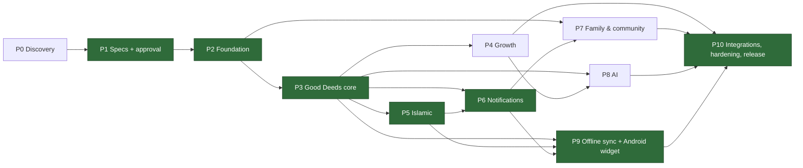

# Implementation Master Plan

> **Status:** Phase 0 is complete. Phase 1 specifications are **awaiting approval**. **No application code has been written.**
> **Scope:** {{TASK_COUNT}} technical tasks and {{SUBTASK_COUNT}} subtasks across Phases 0–10. Every in-scope feature (P2–P10) in [FEATURE_ID_REGISTRY.md](../product/FEATURE_ID_REGISTRY.md) maps to at least one task. The reverse index is in [MASTER_TASK_TRACKER.md](MASTER_TASK_TRACKER.md).
> **ID scheme:** see [docs/README.md §2](../README.md). Tasks are `T-P{phase}-{MOD}-{nnn}`, subtasks are `.n`, risks are `RISK-nnn`.

Besides the feature module codes, the task IDs use these epic codes: **GOV** (governance and planning), **PLAT** (platform, infrastructure, CI, deployment, operations), **UI** (design tokens, component library, shell), and **QA** (cross-cutting test suites).

---

## 1. Phase overview

| Phase | Name | Objective | Features (count) | Depends on | Size |
|---|---|---|---|---|---|
| P0 | Discovery & planning | Understand the repo and environment; set canonical IDs | — | — | S |
| P1 | Specifications | Product, SRS, architecture, DB, API, UX, QA, and plan docs; approval gate | — | P0 | L |
| P2 | Foundation | Monorepo, CI/CD, tokens/UI kit, i18n, PWA shell, auth, RBAC, admin shell, audit, flags, email, staging | AUTH, RBAC, I18N, PWA (shell), ADMIN core, INTG-001 | P1 approval | XL |
| P3 | Good Deeds core | Deed library, custom deeds, recurrence, checklist, completions, calendar, streaks, content admin, translations, versioning | DEED, CAL, ADMIN-003/004/011, I18N-008 | P2 | XL |
| P4 | Personal growth | Goals, journal (encrypted), planner, gamification, basic reports, wellbeing (S) | GROW, JRNL, PLAN, GAME, RPT-001/003/004/005, WELL-003/007, CAL-009 | P3 | L |
| P5 | Islamic lifestyle | Salah, prayer times, Quran, dhikr, duas, fasting, Ramadan, Hijri, zakat, hadith, verified content | ISL, ADMIN-005 | P3 (P4 for journal-linked reflections, soft dependency) | L |
| P6 | Notifications | In-app, reminders, quiet hours, push, digests, prayer reminders, broadcasts, job monitoring | NOTIF, INTG-002, I18N-006, ADMIN-007/014 | P3, P5 (prayer reminders) | M |
| P7 | Family & community | Groups, invitations, challenges, campaigns, stories, moderation, privacy, QR, wellbeing (C) | COMM, WELL (C), GAME-007, NOTIF-007, INTG-006, ADMIN-006/008 | P2, P3, P6 | XL |
| P8 | AI | Gateway, consent, quotas, guardrails, suggestions, coach, reports, voice | AI, JRNL-010 | P3, P4 (P5 for guardrail context) | L |
| P9 | Offline sync & Android widget | IndexedDB cache, outbox, /sync, update flow, widget host and four widgets | PWA-004/005/006/009, WIDGET | P3, P5 (Islamic widget), P6 | XL |
| P10 | Integrations, intelligence & release | Recovery, advanced reports/exports, analytics, calendar, public API, A/B, health/backup/API analytics, then full hardening and production release | AUTH-011, RPT-002/006/007/008, INTG-003/005, PLAN-008, ADMIN-010/012/013/015 | All prior phases | XL |

### 1.1 Reordering rationale (directive §7 allows reordering)
1. **Notifications moved from late to P6, before Community.** Daily reminders (F-NOTIF-002) are what make the deed checklist (P3) and salah tracking (P5) useful day to day. Community challenge notifications (F-NOTIF-007) also need the notification pipeline to exist. Transactional email (F-NOTIF-005) is already delivered in P2 because auth needs it.
2. **The PWA is split between P2 and P9.** Installability, the cached app shell, and the in-app-browser fallback are foundational (P2), because the first users will arrive through Facebook and Messenger links. Offline mutation sync (P9) needs a stable domain model, so it waits until deeds (P3) and Islamic trackers (P5) exist. P9 reuses the `/sync` protocol for the Android widget.
3. **AI (P8) comes after the core data exists.** AI is optional (guardrail 4), and suggestions and insights need real completion, goal, and journal data to be useful.
4. **Wellbeing is split.** The Should items (habit avoidance, affirmations) ship with Growth in P4. The Could items that reuse the challenge engine ship in P7.
5. **Hardening is continuous.** Security, a11y, perf, and authz tests run every phase. P10 is the *full* regression and release gate, not the first time quality is checked.

---

## 2. Dependency graph and critical path



**Critical path:** P1 approval → P2 Foundation (auth, i18n, CI) → P3 deeds and the streak engine → P5 Islamic → P6 reminders → P9 offline sync and widget → P10 release.
P4, P7, and P8 can run in parallel with the critical path if there is capacity:
- P4 needs only P3.
- P7 needs P6.
- P8 needs P4.

**Intra-phase critical tasks:**
- **P2:** T-P2-PLAT-001 → PLAT-003 → AUTH-001 → AUTH-004 → RBAC-002 → ADMIN-001.
- **P3:** CAL-001 → DEED-001 → DEED-006 → DEED-007 → DEED-008/009 → CAL-002.

---

## 3. Working agreements (apply to every task)

**Global Definition of Done.** Every task must meet all of the following, plus its own DoD:
1. Code is merged through a PR with green CI (lint, typecheck, unit, integration, and E2E where there is UI).
2. Every new endpoint declares its permission; the authz matrix test passes.
3. Every user-facing string exists in `en.json` and `bn.json`. Any BN copy that still needs native-speaker review is flagged in KNOWN_ISSUES.
4. Loading, empty, and error states are implemented per [PAGE_SPECIFICATIONS](../design/PAGE_SPECIFICATIONS.md); the axe check passes.
5. OpenAPI is regenerated and the contract drift check passes. Migrations are reviewed (expand/contract).
6. No mock data in production paths. An unconfigured integration has an explicit "not configured" state, and the gap is listed in KNOWN_ISSUES.
7. IMPLEMENTATION_STATUS, CHANGELOG, MASTER_TASK_TRACKER, and TRACEABILITY_MATRIX are updated.
8. The module report (what was implemented, files, DB changes, APIs, tests run with results, remaining issues, next task) is posted at the end of the module (directive §8).

**Workflow.** One phase at a time. Each phase starts with a short kickoff that re-checks scope and open decisions, and ends at an exit gate where the user reviews and approves. Work happens on a feature branch per task (`feat/T-P3-DEED-008-checklist`) and is squash-merged to `main`.

---

## 4. Phases

### P0 — Discovery & planning  *(Size S · Status: complete)*
- **Objectives:** inspect the repo and environment; establish canonical IDs and conventions.
- **Scope:** none (governance).
- **Dependencies:** none.
- **Epics:** EP-GOV.

{{TASKS:P0}}
- **Deliverables:** `docs/PROJECT_DISCOVERY.md`, `EXISTING_ARCHITECTURE.md`, `TECH_STACK_DECISION.md`, `PROJECT_GAPS.md`, `docs/README.md`, `docs/product/FEATURE_ID_REGISTRY.md`.
- **Database / API / UI changes:** none.
- **Tests:** none (documentation).
- **Risks:** RISK-001.
- **Exit criteria:** findings are factual; the registry has no duplicate IDs (verified by script).
- **Checklist:** [x] repo inspected · [x] toolchain recorded · [x] gaps listed · [x] IDs registered.

### P1 — Specifications & approval  *(Size L · Status: in review)*
- **Objectives:** complete Stages 1–5 plus the UX, QA, and implementation docs; get user approval.
- **Scope:** all 198 features specified.
- **Dependencies:** P0.
- **Epics:** EP-GOV.

{{TASKS:P1}}
- **Deliverables:** all files under `docs/product`, `docs/specifications`, `docs/architecture`, `docs/database`, `docs/api` (including `openapi.yaml`), `docs/design`, `docs/qa`, `docs/implementation`, and `docs/EXECUTIVE_SUMMARY.md`.
- **Database / API / UI changes:** specified only.
- **Tests:** ID-consistency script; OpenAPI lint; Mermaid syntax spot check.
- **Risks:** RISK-001, RISK-002.
- **Exit criteria:** the user approves the plan; open decisions are logged in DECISION_LOG.
- **Checklist:** [ ] traceability complete · [ ] OpenAPI lints · [ ] summary presented · [ ] approval recorded.

### P2 — Foundation  *(Size XL)*
- **Objectives:** a buildable, deployable monorepo with CI. It includes the design tokens and UI kit, full EN/BN infrastructure, the installable PWA shell with the in-app-browser fallback, secure auth (email/password, Google, sessions, deletion), RBAC with audit logging and admin 2FA, the admin shell (users, roles, flags, audit), the email adapter, and a staging environment.
- **Scope:** F-AUTH-001…010 · F-RBAC-001…007 · F-I18N-001/002/003/004/005/007/009 · F-PWA-001/002/003/007/008 · F-ADMIN-001/002/009/016 · F-INTG-001 · F-NOTIF-005 (transactional).
- **Dependencies:**
  - P1 approval.
  - **User actions:** Neon project, GitHub remote, hosting accounts, Resend plus a domain, and a Google OAuth client.
- **Epics:** EP-PLAT, EP-UI, EP-I18N, EP-PWA, EP-AUTH, EP-RBAC, EP-ADMIN, EP-INTG, EP-QA.

{{TASKS:P2}}
- **Deliverables:**
  - `apps/web`, `apps/api`, `apps/worker`, and `packages/{config,contracts,i18n,ui,tokens,domain}`.
  - GitHub Actions CI and a staging URL.
  - Auth, RBAC, and the admin shell, working end to end in EN and BN.
- **Database changes:** `users`, `user_preferences`, `auth_identities`, `user_sessions`, `verification_tokens`, `roles`, `permissions`, `user_roles`, `role_permissions`, `mfa_factors`, `audit_logs`, `feature_flags`, `system_settings`, `idempotency_keys`, `export_jobs`, and the `pgboss` schema.
- **API changes:**
  - `/health`, `/auth/*` (register, login, logout, verify-email, password reset, Google OAuth).
  - `/me`, `/me/preferences`, `/me/sessions`, `/me/export`, `/me/deletion`.
  - `/admin/users`, `/admin/roles`, `/admin/flags`, `/admin/audit-logs`, `/admin/settings`.
- **UI pages:**
  - Public: landing, register, login, verify email, forgot/reset password.
  - Account: profile, preferences, sessions, account deletion.
  - App: empty-state Today page (placeholder shell, no mock data), offline fallback.
  - Admin: dashboard shell, users, user detail, roles, flags, audit log, settings, TOTP enrollment.
- **Tests:**
  - Unit: domain/i18n/capabilities.
  - API integration: auth flows, session revocation, Origin-check CSRF protection, rate limits.
  - Authz matrix.
  - E2E: auth journeys in EN/BN on mobile and desktop, in-app UA banner, offline shell.
  - Quality: axe on all pages, Lighthouse installability, dependency and secret scan.
- **Risks:** RISK-003 (credentials late), RISK-004 (auth security defects), RISK-005 (BN translation lag), RISK-006 (in-app browser OAuth), RISK-017 (Windows/Linux tooling drift).
- **Exit criteria:**
  - A new user can register, verify, log in (email or Google), set language and timezone, see the shell in BN, log out everywhere, and request deletion on staging.
  - An admin with TOTP can manage roles and flags, and every action is audited.
  - CI is green; no High/Critical vulnerabilities.
- **Checklist:** [ ] CI green on main · [ ] staging deployed · [ ] authz matrix 100% routes · [ ] EN/BN key parity · [ ] axe clean · [ ] KNOWN_ISSUES updated · [ ] user sign-off.

### P3 — Good Deeds core, calendar & streaks  *(Size XL)*
- **Objectives:** the core value loop. Users discover deeds, build a routine with recurrence, complete the daily checklist, and see their calendar, heatmap, and streaks. All of it is correct in the user's timezone. Admins manage bilingual, versioned content.
- **Scope:** F-DEED-001…014 · F-CAL-001…008, 010, 011 · F-ADMIN-003/004/011 · F-I18N-008.
- **Dependencies:**
  - P2 (auth, i18n, UI kit, admin shell, settings).
  - **User actions:** R2 bucket; content sign-off for the seed library.
- **Epics:** EP-DEED, EP-CAL, EP-ADMIN, EP-I18N, EP-QA.

{{TASKS:P3}}
- **Deliverables:** deed library (≥150 EN/BN deeds), routine builder, Today checklist, history, calendar views, heatmap, streaks, content admin with translations and versions.
- **Database changes:** `deed_categories`, `deed_category_translations`, `deeds`, `deed_translations`, `deed_plans`, `deed_completions`, `completion_attachments`, `favorite_deeds`, `streaks`, `daily_summaries`, `content_versions`.
- **API changes:** `/categories`, `/deeds` (+`/random`, `/recommendations`, `/{id}/favorite`), `/plans`, `/completions`, `/checklist/{localDate}`, `/calendar`, `/streaks`, `/heatmap`, `/admin/deeds`, `/admin/categories`, `/admin/content-versions`.
- **UI pages:** Today, Discover, Deed detail, Create/edit custom deed, My routine, History, Calendar (day/week/month), Year heatmap, admin deed/category list and editor, translation editor, version history.
- **Tests:**
  - Property tests: recurrence and streak engines.
  - DST and timezone-change scenarios.
  - Edit-window enforcement.
  - Idempotent completion replays.
  - Cross-user isolation.
  - E2E: core loop in EN/BN.
  - k6 baseline for `/checklist`.
  - axe on the calendar and heatmap.
- **Risks:** RISK-007 (streak/timezone correctness), RISK-008 (seed content quality/translation), RISK-009 (calendar aggregate performance).
- **Exit criteria:**
  - Streaks and completion rates match the SRS rules on the test fixtures, including DST.
  - Today page LCP < 2.5 s (mid-tier mobile, 4G profile).
  - `/checklist` p95 < 300 ms at the baseline load.
  - Content publishes in EN/BN with a version history.
- **Checklist:** [ ] engines property-tested · [ ] seed content signed off · [ ] perf budget met · [ ] admin content audited · [ ] user sign-off.

### P4 — Personal growth, journal, planner, gamification  *(Size L)*
- **Objectives:** goals and milestones, a private encrypted journal, a daily planner, achievements and the Good Deeds Tree, personal reports, and the Should-priority wellbeing items. Everything uses neutral, non-judgmental framing.
- **Scope:** F-GROW-001…009 · F-JRNL-001…009 · F-PLAN-001…007 · F-GAME-001…006, 008 · F-CAL-009 · F-RPT-001/003/004/005 · F-WELL-003/007.
- **Dependencies:** P3 (completions, recurrence engine, streaks).
- **Epics:** EP-GROW, EP-JRNL, EP-PLAN, EP-GAME, EP-RPT, EP-WELL.

{{TASKS:P4}}
- **Deliverables:** growth hub, journal suite, planner, badges/tree, reports.
- **Database changes:** `goals`, `goal_milestones`, `growth_snapshots`, `life_balance_categories`, `life_balance_assessments`, `journal_entries`, `planner_items`, `achievements`, `achievement_translations`, `user_achievements`, `wellbeing_logs`, `affirmations`.
- **API changes:** `/goals` (+`/milestones`), `/life-balance`, `/growth/*`, `/journal`, `/planner`, `/achievements`, `/tree`, `/wellbeing/*`, `/reports/*`.
- **UI pages:** Goals list and detail, Life balance, Growth timeline, Monthly reflection, Journal (list, editor, entry types), Future letters, Planner (day/week), Morning and evening flows, Achievements, Tree, Reports, Wellbeing tracker.
- **Tests:**
  - Encryption at rest (no plaintext in a DB dump).
  - Admin cannot read journals.
  - Achievement rules.
  - Copy review against the non-shaming guide.
  - E2E journeys.
- **Risks:** RISK-010 (journal key management), RISK-011 (gamification turning manipulative or shaming).
- **Exit criteria:** journal privacy proven by tests; reports render with accessible table alternatives; all GROW/JRNL Must ACs pass.
- **Checklist:** [ ] key rotation tested · [ ] copy reviewed EN/BN · [ ] reports accessible · [ ] user sign-off.

### P5 — Islamic lifestyle  *(Size L)*
- **Objectives:** a respectful, configurable, source-referenced Islamic toolkit that users can turn off entirely.
- **Scope:** F-ISL-001…018 · F-ADMIN-005 (+ the Hijri part of F-I18N-004).
- **Dependencies:**
  - P3 (tracker patterns, content admin, versioning).
  - **User actions:** confirm Quran.com API terms and translation licenses (especially BN); appoint an Islamic content reviewer.
- **Epics:** EP-ISL, EP-ADMIN.

{{TASKS:P5}}
- **Deliverables:** prayer times, salah/Quran/dhikr/sunnah/fasting trackers, Ramadan planner, Hijri calendar, zakat calculator, dua and hadith library, verification workflow.
- **Database changes:** `islamic_preferences`, `salah_records`, `quran_reading_logs`, `quran_memorization_progress`, `khatam_plans`, `dhikr_presets`, `dhikr_logs`, `duas`, `dua_translations`, `hadith_entries`, `hadith_translations`, `sunnah_practices`, `practice_logs`, `fasting_records`, `ramadan_plans`, `zakat_calculations`, `islamic_content_sources` (+ Quran metadata cache).
- **API changes:** `/islamic/{preferences, prayer-times, salah, quran/*, dhikr, duas, sunnah, fasting, ramadan-plans, zakat, hijri, hadith/today}`, `/admin/islamic/*`.
- **UI pages:** Islamic hub, Prayer times, Salah tracker, Quran reading, Memorization, Khatam planner, Dhikr and Tasbih, Duas, Sunnah/Tahajjud, Fasting, Ramadan planner, Hijri calendar, Zakat calculator, Hadith of the Day, Learning hub, Islamic settings, and the admin content verification queue.
- **Tests:**
  - Prayer-time accuracy against reference tables.
  - Zakat worked examples.
  - Unverified content never served.
  - Module opt-out hides all Islamic surfaces.
  - Worship data never visible to admins or other users.
- **Risks:** RISK-012 (religious content accuracy/licensing), RISK-013 (prayer time disputes), RISK-007.
- **Exit criteria:**
  - All content shown has a source.
  - Opting out removes Islamic nav, widgets, and reminders.
  - Prayer times are within ±1 min of the references.
- **Checklist:** [ ] licenses confirmed · [ ] reviewer sign-off · [ ] disclaimers EN/BN · [ ] user sign-off.

### P6 — Notifications & reminders  *(Size M)*
- **Objectives:** reliable, respectful reminders across in-app, email, and Web Push. Delivery honours timezone and quiet hours, and admins can see job health.
- **Scope:** F-NOTIF-001…006, 008, 009, 010 · F-INTG-002 · F-I18N-006 · F-ADMIN-007/014.
- **Dependencies:** P2 (worker, email), P3 (checklist), P5 (prayer times).
- **Epics:** EP-NOTIF, EP-INTG, EP-I18N, EP-ADMIN.

{{TASKS:P6}}
- **Deliverables:** notification center, reminder scheduler, push, digests, broadcast tool, job monitor.
- **Database changes:** `notifications`, `notification_preferences`, `reminders`, `push_subscriptions`, `broadcasts`.
- **API changes:** `/notifications`, `/notification-preferences`, `/reminders`, `/push-subscriptions`, `/admin/broadcasts`, `/admin/jobs`.
- **UI pages:** Notification center, Notification settings (channels, quiet hours), Reminder editor, Push permission explainer (including iOS install guidance), Admin broadcasts, Admin jobs.
- **Tests:**
  - Scheduler with a fake clock across DST.
  - Quiet-hours suppression.
  - Push payload localization.
  - Expired subscription cleanup.
  - At-most-once per occurrence (idempotency).
- **Risks:** RISK-014 (push platform limits / iOS), RISK-015 (notification fatigue).
- **Exit criteria:** reminders fire within ±1 min of schedule in the user's tz; quiet hours honoured; no duplicate sends under worker restarts.
- **Checklist:** [ ] fake-clock tests · [ ] VAPID keys in secrets · [ ] unsubscribe works · [ ] user sign-off.

### P7 — Family, community & moderation  *(Size XL)*
- **Objectives:** private-by-default family groups and challenges, plus moderated community spaces for stories, campaigns, and volunteering. Anonymous sharing and reporting/blocking are included.
- **Scope:** F-COMM-001…014 · F-GAME-007 · F-NOTIF-007 · F-INTG-006 · F-ADMIN-006/008 · F-WELL-001/002/004/005/006.
- **Dependencies:** P2 (RBAC, flags), P3, P6 (notifications).
- **Release gate:** community features stay behind feature flags until F-COMM-012/013 and F-ADMIN-008 pass.
- **Epics:** EP-COMM, EP-ADMIN, EP-INTG, EP-NOTIF, EP-WELL.

{{TASKS:P7}}
- **Deliverables:** families, challenges, community groups, campaigns, volunteer listings, stories feed, moderation console, QR join.
- **Database changes:** `groups`, `group_members`, `group_invitations`, `challenges`, `challenge_participants`, `challenge_progress`, `campaigns`, `campaign_participations`, `volunteer_opportunities`, `posts`, `comments`, `reactions`, `content_reports`, `user_blocks`, `moderation_actions` (+ `wellbeing_logs` types).
- **API changes:** `/groups`, `/groups/{id}/members`, `/invitations`, `/challenges`, `/campaigns`, `/volunteer-opportunities`, `/posts`, `/reports`, `/blocks`, `/admin/moderation`, `/admin/campaigns`.
- **UI pages:** Family home, Invite, Family challenge, Shared calendar, Community groups, Campaign detail and QR join, Volunteer listings, Stories feed, Post composer (anonymous toggle), Report dialog, Blocked users, Sharing settings, Admin moderation queue, Admin campaigns, Wellbeing journals (C).
- **Tests:**
  - Visibility and authz matrix for group roles.
  - No automatic sharing of journals or worship.
  - Anonymous posts never expose the author to other users.
  - Moderation workflow.
  - Abuse rate limits.
- **Risks:** RISK-016 (harmful UGC / moderation load), RISK-018 (privacy leakage through sharing).
- **Exit criteria:** privacy tests pass; moderation SLA tooling in place; flags allow staged rollout.
- **Checklist:** [ ] privacy review · [ ] moderation runbook · [ ] community guidelines EN/BN · [ ] user sign-off.

### P8 — AI-powered intelligence  *(Size L)*
- **Objectives:** optional AI features behind a provider-agnostic gateway (default provider: Anthropic Claude). The gateway handles consent, data minimization, quotas, cost control, and religious guardrails.
- **Scope:** F-AI-001…013 · F-JRNL-010.
- **Dependencies:**
  - P3, P4 (data for insights); P5 (guardrail scope).
  - **User actions:** Anthropic API key and a monthly budget cap.
- **Epics:** EP-AI, EP-JRNL.

{{TASKS:P8}}
- **Deliverables:** AI gateway, consent center, usage dashboard, suggestions, reflections, weekly narrative, coach/assistant, NL task creation, voice journal (adapter).
- **Database changes:** `ai_consents`, `ai_conversations`, `ai_messages`, `ai_usage_logs`, `ai_insights`.
- **API changes:** `/ai/{suggestions, conversations, reflections, weekly-report, consent, usage}`, `/admin/ai/usage`.
- **UI pages:** AI settings and consent, Suggestions panel, Coach chat, Weekly report, Voice journal recorder, Admin AI usage.
- **Tests:**
  - Prompt regression and eval suite (tone, no fatwa, PII redaction).
  - Quota and budget breaker.
  - The app works with AI disabled (full E2E run with the flag off).
  - Provider failure falls back gracefully.
- **Risks:** RISK-019 (AI cost overrun), RISK-020 (unsafe or religiously inappropriate output), RISK-021 (privacy of AI inputs).
- **Exit criteria:** evals pass their thresholds; budget breaker verified; consent is required before any personal data goes to the provider.
- **Checklist:** [ ] eval suite in CI · [ ] budget cap set · [ ] privacy notice EN/BN · [ ] user sign-off.

### P9 — Offline sync & Android widget  *(Size XL)*
- **Objectives:** completing deeds and salah offline with safe sync, and native Android home-screen widgets that use the same backend.
- **Scope:** F-PWA-004/005/006/009 · F-WIDGET-001…009.
- **Dependencies:**
  - P3 (completions), P5 (Islamic widget data), P6.
  - **User actions:** `ANDROID_HOME` configured; Play Console account; domain for App Links.
- **Epics:** EP-PWA, EP-WIDGET.

{{TASKS:P9}}
- **Deliverables:** offline-capable PWA, `/sync` protocol, Android widget app (small, medium, large, Islamic).
- **Database changes:** `sync_operations`, `widget_devices`, plus the `change_seq` sequence, columns and triggers on syncable tables.
- **API changes:** `/sync`, `/widget/link`, `/widget/snapshot`, `/me/devices` (revocation).
- **UI pages:**
  - Web: offline indicator, conflict notice, update prompt, Linked devices / Link widget (code + QR).
  - Android: link screen, widget configuration.
- **Tests:**
  - Offline E2E: complete offline → reconnect → server state correct.
  - Duplicate replay idempotency.
  - Two-device conflict.
  - Android: Glance UI tests, WorkManager retry tests, revoked-token handling, EN/BN.
- **Risks:** RISK-022 (sync conflicts/data loss), RISK-023 (Android OEM background restrictions), RISK-014.
- **Exit criteria:**
  - No lost or duplicated completions across offline/online transitions in the test matrix.
  - Widget shows a stale indicator when data is older than the threshold.
  - Widget completions sync within one WorkManager cycle once online.
- **Checklist:** [ ] sync test matrix · [ ] OEM devices tested (Samsung, Xiaomi, Pixel) · [ ] Play pre-launch report clean · [ ] user sign-off.

### P10 — Integrations, admin intelligence, hardening & release  *(Size XL)*
- **Objectives:** the remaining Could/Should integrations and admin intelligence, then a full quality gate and production launch.
- **Scope:** F-AUTH-011 · F-RPT-002/006/007/008 · F-INTG-003/005 · F-PLAN-008 · F-ADMIN-010/012/013/015.
- **Out of scope (Won't Have, initial release):** F-INTG-004, F-ADMIN-017.
- **Dependencies:** all prior phases.
- **Epics:** EP-AUTH, EP-RPT, EP-INTG, EP-ADMIN, EP-QA, EP-PLAT.

{{TASKS:P10}}
- **Deliverables:** recovery, advanced reports and exports, consented analytics, calendar feed/sync, public API (beta), A/B testing, health/API/backup dashboards, production environment, release.
- **Database changes:** `recovery_codes`, `api_clients`, `experiments`.
- **API changes:** `/auth/recovery/*`, `/reports/monthly|yearly`, `/exports`, `/public/*`, `/admin/{experiments, health, api-analytics, backups}`.
- **UI pages:** Recovery setup, Reports (monthly/yearly), Export center, Calendar connect, Developer/API tokens (C), Admin experiments, Admin health, Admin API analytics, Admin backups.
- **Tests:** full regression; ZAP authenticated scan; k6 load at target concurrency; Lighthouse CI budgets; WCAG 2.2 AA audit including manual screen readers in EN/BN; cross-browser, in-app, and PWA matrix; restore drill.
- **Risks:** RISK-024 (release-blocking defects found late), RISK-003.
- **Exit criteria:** [qa/RELEASE_CHECKLIST.md](../qa/RELEASE_CHECKLIST.md) is fully satisfied, with no open High/Critical issues and directive §11 success criteria met.
- **Checklist:** [ ] regression green · [ ] security sign-off · [ ] perf budgets · [ ] a11y sign-off · [ ] restore drill · [ ] docs reflect the as-built system · [ ] production launch approved.

---

## 5. Global risk register

| ID | Risk | Likelihood | Impact | Mitigation | Owner | Phase |
|---|---|---|---|---|---|---|
| RISK-001 | Scope is very large (198 features); delivery stretches or quality drops | High | High | Strict MoSCoW, phase gates, Could items deferrable without breaking dependencies | PM | All |
| RISK-002 | Specs drift from implementation | Medium | Medium | Generated tracker, traceability matrix updated per task, contract drift check | Tech lead | All |
| RISK-003 | External credentials and accounts arrive late (DB, OAuth, email, R2, AI, Play) | High | Medium | Adapters with explicit "unconfigured" states; credential checklist in PROJECT_GAPS ahead of each phase | User / PM | P2, P3, P8, P9 |
| RISK-004 | Security defects in custom auth (token handling, CSRF, enumeration) | Medium | Critical | Proven libraries (argon2, jose), security test plan, authz matrix, external review before launch | Security | P2 |
| RISK-005 | Bengali translations lag behind or are machine-quality | High | Medium | Key-parity CI, translator handoff exports, native reviewer sign-off per phase | PM | All |
| RISK-006 | OAuth and push blocked inside in-app browsers | High | Medium | Detection + "open in browser"; email login in webviews; documented limits | Frontend | P2, P6 |
| RISK-007 | Timezone/DST/streak bugs undermine trust | Medium | High | `local_date` model, pure domain engines with property tests, rebuildable caches | Backend | P3, P5 |
| RISK-008 | Seed deed content is thin or culturally off | Medium | Medium | Content workstream with review; admin CMS allows fast fixes | Content | P3 |
| RISK-009 | Calendar/heatmap aggregate queries are slow | Low | Medium | Indexes per INDEXING_STRATEGY, streak cache, k6 baseline | Backend | P3 |
| RISK-010 | Journal encryption key loss or mishandling | Low | Critical | Envelope encryption with versioned keys, KMS-ready, backup of KEK in secrets manager, rotation tests | Security | P4 |
| RISK-011 | Gamification feels manipulative or shaming | Medium | Medium | Non-shaming copy guide, no worship rankings, opt-outs, review gate | Design | P4, P7 |
| RISK-012 | Religious content inaccurate or improperly licensed | Medium | High | Verified-source workflow, two-person verification, license confirmation before P5 | Content | P5 |
| RISK-013 | Prayer times differ from local mosque timings | High | Low | Selectable method/madhab, per-prayer minute adjustments, disclaimer | Product | P5 |
| RISK-014 | Web Push limitations (iOS needs installed PWA; some browsers lack support) | High | Medium | In-app + email fallbacks; capability detection; install guidance | Frontend | P6, P9 |
| RISK-015 | Notification fatigue causes uninstalls | Medium | Medium | Conservative defaults, quiet hours, max frequency caps, easy opt-out | Product | P6 |
| RISK-016 | Harmful user-generated content / moderation workload | Medium | High | Pre-moderation for new accounts, reporting/blocking, flags for staged rollout | Trust & safety | P7 |
| RISK-017 | Windows dev vs Linux CI differences (line endings, paths) | Medium | Low | .gitattributes LF, CI on Linux plus a Windows smoke job | DevOps | P2 |
| RISK-018 | Privacy leakage through sharing/family features | Low | Critical | Default-private model, per-item share, visibility tests on every read | Security | P7 |
| RISK-019 | AI cost overrun | Medium | Medium | Per-user quotas, monthly budget breaker, cheap-model routing, caching | Backend | P8 |
| RISK-020 | Unsafe or religiously inappropriate AI output | Medium | High | Guardrail system prompts, output filters, eval suite, no-fatwa policy, report button | AI lead | P8 |
| RISK-021 | Personal data sent to the AI provider without adequate consent | Low | High | Per-feature consent, data minimization/redaction, disclosure, global kill switch | Security | P8 |
| RISK-022 | Offline sync conflicts cause data loss or duplicates | Medium | High | Idempotency keys, row-level LWW on clientTime with conflict log (DL-015), sync test matrix | Backend | P9 |
| RISK-023 | Android OEM battery optimizations delay widget sync | High | Medium | WorkManager constraints, on-demand refresh on tap, stale indicator | Android | P9 |
| RISK-024 | Critical defects found only at release | Medium | High | Continuous quality gates every phase; P10 is confirmation, not discovery | QA | P10 |

---

## 6. Relative complexity summary

| Size | Meaning (relative, not time-boxed) | Phases |
|---|---|---|
| S | Contained; few moving parts | P0 |
| M | One module, moderate integration | P6 |
| L | Several modules or tricky domain logic | P1, P4, P5, P8 |
| XL | Cross-cutting, multiple platforms, or high correctness risk | P2, P3, P7, P9, P10 |

No calendar estimates are given until team capacity is known. They will be added at the P2 kickoff.

---

## 7. Module completion report template (directive §8)

```
### Module report — <EP-XXX / task range>
- Implemented: …
- Files created/modified: …
- Database changes (migrations): …
- APIs created/changed: …
- Tests executed (command) and results (pass/fail counts, links): …
- Remaining issues (KNOWN_ISSUES IDs): …
- Next recommended task: …
```
